# 第 3.2 节：Nest 范畴与细化
[译文总目录](Layout.md) · [第 3.1 节：元组态射上的运算](Translation-07-Tuple-Operations.md) · [第 3.2 节：嵌套元组态射上的运算](Translation-09-Nest-Operations.md)
> 来源：Colfax Research，2025 年 9 月版。本文为中文逐段译文，保留原文顺序及定义、命题、例子、证明和公式；校对说明以“校注”明确区分于原文，详见[校对记录](Proofreading.md)。复杂数学式与图示直接使用本地原文裁片。每页末尾可展开原页核对。

## PDF 第 125 页 · 原书第 123 页

### 3.2 Nest 范畴

上一节介绍了 Tuple 范畴，其态射编码可处理平坦布局。本节介绍 Nest 范畴，其态射编码具有任意嵌套结构的可处理布局。

### 3.2.1 基本定义

回想一下，对于嵌套元组 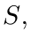，我们编写 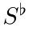 来展平  例如，如果 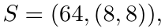 那么 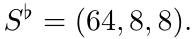

定义 3.2.1.1. 令 `Nest` 表示其对象是正整数嵌套元组的范畴，并且其中态射

`Nest` 中由元组态射指定

换句话说，

具体而言，Nest 中的态射 $f:S\to T$ 由可处理的保基点映射 $\alpha:\langle\operatorname{len}(S)\rangle_*\to\langle\operatorname{len}(T)\rangle_*$ 给出，该映射满足以下条件：

• 如果 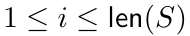 和 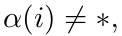 则 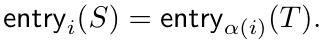

我们说这样的态射  位于 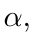 之上，并将  称为嵌套元组态射。

符号 3.2.1.2. 如果  是位于 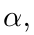 之上的嵌套元组态射，我们将  描述为

示例 3.2.1.3. 以下是嵌套元组态射的一些示例。

观察 3.2.1.4。如果 X 是集合，将 X 上的混沌范畴（indiscrete category）记为 Xᵢₙd。这个范畴的对象是 X 的元素，并且任意两个对象之间都存在唯一的（同构）态射。根据 Nest 的定义，我们有下列拉回方块：

我们可以将其视为拉回方块 2.2.2.4 的范畴化。

展开原页对照（保留全部图示、代码、标签和数学排版）

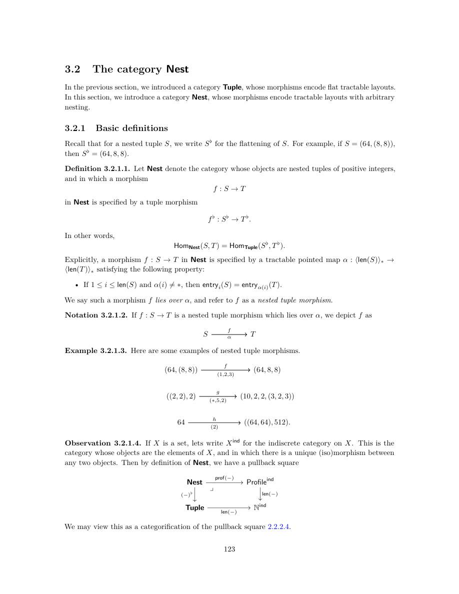

展开本页英文正文

<pre v-pre style="white-space:pre-wrap;overflow-wrap:anywhere">3.2 The category Nest

In the previous section, we introduced a category Tuple, whose morphisms encode flat tractable layouts. In this section, we introduce a category Nest, whose morphisms encode tractable layouts with arbitrary nesting.

3.2.1 Basic definitions

Recall that for a nested tuple S, we write S♭for the flattening of S. For example, if S = (64, (8, 8)), then S♭= (64, 8, 8).

Definition 3.2.1.1. Let Nest denote the category whose objects are nested tuples of positive integers, and in which a morphism

in Nest is specified by a tuple morphism

In other words,

Explicitly, a morphism f : S →T in Nest is specified by a tractable pointed map α : ⟨len(S)⟩∗→ ⟨len(T)⟩∗satisfying the following property:

• If 1 ≤i ≤len(S) and α(i)̸ = ∗, then entryi(S) = entryα(i)(T).

We say such a morphism f lies over α, and refer to f as a nested tuple morphism.

Notation 3.2.1.2. If f : S →T is a nested tuple morphism which lies over α, we depict f as

Example 3.2.1.3. Here are some examples of nested tuple morphisms.

Observation 3.2.1.4. If X is a set, lets write Xind for the indiscrete category on X. This is the category whose objects are the elements of X, and in which there is a unique (iso)morphism between any two objects. Then by definition of Nest, we have a pullback square

We may view this as a categorification of the pullback square 2.2.2.4.</pre>

## PDF 第 126 页 · 原书第 124 页

示例 3.2.1.5. 假设 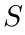 是长度为 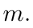 的嵌套元组如果 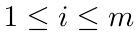 则存在嵌套元组态射

位于 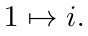 给出的映射 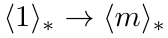 上例如，如果 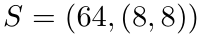 和 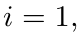 那么我们有一个嵌套元组态射

示例 3.2.1.6. 假设 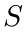 是秩为 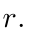 的嵌套元组如果 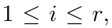 则存在规范嵌套元组态射

位于 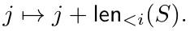 给出的映射 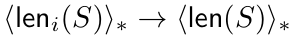 例如，如果 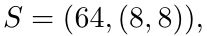 那么我们有一个嵌套元组态射

观察 3.2.1.7. 有与范畴 `Nest` 和  相关的函子首先，有一个包含函子

它将元组态射 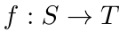 视为嵌套元组态射。接下来，有一个展平函子

它将嵌套元组态射 $f:S\to T$ 映到其底层元组态射 $f^\flat:S^\flat\to T^\flat$。复合函子

是  上的恒等函子，因此 `Tuple` 是  的回缩子范畴。此外，这些函子形成范畴的伴随等价。

备注 3.2.1.8. 人们可能希望考虑某种范畴 `C`，其态射编码可处理

布局，但与 Tuple 不等价。作者考虑过几个这样的例子，留待未来研究。

### 3.2.2 从嵌套元组态射到布局

范畴 `Nest` 的关键特征是，如果  是嵌套元组态射，则  编码布局 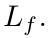。该布局是通过为平坦布局 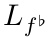 配备 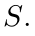 的嵌套轮廓来获得的。更准确地说，我们有以下构造。

构造 3.2.2.1. 假设

是一个嵌套元组态射，假设 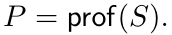 我们定义  为布局

其中 $(-)_P$ 是定义 2.3.1.19 的 $P$-代入运算。称 $L_f$ 为 $f$ 所编码的布局。

展开原页对照（保留全部图示、代码、标签和数学排版）

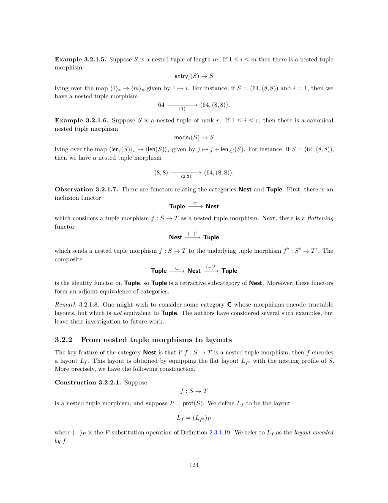

展开本页英文正文

<pre v-pre style="white-space:pre-wrap;overflow-wrap:anywhere">Example 3.2.1.5. Suppose S is a nested tuple of length m. If 1 ≤i ≤m then there is a nested tuple morphism

lying over the map ⟨1⟩∗→⟨m⟩∗given by 1 7→i. For instance, if S = (64, (8, 8)) and i = 1, then we have a nested tuple morphism

Example 3.2.1.6. Suppose S is a nested tuple of rank r. If 1 ≤i ≤r, then there is a canonical nested tuple morphism

lying over the map ⟨leni(S)⟩∗→⟨len(S)⟩∗given by j 7→j + len&lt;i(S). For instance, if S = (64, (8, 8)), then we have a nested tuple morphism

Observation 3.2.1.7. There are functors relating the categories Nest and Tuple. First, there is an inclusion functor

which considers a tuple morphism f : S →T as a nested tuple morphism. Next, there is a flattening functor

which sends a nested tuple morphism f : S →T to the underlying tuple morphism f ♭: S♭→T ♭. The composite

is the identity functor on Tuple, so Tuple is a retractive subcategory of Nest. Moreover, these functors form an adjoint equivalence of categories.

Remark 3.2.1.8. One might wish to consider some category C whose morphisms encode tractable

layouts, but which is not equivalent to Tuple. The authors have considered several such examples, but leave their investigation to future work.

3.2.2 From nested tuple morphisms to layouts

The key feature of the category Nest is that if f : S →T is a nested tuple morphism, then f encodes a layout Lf. This layout is obtained by equipping the flat layout Lf ♭with the nesting profile of S. More precisely, we have the following construction.

Construction 3.2.2.1. Suppose

is a nested tuple morphism, and suppose P = prof(S). We define Lf to be the layout

where (−)P is the P-substitution operation of Definition 2.3.1.19. We refer to Lf as the layout encoded by f.</pre>

## PDF 第 127 页 · 原书第 125 页

构造 3.2.2.2. 假设

是一个嵌套元组态射。我们将  定义为其形状的布局

是  的域，其步长

具有由公式定义的分量

我们将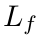称为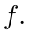编码的布局

示例 3.2.2.3. 编码的布局

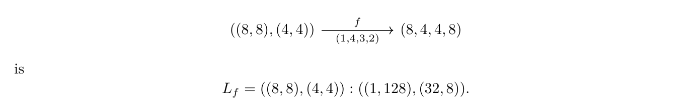

示例 3.2.2.4. 编码的布局

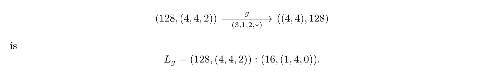

观察 3.2.2.5. 展平函子

与布局展平兼容，因为如果  是嵌套元组态射，则

如果  是一个可处理布局，那么我们可以构造一个嵌套元组态射，如下所示对  进行编码。

构造 3.2.2.6. 假设 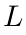 是一个可处理布局。我们将  的标准表示定义为嵌套元组态射

其中，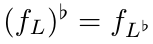 是其展平布局的标准表示，S = shape(L) 是 L 的形状，而 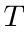 是 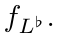 的陪域。

展开原页对照（保留全部图示、代码、标签和数学排版）

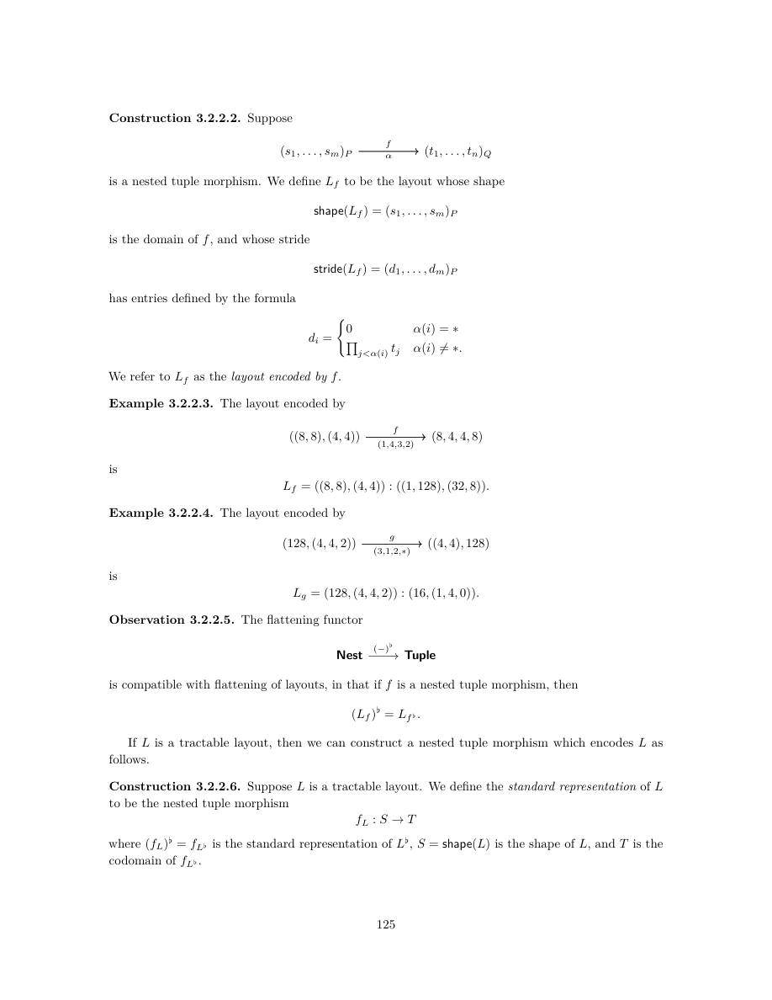

展开本页英文正文

<pre v-pre style="white-space:pre-wrap;overflow-wrap:anywhere">Construction 3.2.2.2. Suppose

is a nested tuple morphism. We define Lf to be the layout whose shape

is the domain of f, and whose stride

has entries defined by the formula

We refer to Lf as the layout encoded by f.

Example 3.2.2.3. The layout encoded by

Example 3.2.2.4. The layout encoded by

Observation 3.2.2.5. The flattening functor

is compatible with flattening of layouts, in that if f is a nested tuple morphism, then

If L is a tractable layout, then we can construct a nested tuple morphism which encodes L as follows.

Construction 3.2.2.6. Suppose L is a tractable layout. We define the standard representation of L to be the nested tuple morphism

where (fL)♭= fL♭is the standard representation of L♭, S = shape(L) is the shape of L, and T is the codomain of fL♭.</pre>

## PDF 第 128 页 · 原书第 126 页

示例 3.2.2.7. 如果

那么  的标准表示是

引理 3.2.2.8. 如果  是可处理布局，并且 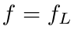 是 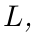 的标准表示，则

证明。我们有

和

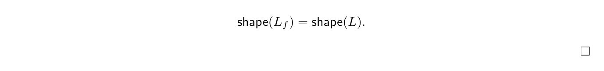

命题 3.2.2.9. 假设  是一个布局。那么，当且仅当  可处理时，存在编码  的嵌套元组态射 。

证明。首先假设 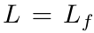 对于某些嵌套元组态射 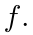 然后 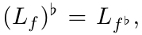 并根据命题 3.1.2.10, 我们知道 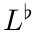 是可处理的，因此 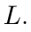 也是如此。相反，如果  是可处理的，那么我们可以取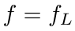 是 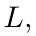 的标准表示，根据引理 3.2.2.8,，我们有 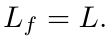

为了在可处理布局和某些嵌套元组态射之间建立一对一的对应关系，我们引入了嵌套元组态射的标准形式的概念。

定义 3.2.2.10. 假设 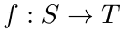 是一个嵌套元组态射。我们说  具有标准形式，如果

 具有标准形式，如定义 3.1.2.12, 和

2. $T$ 为平坦元组。

示例 3.2.2.11. 嵌套元组态射

有标准形式。

示例 3.2.2.12. 嵌套元组态射

由于  的陪域不平坦，因此没有标准形式。

与平坦情形一样，为在标准形式的嵌套元组态射与可处理布局之间建立一一对应，需要排除非退化的嵌套元组态射和非退化布局。为此作如下定义。〔校注：原文此处将应排除的对象写成 non-degenerate（非退化）；按后续定义及命题，应为 degenerate（退化）。一一对应所保留的对象是非退化对象。〕

展开原页对照（保留全部图示、代码、标签和数学排版）

展开本页英文正文

<pre v-pre style="white-space:pre-wrap;overflow-wrap:anywhere">Example 3.2.2.7. If

then the standard representation of L is

Lemma 3.2.2.8. If L is a tractable layout, and f = fL is the standard representation of L, then

Proof. We have

and

Proposition 3.2.2.9. Suppose L is a layout. Then there exists a nested tuple morphism f encoding L if and only if L is tractable.

Proof. Suppose first that L = Lf for some nested tuple morphism f. Then (Lf)♭= Lf ♭, and by Proposition 3.1.2.10, we know that L♭is tractable, hence so is L. Conversely, if L is tractable, then we can take f = fL to be the standard representation of L, and by Lemma 3.2.2.8, we have Lf = L.

In order to establish a one-to-one correspondence between tractable layouts and certain nested tuple morphisms, we introduce the notion of standard form for nested tuple morphisms.

Definition 3.2.2.10. Suppose f : S →T is a nested tuple morphism. We say f has standard form if

1. f ♭has standard form, as in Definition 3.1.2.12, and

2. T is flat.

Example 3.2.2.11. The nested tuple morphism

has standard form.

Example 3.2.2.12. The nested tuple morphism

does not have standard form since the codomain of g is not flat.

Just as in the flat case, we need to exclude non-degenerate nested tuple morphisms and non- degenerate layouts in order to obtain a one-to-one correspondence between nested tuple morphisms of standard form and tractable layouts. To this end, we make the following definition.</pre>

## PDF 第 129 页 · 原书第 127 页

定义 3.2.2.13. 假设

是一个嵌套元组态射，并且假设

是一个布局。

1. 我们说  是非退化的，如果

2. 我们说  是非退化的，如果

备注 3.2.2.14. 如果  是嵌套元组态射，则  是非退化的当且仅当  是

非退化。如果  是布局，则当且仅当  是非退化时， 是非退化的。

命题 3.2.2.15. 映射

构造 3.2.2.2 与 3.2.2.6 给出了标准形式的非退化嵌套元组态射与非退化可处理布局之间的一一对应。〔校注：原文此句省略了 non-degenerate 限定，但上方对应图明确保留该限定；此处按对应图补明。〕

证明。我们已经在命题 3.2.2.9 中证明，如果  是可处理布局，并且  是  的标准形式，那么  接下来假设  具有标准形式，并让  是由  编码的布局。证明  等于  的标准表示  由命题 3.1.2.21, 我们知道  等于  的标准表示  并且因为

和

我们推断 

### 3.2.3 例子

在本节中，我们列出了一些重要的嵌套元组态射家族。

展开原页对照（保留全部图示、代码、标签和数学排版）

展开本页英文正文

<pre v-pre style="white-space:pre-wrap;overflow-wrap:anywhere">Definition 3.2.2.13. Suppose

is a nested tuple morphism, and suppose

is a layout.

1. We say f is non-degenerate if

2. We say L is non-degenerate if

Remark 3.2.2.14. If f is a nested tuple morphism, then f is non-degenerate if and only if f ♭is

non-degenerate. If L is a layout, then L is non-degenerate if and only if L♭is non-degenerate.

Proposition 3.2.2.15. The maps

 Non-degenerate

Non-degenerate nested tuple morphisms

tractable layouts

of standard form

of Constructions 3.2.2.2 and 3.2.2.6 determine a one-to-one correspondence between nested tuple morphisms of standard form, and tractable layouts.

Proof. We have already shown in Proposition 3.2.2.9 that if L is a tractable layout and f = fL is the standard form of L, then Lf = L. Suppose next that f has standard form, and let L = Lf be the layout encoded by f. We want to show that f is equal to the standard representation fL of L. By Proposition 3.1.2.21, we know that f ♭is equal to the standard representation fL♭of L♭, and since

and

we deduce that f = fL.

3.2.3 Examples

In this section, we list some important families of nested tuple morphisms.</pre>

## PDF 第 130 页 · 原书第 128 页

例 3.2.3.1（重括号化）。设嵌套元组 $S_1,S_2$ 具有相同的展平结果：

然后就有了重括号同构

位于恒等映射之上。这些态射满足传递性，即

并且与恒等态射相容，即

 是重括号同构，则  是形状为  的列主序布局

示例 3.2.3.2（展平）。作为上一个示例的特例，如果  是任何嵌套元组，那么我们就有一个展平同构

以及逆展平同构

观察 3.2.3.3. 若 $f:S\to T$ 是嵌套元组态射，则 $f$ 等于以下复合：〔校注：原文漏写 morphism（态射），仅写了 nested tuple。〕

换言之，有如下典范分解：

示例 3.2.3.4（分量）。假设

是嵌套元组态射。设 $1\le i\le\operatorname{len}(S)$，并记 $j=\alpha(i)$。将以下嵌套元组态射

称为 $f$ 的第 $i$ 个分量。$\operatorname{entry}_i(f)$ 所编码的布局为

例 3.2.3.5（分量包含映射）。作为前例的特例，若 $S$ 是嵌套元组且 $1\le i\le\operatorname{len}(S)$，取 $f=\operatorname{id}_S$，此时

是 $S$ 的第 $i$ 个分量的包含映射。

展开原页对照（保留全部图示、代码、标签和数学排版）

展开本页英文正文

<pre v-pre style="white-space:pre-wrap;overflow-wrap:anywhere">Example 3.2.3.1 (Reparenthesizations). Suppose S1 and S2 are nested tuples with the same flattening

Then there is a reparenthesization isomorphism

lying over the identity. These morphisms are transitive, in that

and compatible with identities, in that

S1 is a reparenthesization isomorphism, then Lf is the column major layout with shape S1.

Example 3.2.3.2 (Flattenings). As a special case of the previous example, if S is any nested tuple, then we have a flattening isomorphism

and an unflattening isomorphism

Observation 3.2.3.3. If f : S →T is a nested tuple, then f is equal to the composite

In other words, we have a canonical factorization

Example 3.2.3.4 (Entries). Suppose

is a nested tuple morphism. Suppose 1 ≤i ≤len(S), and write j = α(i). Then we refer to the nested tuple morphism

as the ith entry of f. The layout encoded by entryi(f) is

Example 3.2.3.5 (Entry inclusions). As a special case of the previous example, if S is a nested tuple and 1 ≤i ≤len(S), we can take f = idS, in which case

is the inclusion of the ith entry of S.</pre>

## PDF 第 131 页 · 原书第 129 页

示例 3.2.3.6（模态）。假设

是一个嵌套元组态射。假设  并写

然后我们引用嵌套元组态射

称为 $S$ 的第 $i$ 个模态。$\operatorname{mode}_i(L_f)$ 所编码的布局为〔校注：原文此句对象混用；所定义的态射应称为 $f$ 的第 $i$ 个模态，而该态射编码的布局是下式中的 $\operatorname{mode}_i(L_f)$。〕

示例 3.2.3.7（模态包含）。作为上一个示例的特例，我们可以采用 ，在这种情况下

是  的第  模态的包含我们有时将此映射表示为

### 3.2.4 嵌套元组态射的具象化

在平坦情形中，我们构造了具象化函子

它将元组态射  发送到  的布局函数我们可以将其扩展为具象化函子

通过与展平函子  进行预复合

定义 3.2.4.1. 我们定义具象化函子

为以下函子的复合：

引理 3.2.4.2. 如果  是嵌套元组态射，则  的具象化  就是  的布局函数

证明。由 3.1.4.5 立即可得，因为

展开原页对照（保留全部图示、代码、标签和数学排版）

展开本页英文正文

<pre v-pre style="white-space:pre-wrap;overflow-wrap:anywhere">Example 3.2.3.6 (Modes). Suppose

is a nested tuple morphism. Suppose 1 ≤i ≤rank(S) and, write

Then we refer to the nested tuple morphism

as the ith mode of S. The layout encoded by modei(Lf) is

Example 3.2.3.7 (Mode inclusions). As a special case of the previous example we may take f = idS, in which case

is the inclusion of the ith mode of S. We sometime denote this map by

3.2.4 Realization of nested tuple morphisms

In the flat case, we constructed a realization functor

which sends a tuple morphism f to the layout function of Lf. We can extend this to a realization functor

by precomposing with the flattening functor Nest →Tuple.

Definition 3.2.4.1. We define the realization functor

to be the composite

Lemma 3.2.4.2. If f : S →T is a nested tuple morphism, then the realization |f| of f is the layout function of Lf:

Proof. This follows immediately from 3.1.4.5, since</pre>

## PDF 第 132 页 · 原书第 130 页

### 3.2.5 细化

在本节中，我们从范畴论角度重新审视嵌套元组的细化。回想一下 2.2.4 节，嵌套元组  细化了  表示

如果可以通过用相同大小的嵌套元组替换  的每个分量来从  获得 。例如，

和

如果  和  那么我们可以写

写成相对模态的 $P$-代入：

我们指的是普通的拼接

作为  相对于  的展平

设 `Ref` 表示细化下的正整数嵌套元组的偏序集范畴，因此 `Ref` 中的态射是细化  如果  是嵌套元组，则令

 细化 

表示所有细化 $S$ 的嵌套元组所组成的偏序集。等价地，$\operatorname{Ref}(S)$ 是切片范畴 $\operatorname{Ref}/S$。

构造3.2.5.1. [相对模态包含] 假设是一个细化，并写

表示 $S'$ 相对于 $S$ 的模态。$S'$ 与 $(S'_1,\ldots,S'_m)$ 具有相同的展平结果，因此有重括号化同构

我们定义

为以下复合：

即将 $(S'_1,\ldots,S'_m)$ 的第 $i$ 个模态包含映射与重括号化同构 $(S'_1,\ldots,S'_m)\cong S'$ 复合。

示例 3.2.5.2. 如果  和 ，则  细化 ，并且  是嵌套元组态射

展开原页对照（保留全部图示、代码、标签和数学排版）

展开本页英文正文

<pre v-pre style="white-space:pre-wrap;overflow-wrap:anywhere">3.2.5 Refinements

In this section, we revisit the refinement of nested tuples from a categorical perspective. Recall from section 2.2.4 that a nested tuple S′ refines S, denoted

if S′ may be obtained from S by replacing each entry of S with some nested tuple of the same size. For example,

and

If len(S) = m and prof(S) = P, then we can write

as the P-substitution of the relative modes

We refer to the ordinary concatenation

as the flattening of S′ relative to S.

Let Ref denote the poset category of nested tuples of positive integers under refinement, so that a morphism in Ref is a refinement S′ ↠S. If S is a nested tuple, let

Ref(S) = {S′ | S′ refines S}

denote the poset of nested tuples refining S. Equivalently, Ref(S) is the slice category Ref/S.

Construction 3.2.5.1. [Relative mode inclusions] Suppose S′ ↠S is a refinement, and write

for the modes of S′ relative to S. Then S′ and (S′

1, . . . , S′ m) have the same flattening, so we have a reparenthesization isomorphism

and we define

to be the composite

of the ith mode inclusion of (S′

1, . . . , S′ m) with the reparenthesization isomorphism (S′

Example 3.2.5.2. If S = (4, (9, 25)) and S′ = ((2, 2), ((3, 3), 25)), then S′ refines S, and incl2(S′, S) is the nested tuple morphism</pre>

## PDF 第 133 页 · 原书第 131 页

构造 3.2.5.3. [相对模态] 假设  是一个嵌套元组态射，并且假设  细化  我们定义  相对于  的  模态，表示为

为以下复合：

特别是，我们有

示例 3.2.5.4. 假设  和  使得  细化  如果  是嵌套元组态射

那么  是嵌套元组态射

构造 3.2.5.5（拉回）。设  是位于  之上的嵌套元组态射，并设  是细化。令：

表示 $T'$ 相对于 $T$ 的第 $j$ 个模态。对任意 $1\le i\le\operatorname{len}(S)$，令

我们将  沿  的拉回定义为嵌套元组：

对于任何  让

在 $\alpha(i)=*$ 时为平凡映射；在 $\alpha(i)=j$ 时为以下包含映射：

映射 $f'_1,\ldots,f'_m$ 的像两两不交，因此可形成拼接

我们将  定义为复合映射

称 $f'$ 为 $f$ 沿 $T$ 的拉回，并将此拉回画为下列方块。〔校注：按构造，此处应为沿细化 $T'\twoheadrightarrow T$ 的拉回；原文仅写了 $T$。〕

展开原页对照（保留全部图示、代码、标签和数学排版）

展开本页英文正文

<pre v-pre style="white-space:pre-wrap;overflow-wrap:anywhere">Construction 3.2.5.3. [Relative modes] Suppose f ′ : S′ →T ′ is a nested tuple morphism, and suppose S′ refines S. We define the ith mode of f ′ relative to S, denoted

to be the composite

In particular, we have

Example 3.2.5.4. Suppose S = (4, (9, 25)) and S′ = ((2, 2), ((3, 3), 25)), so that S′ refines S. If f ′ is the nested tuple morphism

then mode2(f ′, S) is the nested tuple morphism

Construction 3.2.5.5 (Pullbacks). Suppose f : S →T is a nested tuple morphism lying over α, and suppose T ′ ↠T is a refinement. Let

denote the jth mode of T ′ relative to T, and for any 1 ≤i ≤len(S), set

We define the pullback of T ′ along f to be the nested tuple

For any 1 ≤i ≤m, let

be the trivial map if α(i) = ∗, and the inclusion

if α(i) = j. The maps f ′

1, . . . , f ′ m have disjoint images, so we form the concatenation

We define f ′ = T ′∗f to be the composite

We refer to f ′ as the pullback of f along T, and depict such a pullback as a square</pre>

## PDF 第 134 页 · 原书第 132 页

例 3.2.5.6。设  位于  之上。那么有下列拉回方块：

其中  位于  上方

例 3.2.5.7. 设 $S$ 是嵌套元组，其展平结果为

并设 $S'\twoheadrightarrow S$ 是细化，其相对展平结果为

那么， 沿着下列逆展平同构的拉回

是重括号同构

例 3.2.5.8。设  是细化，并考虑第 i 个分量的包含映射：

那么， 沿  的拉回，就是第 i 个相对模态的包含映射：

观察 3.2.5.9。上述拉回构造确定了一个逆变函子：

拉回的关键性质是，f′ 的布局函数等于 f 的布局函数。

展开原页对照（保留全部图示、代码、标签和数学排版）

展开本页英文正文

<pre v-pre style="white-space:pre-wrap;overflow-wrap:anywhere">Example 3.2.5.6. Suppose f : (64, 32) →(4, 64, 4, 32) lies over α = (2, 4). Then we have a pullback square

where f ′ lies over α′ = (3, 4, 7, 8).

Example 3.2.5.7. Suppose S is a nested tuple with flattening

and suppose S′ ↠S is a refinement with relative flattening

Then the pullback of S′ ↠S along the unflattening isomorphism

is the reparenthesization isomorphism

Example 3.2.5.8. Suppose S′ ↠S is a refinement, and consider the ith entry inclusion

Then the pullback of S′ ↠S along si →S is the ith relative mode inclusion

Observation 3.2.5.9. The pullback construction above specifies a contravariant functor

The key property of pullbacks is that the layout function of f ′ is equal to that of f.</pre>

## PDF 第 135 页 · 原书第 133 页

引理 3.2.5.10. 假设

是拉回方块，其中  位于  之上。令：

表示  相对于  的第  模态，并让

那么对于任何  我们有

证明。设 $1\le i\le m$。若 $\alpha(i)=*$，则 $f'_i$ 为平凡映射，所以

特别地，$\operatorname{coal}(L_{f'_i})=s_i:0=s_i:d_i$。再设 $\alpha(i)=j\ne *$。由 $f'$ 的构造，有

它位于映射 $\alpha'_i$ 之上，该映射由 $t\mapsto\operatorname{len}_{<j}(T',T)+t$ 给出。对每个 $1\le t<\operatorname{len}(T'_j)$，都有 $\alpha'_i(t)=\alpha'_i(t+1)$，所以 $L_{f'_i}$ 是大小为 $\operatorname{size}(T'_j)=t_j=s_i$ 的列主序布局。这说明 $\operatorname{coal}(L_{f'_i})$ 是下列形式的深度为 $0$ 的布局：〔校注：原文这里的等式应为 $\alpha'_i(t+1)=\alpha'_i(t)+1$；上述显式映射也直接给出这一关系。另“列主序布局”在此须结合后续整体步长 $e$ 理解，不能一概理解为首步长为 $1$。〕

其中 $e\ge0$ 为整数。我们断言 $e=d_i$。记 $t'_{j'}=\operatorname{entry}_{j'}(T')$，则

命题 3.2.5.11. 如果

是拉回方块，那么 。

展开原页对照（保留全部图示、代码、标签和数学排版）

展开本页英文正文

<pre v-pre style="white-space:pre-wrap;overflow-wrap:anywhere">Lemma 3.2.5.10. Suppose

is a pullback square, where f lies over α. Let

denote the ith mode of f ′ relative to S, and let

Then for any 1 ≤i ≤m, we have

Proof. Suppose 1 ≤i ≤m. If α(i) = ∗, then f ′

i is the trivial map, so

i) = si : 0 = si : di. Suppose next that α(i) = j̸ = ∗. By construction of f ′, we have that

In particular, coal(Lf ′

which lies over the map α′

i given by t 7→len&lt;j(T ′, T) + t. For each 1 ≤t &lt; len(T ′

j), we have α′

i is a column major layout with size size(T ′

j) = tj = si. This implies that coal(Lf ′

i) is a depth 0 layout of the form

for some integer e ≥0. We claim that e = di. If we write t′

j′ = entryj′(T ′), then we have

Proposition 3.2.5.11. If

is a pullback square, then ΦLf = ΦLf′.</pre>

## PDF 第 136 页 · 原书第 134 页

证明。我们从固定符号开始。设  并设

考虑重新括号同构

此映射与 $f'$ 的复合是拼接 $(f'_1,\ldots,f'_m)$，其中 $f'_i$ 在 $\alpha(i)=*$ 时为平凡映射，否则为相对模态包含映射

利用引理 3.2.5.10，以及 $L_{f'}=L_{(f'_1,\ldots,f'_m)}$，计算得

根据命题 2.3.3.14, 我们推断出 

构造 3.2.5.12（前推）。设 $f:S\to T$ 是位于 $\alpha$ 之上的嵌套元组态射，且 $S'\twoheadrightarrow S$ 是细化。令

表示 $S'$ 相对于 $S$ 的第 $i$ 个模态。对任意 $1\le j\le\operatorname{len}(T)$，令

我们将  沿  的前推定义为嵌套元组

对于任何  让

在 $\alpha(i)=*$ 时为平凡映射，在 $\alpha(i)=j$ 时为相对模态包含映射

态射 $f'_1,\ldots,f'_m$ 的像两两不交，故可形成拼接

展开原页对照（保留全部图示、代码、标签和数学排版）

展开本页英文正文

<pre v-pre style="white-space:pre-wrap;overflow-wrap:anywhere">Proof. We begin by fixing notation. Let m = len(S), and let

Consider the reparenthesization isomorphism

The composite of this map with f ′ is the concatenation (f ′

1, . . . , f ′ m) where f ′

i is the trivial map if α(i) = ∗, and the relative mode inclusion

otherwise. Using Lemma 3.2.5.10, and the fact that Lf ′ = L(f ′

1,...,f ′m), we compute

By Proposition 2.3.3.14, we deduce that ΦLf′ = ΦLf .

Construction 3.2.5.12 (Pushforwards). Suppose f : S →T is a nested tuple morphism lying over α, and suppose S′ ↠S is a refinement. Let

denote the ith mode of S′ relative to S, and for any 1 ≤j ≤len(T), set

We define the pushforward of S′ along f to be the nested tuple

For any 1 ≤i ≤m, let

be the trivial map if α(i) = ∗, and the relative mode inclusion

if α(i) = j. The morphisms f ′

1, . . . , f ′ m have disjoint images, so we can form the concatenation</pre>

## PDF 第 137 页 · 原书第 135 页

定义 $f'=S'_*f$ 为下列复合：

称 $f'$ 为 $f$ 沿 $T$ 的前推，画为下列方块。〔校注：按构造，前推所沿的是细化 $S'\twoheadrightarrow S$；原文这里误写为 $T$。〕

例 3.2.5.13. 若 $f:(64,32)\to(4,64,4,32)$ 位于 $\alpha=(2,4)$ 之上，则有下列前推方块：

拉回的关键性质是，$f'$ 的布局函数等于 $f$ 的布局函数。〔校注：本段讨论前推，原文的 pullbacks 应为 pushforwards；后续命题 3.2.5.15 明确陈述前推情形。〕

引理 3.2.5.14. 假设

是前推方块，其中 $f$ 位于 $\alpha$ 之上。令

表示  相对于  的第  模，令

那么对于任何  我们有

证明。证明与引理 3.2.5.10 相同

命题 3.2.5.15. 如果

是前推方块，则 $\Phi_{L_f}=\Phi_{L_{f'}}$。

证明。证明与命题3.2.5.11.相同

展开原页对照（保留全部图示、代码、标签和数学排版）

展开本页英文正文

<pre v-pre style="white-space:pre-wrap;overflow-wrap:anywhere">We define f ′ = S′

∗f to be the composite

We refer to f ′ as the pushforward of f along T. We depict such a pushforward as

Example 3.2.5.13. If f : (64, 32) →(4, 64, 4, 32) lies over α = (2, 4), then we have a pushforward square

The key property of pullbacks is that the layout function of f ′ is equal to that of f.

Lemma 3.2.5.14. Suppose

is a pushforward square, where f lies over α. Let

denote the ith mode of f ′ relative to S, and let

Then for any 1 ≤i ≤m, we have

Proof. The proof is identical to that of Lemma 3.2.5.10

Proposition 3.2.5.15. If

is a pushforward square, then ΦLf = ΦLf′.

Proof. The proof is identical to that of Proposition 3.2.5.11.</pre>

## PDF 第 138 页 · 原书第 136 页

观察 3.2.5.16. 上面定义的前推构造指定了一个协变函子

观察 3.2.5.17. 如果  是嵌套元组的同构，则

和

是范畴的逆同构。具体来说，

 和 

观察 3.2.5.18. 如果  和  是带有  的嵌套元组，则存在规范的嵌套元组同构 ，因此存在规范的范畴同构

我们还需要明确一个概念，称为共同细化。当我们在布局复合算法中使用这个概念时，这个概念的重要性将在 4, 章中变得清晰。

定义 3.2.5.19. 设 $T,U$ 为嵌套元组。$(T,U)$ 的一个共同细化是如下形式的图：

明确地，这是一对嵌套元组 ，使得

 细化 

 细化  和

3. $T'$ 整除 $U'$。

除了共同细化的定义之外，我们还需要以下事实。

引理 3.2.5.20. 设 $T,U$ 为嵌套元组。则 $(T,U)$ 的共同细化与 $(T^\flat,U^\flat)$ 的共同细化之间存在一一对应。

证明。若 $(T',U')$ 是 $(T,U)$ 的共同细化，则沿逆展平同构 $\operatorname{id}^{T}_{T^\flat}:T^\flat\cong T$ 与 $\operatorname{id}^{U}_{U^\flat}:U^\flat\cong U$ 作拉回，得到共同细化

展开原页对照（保留全部图示、代码、标签和数学排版）

展开本页英文正文

<pre v-pre style="white-space:pre-wrap;overflow-wrap:anywhere">Observation 3.2.5.16. The pushforward construction defined above specifies a covariant functor

Observation 3.2.5.17. If f : S →T is an isomorphism of nested tuples, then

and

are inverse isomorphisms of categories. Specifically,

(f −1)∗= f∗ and (f −1)∗= f ∗.

Observation 3.2.5.18. If S1 and S2 are nested tuples with flat(S1) = flat(S2), then there is a canonical nested tuple isomorphism S1 ∼= S2, and hence, a canonical isomorphism of categories

There is one more concept we need to specify, called mutual refinements. The importance of this concept will be come clear in Chapter 4, when we use this concept in our layout composition algorithm.

Definition 3.2.5.19. Suppose T and U are nested tuples. A mutual refinement of (T, U) is a diagram of the form

Explicitly, this is a pair of nested tuples (T ′, U ′) such that

1. T ′ refines T,

2. U ′ refines U, and

3. T ′ divides U ′.

In addition to the definition of mutual refinements, we need the following fact.

Lemma 3.2.5.20. Suppose T and U are nested tuples. Then there is a one-to-one correspondence between mutual refinements of (T, U), and mutual refinements of (T ♭, U ♭).

Proof. If (T ′, U ′) is a mutual refinement of (T, U), then pulling back along the unflattening isomorphisms idT

T ♭and idU

U ♭yields a mutual refinement</pre>

## PDF 第 139 页 · 原书第 137 页

它是 $(T^\flat,U^\flat)$ 的共同细化。反之，若 $((T^\flat)',(U^\flat)')$ 是 $(T^\flat,U^\flat)$ 的共同细化，则沿展平同构 $\operatorname{id}^{T^\flat}_{T}:T\cong T^\flat$ 与 $\operatorname{id}^{U^\flat}_{U}:U\cong U^\flat$ 作拉回，得到共同细化

展开原页对照（保留全部图示、代码、标签和数学排版）

展开本页英文正文

<pre v-pre style="white-space:pre-wrap;overflow-wrap:anywhere">of (T ♭, U ♭). Conversely, if ((T ♭)′, (U ♭)′) is a mutual refinement of T ♭, U ♭, then pulling back along the flattening isomorphisms idT ♭

T and idU ♭

U yields a mutual refinement</pre>

---
[译文总目录](Layout.md) · [第 3.1 节：元组态射上的运算](Translation-07-Tuple-Operations.md) · [第 3.2 节：嵌套元组态射上的运算](Translation-09-Nest-Operations.md)
