# 第 3.2 节：嵌套元组态射上的运算
[译文总目录](Layout.md) · [第 3.2 节：Nest 范畴与细化](Translation-08-Nest.md) · [第 4 章：计算](Translation-10-Computations.md)
> 中文译文：[Colfax Research，2025 年 9 月版](source.pdf)。[校注](Proofreading.md)。

## PDF 第 140 页 · 原书第 138 页

### 3.2.6 嵌套元组态射上的运算

我们的下一个任务是开发“嵌套元组态射代数”。由于我们已经为元组态射开发了这样的“代数”，因此我们可以通过为各种操作的输出配备适当的轮廓来扩展到嵌套情况。

3.2.6.1 拼接

接下来，我们定义嵌套元组态射的拼接操作，它与布局的拼接兼容，因为

我们通过拼接  和 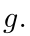 的域来拼接嵌套元组态射  和 

为了明确定义，我们需要  和  来满足不相交条件，我们在下面指定。

定义 3.2.6.1. 假设  和  是具有相同陪域的嵌套元组态射。如果 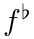 和 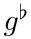 具有不相交的像，则我们说  和  具有不相交的像，如定义 3.1.5.32. 中所示

示例 3.2.6.2. 如果

位于 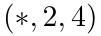 之上并且

位于 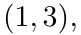 上方，则  和  具有不相交的像。

示例 3.2.6.3. 如果

位于 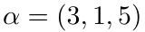 之上并且

位于 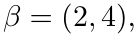 上方，则  和  具有不相交的像。

构造 3.2.6.4. 假设 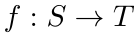 和 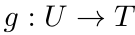 是分别位于  和 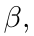 上的嵌套元组态射，并且  和  具有不相交的像。我们将  和  的拼接定义为嵌套元组态射

与

更一般地，如果 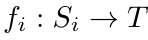 是 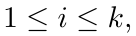 的嵌套元组态射，并且 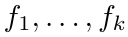 具有成对不相交像，那么我们定义拼接

是嵌套元组态射

示例 3.2.6.5. 示例 3.2.6.2 的态射  和  的拼接是嵌套元组态射

位于 $\alpha\star\beta=(*,2,4,1,3)$ 之上。

展开原页对照（保留全部图示、代码、标签和数学排版）

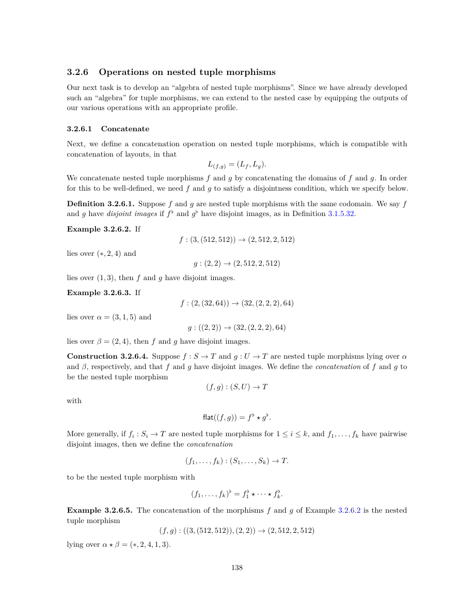

展开本页英文正文

<pre v-pre style="white-space:pre-wrap;overflow-wrap:anywhere">3.2.6 Operations on nested tuple morphisms

Our next task is to develop an “algebra of nested tuple morphisms”. Since we have already developed such an “algebra” for tuple morphisms, we can extend to the nested case by equipping the outputs of our various operations with an appropriate profile.

3.2.6.1 Concatenate

Next, we define a concatenation operation on nested tuple morphisms, which is compatible with concatenation of layouts, in that

We concatenate nested tuple morphisms f and g by concatenating the domains of f and g. In order

for this to be well-defined, we need f and g to satisfy a disjointness condition, which we specify below.

Definition 3.2.6.1. Suppose f and g are nested tuple morphisms with the same codomain. We say f and g have disjoint images if f ♭and g♭have disjoint images, as in Definition 3.1.5.32.

Example 3.2.6.2. If

lies over (∗, 2, 4) and

lies over (1, 3), then f and g have disjoint images.

Example 3.2.6.3. If

lies over α = (3, 1, 5) and

lies over β = (2, 4), then f and g have disjoint images.

Construction 3.2.6.4. Suppose f : S →T and g : U →T are nested tuple morphisms lying over α and β, respectively, and that f and g have disjoint images. We define the concatenation of f and g to be the nested tuple morphism

with

More generally, if fi : Si →T are nested tuple morphisms for 1 ≤i ≤k, and f1, . . . , fk have pairwise disjoint images, then we define the concatenation

to be the nested tuple morphism with

Example 3.2.6.5. The concatenation of the morphisms f and g of Example 3.2.6.2 is the nested tuple morphism

lying over α ⋆β = (∗, 2, 4, 1, 3).</pre>

## PDF 第 141 页 · 原书第 139 页

示例 3.2.6.6. 示例 3.2.6.3 的态射  和 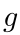 的拼接是嵌套元组态射

位于 $\alpha\star\beta=(3,1,5,2,4)$ 之上。

示例 3.2.6.7. 如果

位于 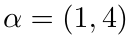

位于 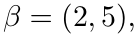 之上并且

位于 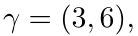 上，则 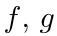 和 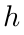 具有成对不相交像，并且拼接

位于 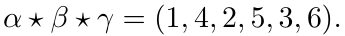

示例 3.2.6.8. 假设  是嵌套元组态射，并假设

回想一下示例 3.2.3.4，对于任何 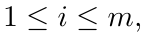 都存在嵌套元组态射

称为 $f$ 的第 $i$ 个分量。这些态射的像两两不交，其拼接

是复合的

示例 3.2.3.2

示例 3.2.6.9. 假设  是嵌套元组态射，并假设

回想一下示例 3.2.3.6，对于任何 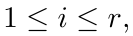 都存在嵌套元组态射

称为 $f$ 的第 $i$ 个模态。这些态射的像两两不交，其拼接

等于 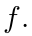 换句话说，每个嵌套元组态射  都可以写成其模态的拼接：

命题 3.2.6.10. 如果 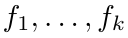 是具有相同陪域且具有成对不相交像的嵌套元组态射，则

展开原页对照（保留全部图示、代码、标签和数学排版）

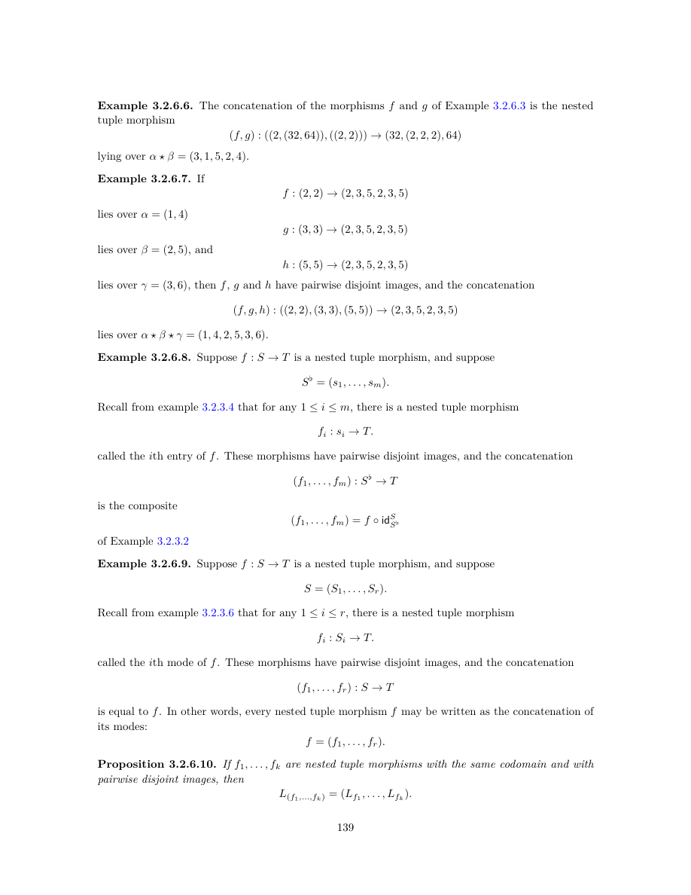

展开本页英文正文

<pre v-pre style="white-space:pre-wrap;overflow-wrap:anywhere">Example 3.2.6.6. The concatenation of the morphisms f and g of Example 3.2.6.3 is the nested tuple morphism

lying over α ⋆β = (3, 1, 5, 2, 4).

Example 3.2.6.7. If

lies over α = (1, 4)

lies over β = (2, 5), and

lies over γ = (3, 6), then f, g and h have pairwise disjoint images, and the concatenation

lies over α ⋆β ⋆γ = (1, 4, 2, 5, 3, 6).

Example 3.2.6.8. Suppose f : S →T is a nested tuple morphism, and suppose

Recall from example 3.2.3.4 that for any 1 ≤i ≤m, there is a nested tuple morphism

called the ith entry of f. These morphisms have pairwise disjoint images, and the concatenation

is the composite

of Example 3.2.3.2

Example 3.2.6.9. Suppose f : S →T is a nested tuple morphism, and suppose

Recall from example 3.2.3.6 that for any 1 ≤i ≤r, there is a nested tuple morphism

called the ith mode of f. These morphisms have pairwise disjoint images, and the concatenation

is equal to f. In other words, every nested tuple morphism f may be written as the concatenation of its modes:

Proposition 3.2.6.10. If f1, . . . , fk are nested tuple morphisms with the same codomain and with pairwise disjoint images, then</pre>

## PDF 第 142 页 · 原书第 140 页

证明。通过构建，我们有

并使用 3.1.5.38, 命题，我们有

3.2.6.2 合并

如果  是嵌套元组态射，那么我们可以将  定义为 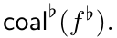 理论上，这是一个合理的定义。然而，为了使我们的定义与 `cute` 实现兼容，我们对 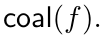 的定义进行了小小的修改

定义 3.2.6.11. 假设 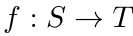 是一个嵌套元组态射，并写成

•（案例  如果 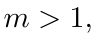 我们定义 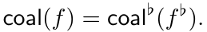

• （案例  如果 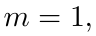 我们将 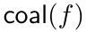 定义为复合

• （案例 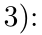 如果 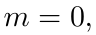 我们将 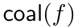 定义为复合

示例 3.2.6.12. 如果

那么位于 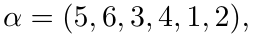 之上

位于 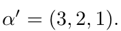

命题 3.2.6.13. 如果  是嵌套元组态射，则

展开原页对照（保留全部图示、代码、标签和数学排版）

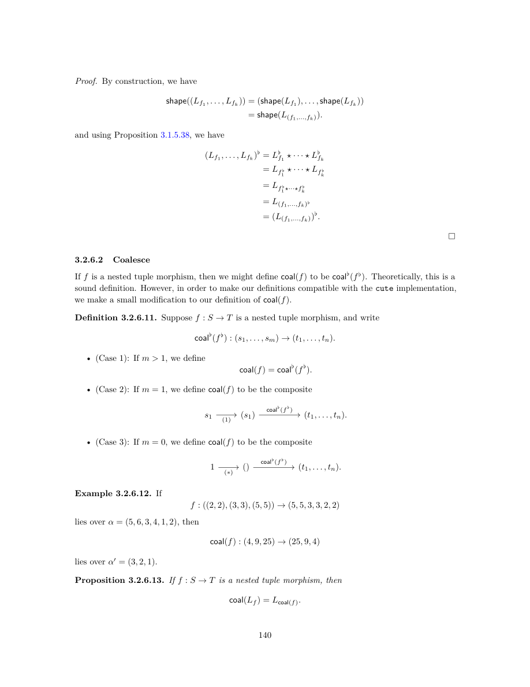

展开本页英文正文

<pre v-pre style="white-space:pre-wrap;overflow-wrap:anywhere">Proof. By construction, we have

and using Proposition 3.1.5.38, we have

3.2.6.2 Coalesce

If f is a nested tuple morphism, then we might define coal(f) to be coal♭(f ♭). Theoretically, this is a sound definition. However, in order to make our definitions compatible with the cute implementation, we make a small modification to our definition of coal(f).

Definition 3.2.6.11. Suppose f : S →T is a nested tuple morphism, and write

• (Case 1): If m &gt; 1, we define coal(f) = coal♭(f ♭).

• (Case 2): If m = 1, we define coal(f) to be the composite

• (Case 3): If m = 0, we define coal(f) to be the composite

Example 3.2.6.12. If

lies over α = (5, 6, 3, 4, 1, 2), then

lies over α′ = (3, 2, 1).

Proposition 3.2.6.13. If f : S →T is a nested tuple morphism, then</pre>

## PDF 第 143 页 · 原书第 141 页

证明。我们再写一下

需要考虑三种情况。

•（案例 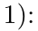 假设 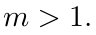 那么

•（案例 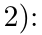 假设 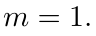 那么

•（案例  假设 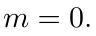 那么

3.2.6.3 补

在本节中，我们定义互补嵌套元组态射的概念。

定义 3.2.6.14. 设 $f:S\to T$ 与 $g:U\to T$ 是像不相交的嵌套元组态射。若下列态射为同构，就称 $g$ 是 $f$ 的补态射：

备注 3.2.6.15. 对于嵌套元组态射 $f:S\to T$ 与 $g:U\to T$，$g$ 是 $f$ 的补态射，当且仅当 $g^\flat$ 是 $f^\flat$ 的补态射，因为 $(f,g)^\flat=f^\flat\star g^\flat$。

命题 3.2.6.16. 若 $f:S\to T$ 是嵌套元组态射，且 $g:U\to T$ 是 $f$ 的补态射，则 $L_g$ 是 $L_f$ 的一个 $\operatorname{size}(T)$-补布局。

展开原页对照（保留全部图示、代码、标签和数学排版）

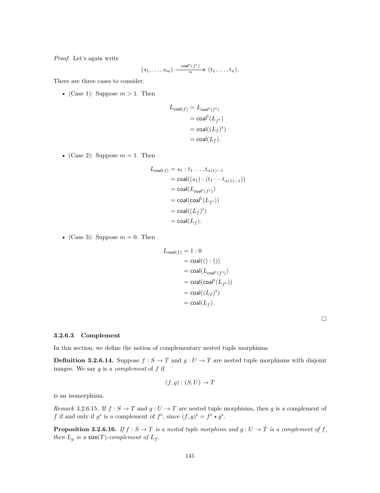

展开本页英文正文

<pre v-pre style="white-space:pre-wrap;overflow-wrap:anywhere">Proof. Let’s again write

There are three cases to consider.

• (Case 1): Suppose m &gt; 1. Then

• (Case 2): Suppose m = 1. Then

• (Case 3): Suppose m = 0. Then

3.2.6.3 Complement

In this section, we define the notion of complementary nested tuple morphisms.

Definition 3.2.6.14. Suppose f : S →T and g : U →T are nested tuple morphisms with disjoint images. We say g is a complement of f if

is an isomorphism.

Remark 3.2.6.15. If f : S →T and g : U →T are nested tuple morphisms, then g is a complement of

f if and only if g♭is a complement of f ♭, since (f, g)♭= f ♭⋆g♭.

Proposition 3.2.6.16. If f : S →T is a nested tuple morphism and g : U →T is a complement of f, then Lg is a size(T)-complement of Lf.</pre>

## PDF 第 144 页 · 原书第 142 页

证明。观察 3.2.2.5 意味着

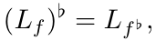 和

引理 2.3.6.2 允许我们简化为平坦情形（命题 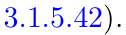

构造 3.2.6.17. 设 $f:S\to T$ 是嵌套元组态射。定义 $f$ 的补态射为以下复合：〔校注：原文此处未重述可取补条件；构造依赖构造 3.1.5.46，故要求 $f^\flat$ 所在的保基点映射为单射。〕

其中 $(f^\flat)^c$ 按构造 3.1.5.46 定义，而 $\operatorname{id}^{T}_{T^\flat}:T^\flat\cong T$ 是逆展平同构。

例 3.2.6.18. 以下嵌套元组态射的补态射为

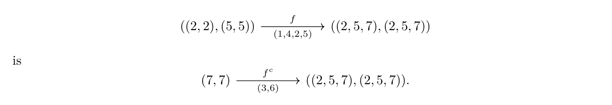

命题 3.2.6.19. 设 $f:S\to T$ 与 $g:U\to T$ 为嵌套元组态射。若 $f$ 为单射，且 $g$ 为 $f$ 的补态射，则 $L_g$ 为 $L_f$ 的一个 $\operatorname{size}(T)$-补布局。

证明。这是从命题 3.1.5.42 和引理 2.3.6.2 得出的，因为

命题 3.2.6.20. 如果  是单射嵌套元组态射，则

证明。由于 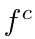 是通过重新括号同构后复合从 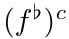 获得的，因此可以得出：

因此，由命题 3.2.6.20 得〔校注：这里原文引用了正在证明的命题自身；相应平坦情形应参照命题 3.1.5.43。〕

将  应用到两侧即可得到结果。

展开原页对照（保留全部图示、代码、标签和数学排版）

展开本页英文正文

<pre v-pre style="white-space:pre-wrap;overflow-wrap:anywhere">Proof. Observation 3.2.2.5 implies that

(Lf)♭= Lf ♭, and

and Lemma 2.3.6.2 allows us to reduce to the flat case (Proposition 3.1.5.42).

Construction 3.2.6.17. Suppose f : S →T is a nested nested tuple morphism. We define the complement of f to be the composite

T ♭: T ♭∼= T is the unflattening isomorphism.

where (f ♭)c, is as defined in Construction 3.1.5.46, and idT

Example 3.2.6.18. The complement of the nested tuple morphism

Proposition 3.2.6.19. Suppose f : S →T and g : U →T are nested tuple morphisms. If f is injective and g is a complement of f, then Lg is a size(T)-complement of Lf.

Proof. This follows from Proposition 3.1.5.42 and Lemma 2.3.6.2 since

Proposition 3.2.6.20. If f : S →T is an injective nested tuple morphism, then

Proof. Since f c is obtained from (f ♭)c by post-composing with a reparenthesization isomorphism, it follows that

so by Proposition 3.2.6.20, it follows that

Applying coal(−) to both sides yields the result.</pre>

## PDF 第 145 页 · 原书第 143 页

3.2.6.4 组成

我们可以使用 3.2.4 节的具象化函子来证明嵌套元组态射的复合

与相关布局的复合兼容。

定理 3.2.6.21. 如果  和  是非退化可复合嵌套元组态射，则

证明。假设  和  是非退化嵌套元组态射。我们需要检查一下

1. $\operatorname{shape}(L_{g\circ f})$ 细化 $\operatorname{shape}(L_f)$。这是因为

 合并于  由于嵌套元组态射  是非退化的，因此布局  也是如此

3. $\Phi_{L_{g\circ f}}=\Phi_{L_g}\circ\Phi^{\operatorname{size}(L_g)}_{L_f}$。由引理 3.2.4.2，有

再与包含映射 $[0,\operatorname{size}(U))\hookrightarrow\mathbb Z$ 作后复合，并注意到 $\operatorname{size}(T)=\operatorname{size}(L_g)$，即得结论。

3.2.6.5 逻辑除法

接下来介绍嵌套元组态射的逻辑除法。这一构造由平坦除法引入嵌套轮廓得到，无须额外的相容性约束。

定义 3.2.6.22. 假设  和  是嵌套元组态射。如果  和  是可复合的，我们就说  整除 。换句话说，

定义 3.2.6.23. 设 $g:S\to T$ 与 $f:T\to U$ 为嵌套元组态射。定义 $f$ 除以 $g$ 的逻辑除法为以下嵌套元组态射：

示例 3.2.6.24. 的逻辑除法

展开原页对照（保留全部图示、代码、标签和数学排版）

展开本页英文正文

<pre v-pre style="white-space:pre-wrap;overflow-wrap:anywhere">3.2.6.4 Composition

We can use the realization functor of Section 3.2.4 to prove that composition of nested tuple morphisms

is compatible with composition of the associated layouts.

Theorem 3.2.6.21. If f and g are non-degenerate composable nested tuple morphisms, then

Proof. Suppose f : S →T and g : T →U are non-degenerate nested tuple morphisms. We need to check that

1. shape(Lg◦f) refines shape(Lf): This holds since

2. Lg◦f is coalesced over shape(Lf): This holds since the nested tuple morphism g ◦f is non- degenerate, hence so is the layout Lg◦f.

3. ΦLg◦f = ΦLg ◦Φsize(Lg) Lf : Using Lemma 3.2.4.2, we have

and by postcomposing with the inclusion [0, size(U)) ⊂Z, and observing that size(T) = size(Lg), the result follows.

3.2.6.5 Logical division

Next, we introduce logical division of nested tuple morphisms. This construction is obtained from flat division by introducing nesting profiles, with no compatibility constraints.

Definition 3.2.6.22. Suppose f and g are nested tuple morphisms. We say g divides f if g and f are composable. In other words,

Definition 3.2.6.23. Suppose g : S →T and f : T →U are nested tuple morphisms. We define the logical division of f by g to be the nested tuple morphism

Example 3.2.6.24. The logical division of</pre>

## PDF 第 146 页 · 原书第 144 页

示例 3.2.6.25. 的逻辑除法

命题 3.2.6.26. 如果  和  是非退化嵌套元组态射，则

证明。根据命题 3.2.6.20,，我们有

我们计算

命题 3.2.6.27. 若 $f,g$ 是嵌套元组，且 $g$ 整除 $f$，则〔校注：按上下文及下式，这里的对象是嵌套元组态射；原文省略了 morphisms。〕

证明。我们计算

3.2.6.6 逻辑乘积

在本节中，我们定义嵌套元组态射的逻辑积。

定义 3.2.6.28. 设 $f,g$ 为嵌套元组态射。若 $\operatorname{codomain}(g)=\operatorname{domain}(f^c)$，就称 $f,g$ 乘积可容许。此时定义它们的逻辑乘积

为以下嵌套元组态射：

展开原页对照（保留全部图示、代码、标签和数学排版）

展开本页英文正文

<pre v-pre style="white-space:pre-wrap;overflow-wrap:anywhere">Example 3.2.6.25. The logical division of

Proposition 3.2.6.26. If g : S →T and f : T →U are non-degenerate nested tuple morphisms, then

Proof. By Proposition 3.2.6.20, we have

and we compute

Proposition 3.2.6.27. If f and g are nested tuples and g divides f, then

Proof. We compute

3.2.6.6 Logical products

In this section, we define the logical product of nested tuple morphisms.

Definition 3.2.6.28. Suppose f and g are nested tuple morphisms. We say f and g are product admissible if codomain(g) = domain(f c). If f and g are product admissible we define the logical product

of f and g to be the nested tuple morphism</pre>

## PDF 第 147 页 · 原书第 145 页

示例 3.2.6.29. 嵌套元组态射

和

乘积可容许，其逻辑乘积为

示例 3.2.6.30. 嵌套元组态射

和

乘积可容许，其逻辑乘积为

命题 3.2.6.31. 设 $f,g$ 是非退化嵌套元组态射，且乘积可容许，则

证明。设 $f:S\to T$ 与 $g:U\to V$ 乘积可容许，并令

由于 $f$ 为单射，且 $\operatorname{codomain}(g)=\operatorname{domain}(f^c)$，因此

利用这个事实，以及事实

我们有

利用这个事实，我们计算

展开原页对照（保留全部图示、代码、标签和数学排版）

展开本页英文正文

<pre v-pre style="white-space:pre-wrap;overflow-wrap:anywhere">Example 3.2.6.29. The nested tuple morphisms

and

are product admissible, and their logical product is

Example 3.2.6.30. The nested tuple morphisms

and

are product admissible, and their logical product is

Proposition 3.2.6.31. Suppose f and g are non-degenerate nested tuple morphisms and that f and g are product-admissible. Then

Proof. Suppose f : S →T and g : U →V are product admissible, and set

Since f is injective and codomain(g) = domain(f c), it follows that

Using this fact, and the fact that

we have

Using this fact, we compute</pre>

---
[译文总目录](Layout.md) · [第 3.2 节：Nest 范畴与细化](Translation-08-Nest.md) · [第 4 章：计算](Translation-10-Computations.md)
