# 第 4 章：计算
[译文总目录](Layout.md) · [第 3.2 节：嵌套元组态射上的运算](Translation-09-Nest-Operations.md) · [附录 A：范畴入门与参考文献](Translation-11-Appendix.md)
> 来源：Colfax Research，2025 年 9 月版。本文为中文逐段译文，保留原文顺序及定义、命题、例子、证明和公式；校对说明以“校注”明确区分于原文，详见[校对记录](Proofreading.md)。复杂数学式与图示直接使用本地原文裁片。每页末尾可展开原页核对。

## PDF 第 148 页 · 原书第 146 页
<a id="pdf-page-148"></a>

<a id="paper-section-4"></a>

### 第 4 章

### 计算

范畴 Tuple 和 Nest 为可处理布局的计算提供了一个强大的框架。然而，在实践中，我们经常会遇到这样的可处理布局 A 和 B：它们在 cute 中可以复合，但其标准表示在 Tuple 和 Nest 中都不可复合。本章将详细说明，尽管如此，仍然可以借助共同细化的概念，使用范畴 Tuple 和 Nest 来计算可处理布局的复合、逻辑除法和逻辑乘积。我们在第 4.1.1 节介绍这一概念，在算法 4.1.1 中给出计算共同细化的算法，并详细分析许多具体例子。

<a id="paper-section-4-1"></a>

### 4.1 复合

设要计算以下可处理布局的复合 $B\circ A$：


可以尝试先计算 $A,B$ 的标准表示 $f,g$ 的复合：


但这两个态射不可复合，因为 $f$ 的陪域 $(6,6)$ 不等于 $g$ 的定义域 $(12,3,6)$。这意味着不能直接使用 $f,g$ 计算复合 $B\circ A$。

不过，可以通过寻找 $(6,6)$ 与 $(12,3,6)$ 的共同细化来继续计算，如下图所示：


这样可将 $f,g$ 转换为可复合的态射 $f',g'$：


<details>
<summary>展开原页对照（保留全部图示、代码、标签和数学排版）</summary>

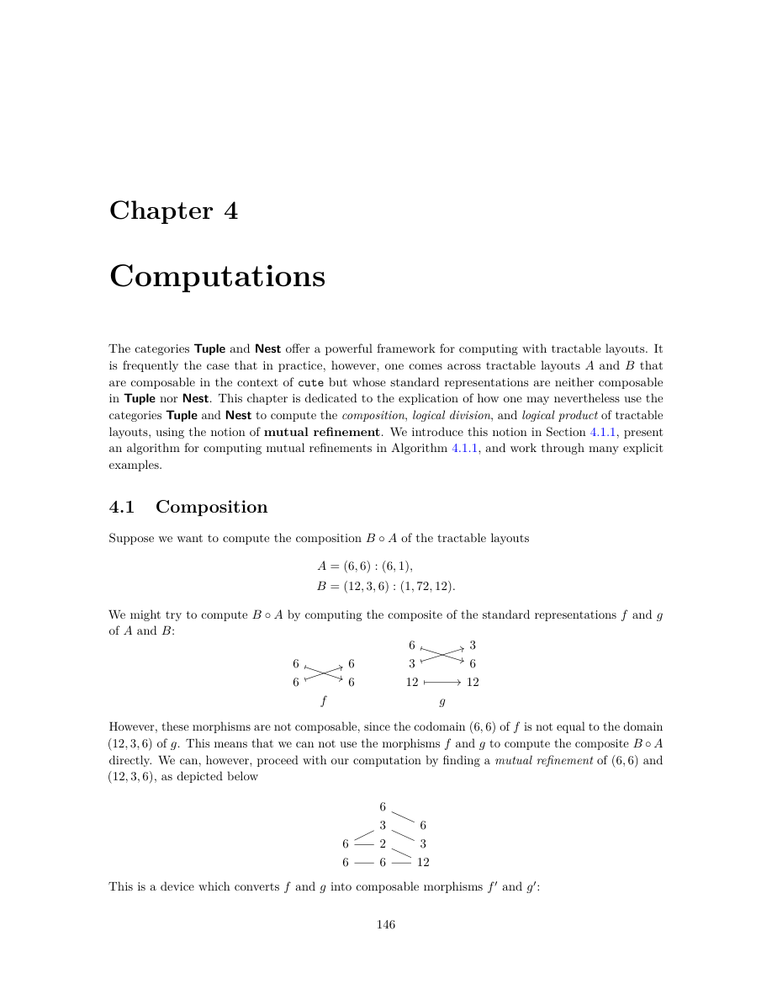

</details>

<details>
<summary>展开本页英文正文</summary>

<pre v-pre style="white-space:pre-wrap;overflow-wrap:anywhere">Chapter 4

Computations

The categories Tuple and Nest offer a powerful framework for computing with tractable layouts. It is frequently the case that in practice, however, one comes across tractable layouts A and B that are composable in the context of cute but whose standard representations are neither composable in Tuple nor Nest. This chapter is dedicated to the explication of how one may nevertheless use the categories Tuple and Nest to compute the composition, logical division, and logical product of tractable layouts, using the notion of mutual refinement. We introduce this notion in Section 4.1.1, present an algorithm for computing mutual refinements in Algorithm 4.1.1, and work through many explicit examples.

4.1 Composition

Suppose we want to compute the composition B ◦A of the tractable layouts

We might try to compute B ◦A by computing the composite of the standard representations f and g

of A and B:

However, these morphisms are not composable, since the codomain (6, 6) of f is not equal to the domain (12, 3, 6) of g. This means that we can not use the morphisms f and g to compute the composite B ◦A

directly. We can, however, proceed with our computation by finding a mutual refinement of (6, 6) and (12, 3, 6), as depicted below

This is a device which converts f and g into composable morphisms f ′ and g′:</pre>

</details>

## PDF 第 149 页 · 原书第 147 页
<a id="pdf-page-149"></a>

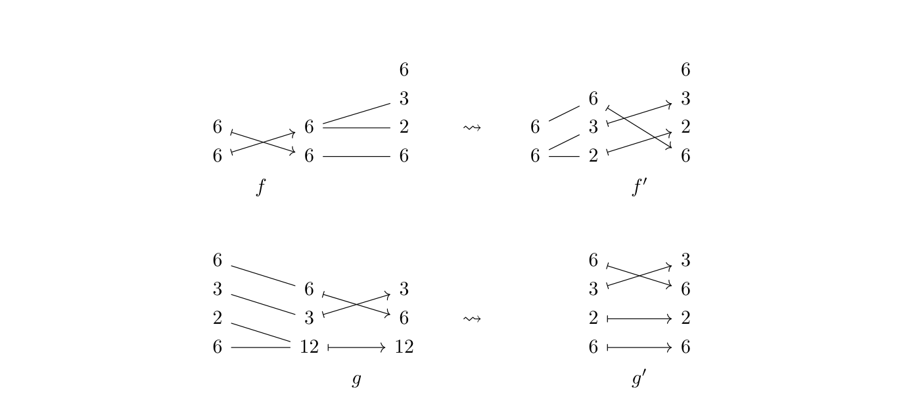

态射 $f',g'$ 可复合，因此可以形成以下复合：

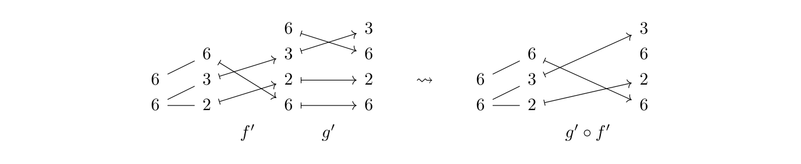

计算其所编码的布局，得到


本节的目标是将这个计算过程形式化为一种算法，用于计算可处理布局  和 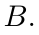 的复合。正如我们在示例中看到的，计算中的重要步骤是

1. 发现某些（嵌套）元组的共同细化，以及

2. 使用共同细化将  和  转换为可复合态射 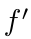 和 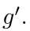

我们将用以下两节来解释这些步骤。

<a id="paper-section-4-1-1"></a>

### 4.1.1 共同细化

在使用 3, 章的范畴论框架给出共同细化的精确定义之前，我们给出一个非正式的概述。考虑我们的激励示例中的元组 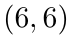 和 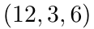。我们断言该图


是 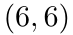 和 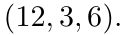 的共同细化我们可以如下对这种共同细化给出更精确的描述。该图的左半部分代表细化 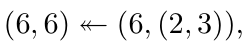 和


<details>
<summary>展开原页对照（保留全部图示、代码、标签和数学排版）</summary>

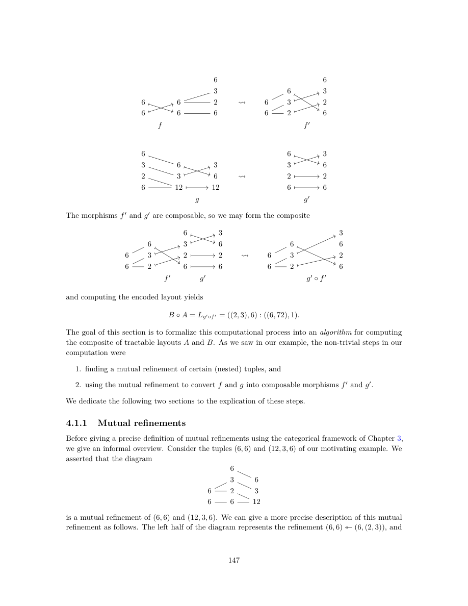

</details>

<details>
<summary>展开本页英文正文</summary>

<pre v-pre style="white-space:pre-wrap;overflow-wrap:anywhere">The morphisms f ′ and g′ are composable, so we may form the composite

and computing the encoded layout yields

The goal of this section is to formalize this computational process into an algorithm for computing the composite of tractable layouts A and B. As we saw in our example, the non-trivial steps in our computation were

1. finding a mutual refinement of certain (nested) tuples, and

2. using the mutual refinement to convert f and g into composable morphisms f ′ and g′.

We dedicate the following two sections to the explication of these steps.

4.1.1 Mutual refinements

Before giving a precise definition of mutual refinements using the categorical framework of Chapter 3, we give an informal overview. Consider the tuples (6, 6) and (12, 3, 6) of our motivating example. We asserted that the diagram

is a mutual refinement of (6, 6) and (12, 3, 6). We can give a more precise description of this mutual refinement as follows. The left half of the diagram represents the refinement (6, 6) ↞(6, (2, 3)), and</pre>

</details>

## PDF 第 150 页 · 原书第 148 页
<a id="pdf-page-150"></a>

图的右半部分代表细化 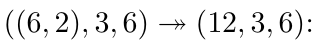

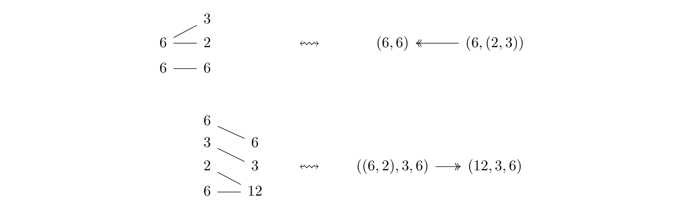

图的左右两半能够拼接，正对应于嵌套元组 $(6,(2,3))$ 整除 $((6,2),3,6)$，记为


将这些观察结果放在一起，我们可以将我们的共同细化准确地表达为


我们选择垂直描绘 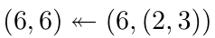 和 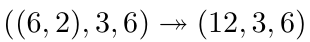 的细化。我们现在可以给出共同细化的精确定义。

定义 4.1.1.1. 设 $T,U$ 为嵌套元组。$(T,U)$ 的一个共同细化是如下形式的图：


明确地，这是一对嵌套元组 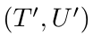，使得

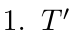 细化 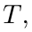

 细化  和

3. $T'$ 整除 $U'$。

示例 4.1.1.2. 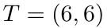 和 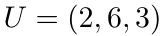 的共同细化由下式给出


我们将这种共同细化描述如下。


<details>
<summary>展开原页对照（保留全部图示、代码、标签和数学排版）</summary>

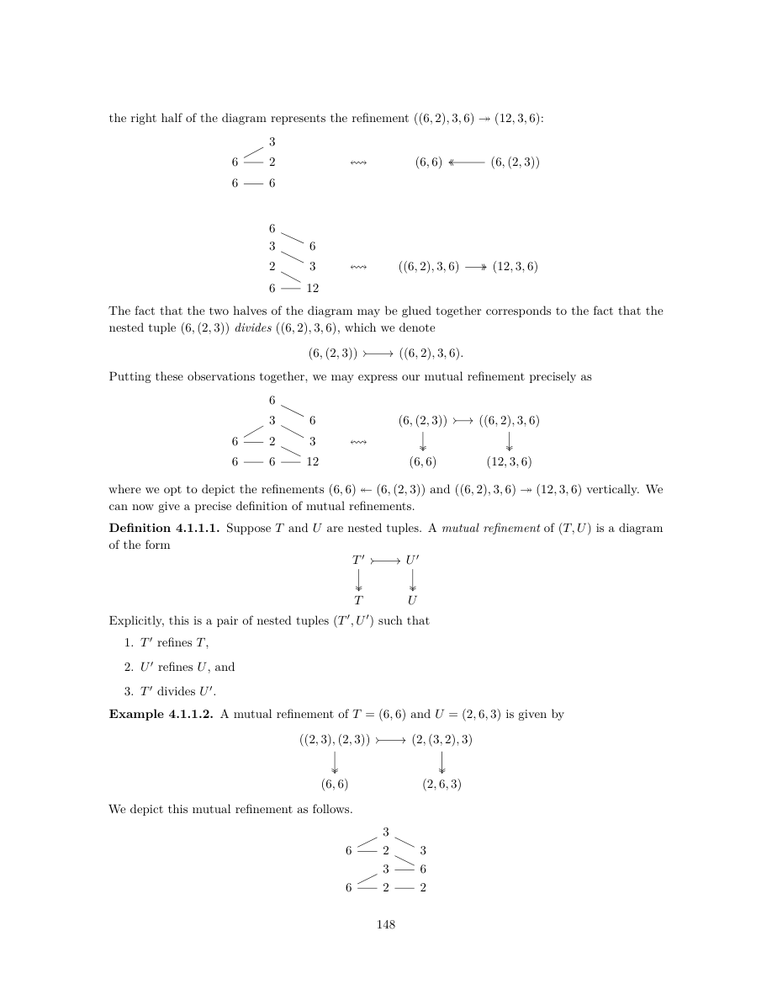

</details>

<details>
<summary>展开本页英文正文</summary>

<pre v-pre style="white-space:pre-wrap;overflow-wrap:anywhere">the right half of the diagram represents the refinement ((6, 2), 3, 6) ↠(12, 3, 6):

The fact that the two halves of the diagram may be glued together corresponds to the fact that the nested tuple (6, (2, 3)) divides ((6, 2), 3, 6), which we denote

Putting these observations together, we may express our mutual refinement precisely as

where we opt to depict the refinements (6, 6) ↞(6, (2, 3)) and ((6, 2), 3, 6) ↠(12, 3, 6) vertically. We can now give a precise definition of mutual refinements.

Definition 4.1.1.1. Suppose T and U are nested tuples. A mutual refinement of (T, U) is a diagram of the form

Explicitly, this is a pair of nested tuples (T ′, U ′) such that

1. T ′ refines T,

2. U ′ refines U, and

3. T ′ divides U ′.

Example 4.1.1.2. A mutual refinement of T = (6, 6) and U = (2, 6, 3) is given by

We depict this mutual refinement as follows.</pre>

</details>

## PDF 第 151 页 · 原书第 149 页
<a id="pdf-page-151"></a>

示例 4.1.1.3. 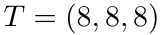 和 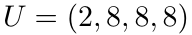 的共同细化由下式给出


我们将这种共同细化描述如下。


示例 4.1.1.4. 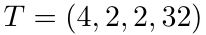 和 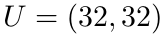 的共同细化由下式给出


我们将这种共同细化描述如下。


示例 4.1.1.5. 如果 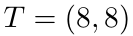 和 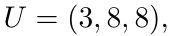，则不存在 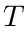 和 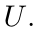 的共同细化

观察 4.1.1.6。在前面的每个例子中，我们考虑的都是平坦元组 T 与 U 的共同细化。但是，共同细化的定义允许 T 与 U 为任意嵌套元组。无论如何，将讨论限制在平坦情形并不损失一般性，因为一对嵌套元组 (T, U) 的共同细化，与其展平 (T♭, U♭) 的共同细化之间存在一一对应（见引理 3.2.5.20）。具体而言，(T, U) 存在共同细化，当且仅当 (T♭, U♭) 存在共同细化。

做出适当的定义后，我们提供了一种计算  共同细化的算法

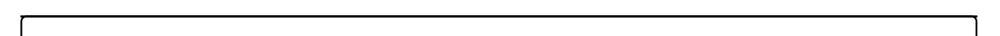

算法 4.1.1: 共同细化算法

1 输入：嵌套元组  和 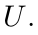


<details>
<summary>展开原页对照（保留全部图示、代码、标签和数学排版）</summary>

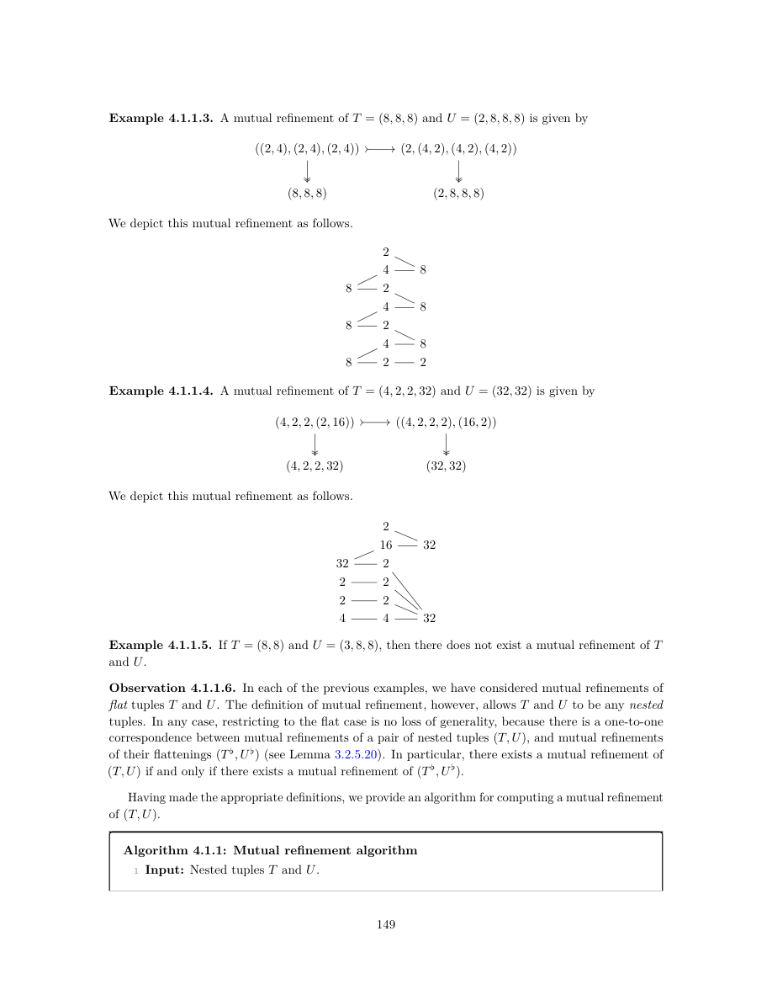

</details>

<details>
<summary>展开本页英文正文</summary>

<pre v-pre style="white-space:pre-wrap;overflow-wrap:anywhere">Example 4.1.1.3. A mutual refinement of T = (8, 8, 8) and U = (2, 8, 8, 8) is given by

We depict this mutual refinement as follows.

Example 4.1.1.4. A mutual refinement of T = (4, 2, 2, 32) and U = (32, 32) is given by

We depict this mutual refinement as follows.

Example 4.1.1.5. If T = (8, 8) and U = (3, 8, 8), then there does not exist a mutual refinement of T and U.

Observation 4.1.1.6. In each of the previous examples, we have considered mutual refinements of flat tuples T and U. The definition of mutual refinement, however, allows T and U to be any nested tuples. In any case, restricting to the flat case is no loss of generality, because there is a one-to-one correspondence between mutual refinements of a pair of nested tuples (T, U), and mutual refinements of their flattenings (T ♭, U ♭) (see Lemma 3.2.5.20). In particular, there exists a mutual refinement of (T, U) if and only if there exists a mutual refinement of (T ♭, U ♭).

Having made the appropriate definitions, we provide an algorithm for computing a mutual refinement of (T, U).

Algorithm 4.1.1: Mutual refinement algorithm

1 Input: Nested tuples T and U.</pre>

</details>

## PDF 第 152 页 · 原书第 150 页
<a id="pdf-page-152"></a>

### 算法 4.1.1（续）：共同细化算法

```text
 2 输出：(T, U) 的共同细化 (T′, U′)；若不存在，则为 None。
 3 X ← T；Y ← U
 4 X′, Y′, X_mode, Y_mode ← ()
 5 i ← 1；j ← 1
 6 当 i ≤ len(X) 且 j ≤ len(Y) 时循环
 7     若 entry_i(X) = entry_j(Y)，则
 8         将 entry_i(X) 追加到 X_mode；将 X_mode 追加到 X′；X_mode ← ()
 9         将 entry_j(Y) 追加到 Y_mode
10         将 Y_mode 追加到 Y′
11         Y_mode ← ()
12         i ← i + 1
13         j ← j + 1
14     否则，若 entry_i(X) 整除 entry_j(Y)，则
15         将 entry_i(X) 追加到 X_mode
16         将 X_mode 追加到 X′
17         X_mode ← ()
18         将 entry_i(X) 追加到 Y_mode
19         entry_j(Y) ← entry_j(Y) / entry_i(X)
20         i ← i + 1
21     否则，若 entry_j(Y) 整除 entry_i(X)，则
22         将 entry_j(Y) 追加到 X_mode
23         将 entry_j(Y) 追加到 Y_mode
24         将 Y_mode 追加到 Y′
25         Y_mode ← ()
26         entry_i(X) ← entry_i(X) / entry_j(Y)
27         j ← j + 1
28     否则
29         返回 None
30     结束条件分支
31 结束循环
32 若 Y_mode ≠ ()，则
33     将 entry_j(Y) 追加到 Y_mode
34     将 Y_mode 追加到 Y′
35     j ← j + 1
36 结束条件分支
37 当 j < len(Y) 时循环
38     将 entry_j(Y) 追加到 Y′
39     j ← j + 1
40 结束循环
41 T′ ← (X′)_{prof(T)}
42 U′ ← (Y′)_{prof(U)}
43 返回 (T′, U′)
```

〔校注（非原文）：第 37 行原文为严格不等号 `<`，此处如实保留。但这会漏掉最后一个尚未处理的 Y 分量。例如 T=(2)、U=(2,3)，第一次循环后 i=2、j=2、Y_mode=()；第 37 行的 2<2 为假，最终 U′=(2) 不是 U 的细化。对该例需将条件改为 j≤len(Y) 才能保留末项。本译文不将此算法当作已经验证的可执行实现。〕


<details>
<summary>展开原页对照（保留全部图示、代码、标签和数学排版）</summary>

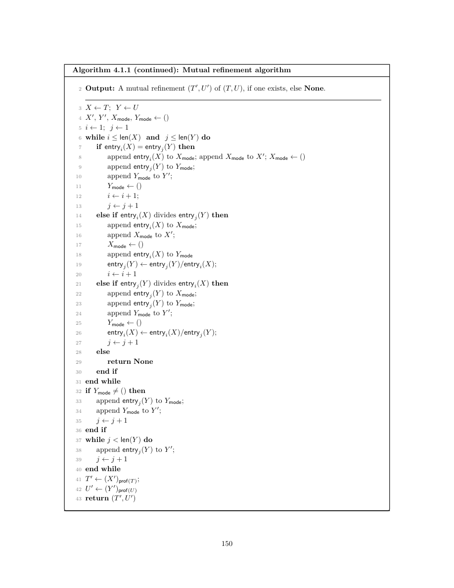

</details>

<details>
<summary>展开本页英文正文</summary>

<pre v-pre style="white-space:pre-wrap;overflow-wrap:anywhere">Algorithm 4.1.1 (continued): Mutual refinement algorithm

2 Output: A mutual refinement (T ′, U ′) of (T, U), if one exists, else None.

6 while i ≤len(X) and j ≤len(Y ) do

7 if entryi(X) = entryj(Y ) then

8 append entryi(X) to Xmode; append Xmode to X′; Xmode ←()

9 append entryj(Y ) to Ymode;

10 append Ymode to Y ′;

14 else if entryi(X) divides entryj(Y ) then

15 append entryi(X) to Xmode;

16 append Xmode to X′;

18 append entryi(X) to Ymode

21 else if entryj(Y ) divides entryi(X) then

22 append entryj(Y ) to Xmode;

23 append entryj(Y ) to Ymode;

24 append Ymode to Y ′;

28 else

29 return None

30 end if

31 end while

32 if Ymode̸ = () then

33 append entryj(Y ) to Ymode;

34 append Ymode to Y ′;

36 end if

37 while j &lt; len(Y ) do

38 append entryj(Y ) to Y ′;

40 end while

43 return (T ′, U ′)</pre>

</details>

## PDF 第 153 页 · 原书第 151 页
<a id="pdf-page-153"></a>

<a id="paper-section-4-1-2"></a>

### 4.1.2 从共同细化到可复合态射

回顾一下：为计算以下布局的复合 $B\circ A$，

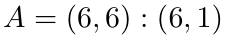 和


我们构造了元组态射


以及一个共同细化。


我们计算的下一步是使用共同细化将  和  转换为可复合态射 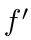 和 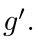 在给出此过程的正式、范畴论定义之前，让我们用一个示例来说明该过程。

我们从  和我们共同细化的左半部分构建 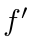：


该结构是通过替换


并进行更换


更一般地，我们进行替换


<details>
<summary>展开原页对照（保留全部图示、代码、标签和数学排版）</summary>

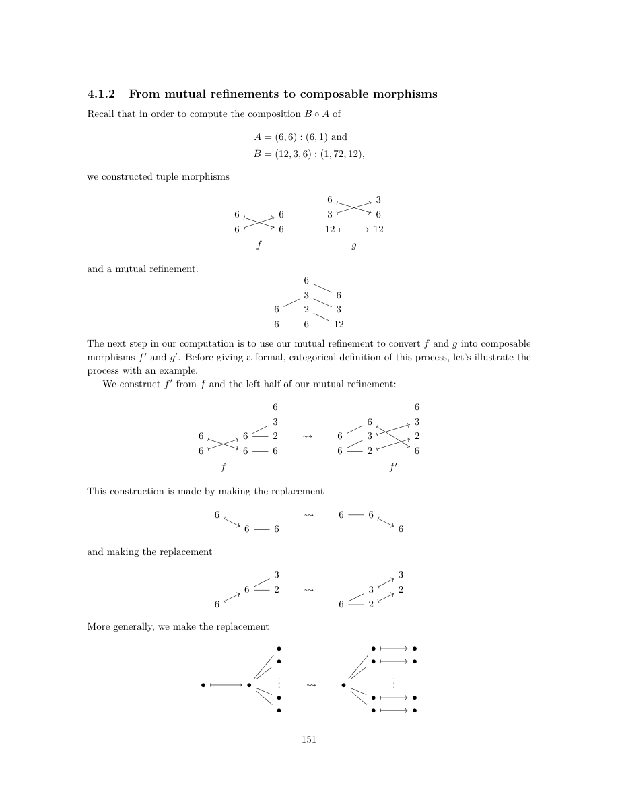

</details>

<details>
<summary>展开本页英文正文</summary>

<pre v-pre style="white-space:pre-wrap;overflow-wrap:anywhere">4.1.2 From mutual refinements to composable morphisms

Recall that in order to compute the composition B ◦A of

A = (6, 6) : (6, 1) and

we constructed tuple morphisms

and a mutual refinement.

The next step in our computation is to use our mutual refinement to convert f and g into composable morphisms f ′ and g′. Before giving a formal, categorical definition of this process, let’s illustrate the process with an example.

We construct f ′ from f and the left half of our mutual refinement:

This construction is made by making the replacement

and making the replacement

More generally, we make the replacement</pre>

</details>

## PDF 第 154 页 · 原书第 152 页
<a id="pdf-page-154"></a>

由 $g$ 和共同细化的右半部分构造 $g'$ 的过程与此类似。


这个结构是通过替换来完成的


更一般地，我们进行替换


在对我们的程序进行了非正式的描述之后，我们将事情精确化如下。

构造 4.1.2.1。设 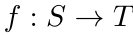 与 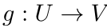 是嵌套元组态射，且 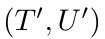 是 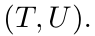 的共同细化。那么，可以使用第 3.2.5 节中的拉回与前推构造，得到下图：


如果我们设置 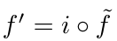 和 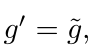 那么


是可复合的嵌套元组态射。

<a id="paper-section-4-1-3"></a>

### 4.1.3 复合算法

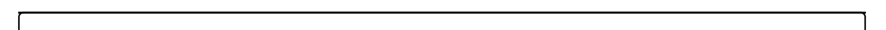

算法 4.1.2: 可处理布局复合算法

1 输入：可处理布局  和 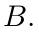


<details>
<summary>展开原页对照（保留全部图示、代码、标签和数学排版）</summary>

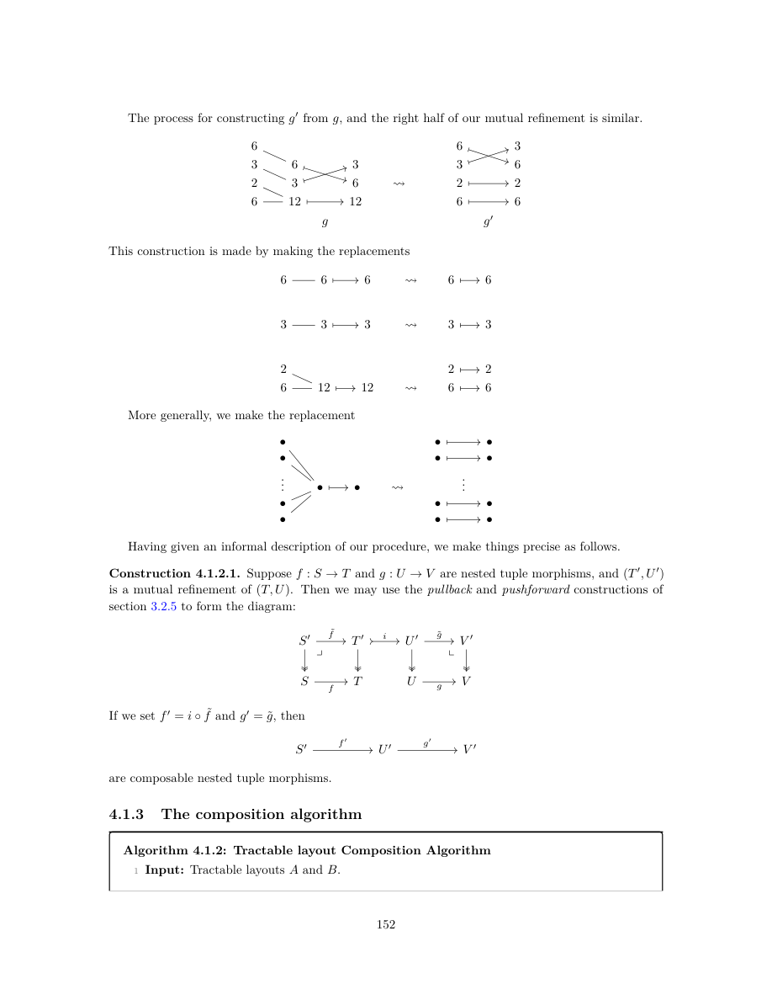

</details>

<details>
<summary>展开本页英文正文</summary>

<pre v-pre style="white-space:pre-wrap;overflow-wrap:anywhere">The process for constructing g′ from g, and the right half of our mutual refinement is similar.

This construction is made by making the replacements

More generally, we make the replacement

Having given an informal description of our procedure, we make things precise as follows.

Construction 4.1.2.1. Suppose f : S →T and g : U →V are nested tuple morphisms, and (T ′, U ′) is a mutual refinement of (T, U). Then we may use the pullback and pushforward constructions of section 3.2.5 to form the diagram:

If we set f ′ = i ◦˜f and g′ = ˜g, then

are composable nested tuple morphisms.

4.1.3 The composition algorithm

Algorithm 4.1.2: Tractable layout Composition Algorithm

1 Input: Tractable layouts A and B.</pre>

</details>

## PDF 第 155 页 · 原书第 153 页
<a id="pdf-page-155"></a>


算法 4.1.2（续）：可处理布局复合算法

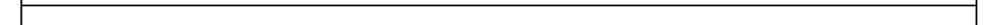

2 输出：若存在，给出 $A,B$ 的一个弱复合 $C$；否则返回 `None`。

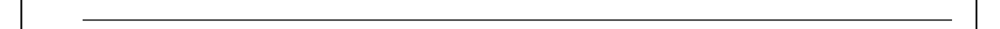

3 取标准表示法


分别为  和 。

4 使用算法 4.1.1 产生共同细化


 如果不存在  的共同细化，则返回 None。

5 使用构造 4.1.2.1 获取可复合嵌套元组态射


6 复合  和  并计算编码布局


7 返回 


定理 4.1.3.1. 如果  和  是易于处理的布局，则先前算法的输出  是  和  的弱复合，因此，〔校注：算法可能返回 `None`；本句中“输出 $C$”应理解为确实返回布局时。另算法 4.1.1 第 37 行的边界条件有疑点，见该算法后的校注。〕


证明。命题 3.2.5.15 告诉我们


命题 3.2.5.11 和示例 3.1.3.6 告诉我们


定理 3.2.6.21 意味着


通过构造， 的形状  细化了  的形状 ，因此我们得出结论  是  和  的弱复合

<a id="paper-section-4-1-4"></a>

### 4.1.4 例子

本节说明如何利用算法 4.1.3 计算可处理布局 $A,B$ 的复合 $B\circ A$。〔校注：这里原文的算法编号应为 4.1.2，即前面的可处理布局复合算法。〕


<details>
<summary>展开原页对照（保留全部图示、代码、标签和数学排版）</summary>


</details>

<details>
<summary>展开本页英文正文</summary>

<pre v-pre style="white-space:pre-wrap;overflow-wrap:anywhere">Algorithm 4.1.2 (continued): Tractable layout Composition Algorithm

2 Output: A weak composite C of A and B, if one exists, else None..

3 Take the standard representations

of A and coal(B), respectively.

4 Use Algorithm 4.1.1 to produce a mutual refinement

of (T, U). If there does not exist a mutual refinement of (T, U), return None.

5 Use Construction 4.1.2.1 to obtain the composable nested tuple morphisms

6 Compose f ′ and g′, and compute the encoded layout

7 return C

Theorem 4.1.3.1. If A and B are tractable layouts, then the output C of the previous algorithm is a weak composite of A and B. Consequently,

Proof. Proposition 3.2.5.15 and tells us that

and Proposition 3.2.5.11 and Example 3.1.3.6 tell us that

Theorem 3.2.6.21 then implies that

By construction, the shape S′ of Lf ′ refines the shape S of A, so we conclude that C is a weak composite of A and B.

4.1.4 Examples

In this section we illustrate how Algorithm 4.1.3 may be used to compute the composition B ◦A of tractable layouts A and B.</pre>

</details>

## PDF 第 156 页 · 原书第 154 页
<a id="pdf-page-156"></a>

示例 4.1.4.1. 假设  和 

1. 取和的标准表示


2. 应用算法 4.1.1 获得共同细化


3. 构造下图：


4. 化简该图：


5. 将 $f',g'$ 复合，得到


6. 计算关联布局


 合并于 ，因此 

示例 4.1.4.2. 假设  和 

1. 取和的标准表示


2. 应用算法 4.1.1 获得共同细化


<details>
<summary>展开原页对照（保留全部图示、代码、标签和数学排版）</summary>


</details>

<details>
<summary>展开本页英文正文</summary>

<pre v-pre style="white-space:pre-wrap;overflow-wrap:anywhere">Example 4.1.4.1. Suppose A = (4) : (1), and B = (2, 2) : (2, 1).

1. Take the standard representations of A and coal(B) = B.

2. Apply Algorithm 4.1.1 to obtain the mutual refinement

3. Form the diagram 2 2 2 4 4 2 2 2

4. Resolve the diagram 2 2 2 4 2 2 2

5. Compose f ′ and g′ to obtain 2 2 4 2 2

6. Compute the associated layout

7. Lg′◦f ′ is coalesced over (4), so B ◦A = ((2, 2)) : ((2, 1)).

Example 4.1.4.2. Suppose A = (6, 6) : (6, 1), and B = (12, 3, 6) : (1, 72, 12).

1. Take the standard representations of A and coal(B) = B.

2. Apply Algorithm 4.1.1 to obtain the mutual refinement</pre>

</details>

## PDF 第 157 页 · 原书第 155 页
<a id="pdf-page-157"></a>

3. 构造下图：


4. 解析图获得


5. 将 $f',g'$ 复合，得到


6. 计算关联布局


 合并到  上，因此


示例 4.1.4.3. 假设  和 

1. 取和的标准表示


2. 应用算法 4.1.1 获得共同细化


<details>
<summary>展开原页对照（保留全部图示、代码、标签和数学排版）</summary>


</details>

<details>
<summary>展开本页英文正文</summary>

<pre v-pre style="white-space:pre-wrap;overflow-wrap:anywhere">3. Form the diagram 6 3 6 3 6 6 2 3 6 6 6 6 12 12

4. Resolve the diagram to obtain

5. Compose f ′ and g′ to obtain 3 6 6 6 3 2 6 2 6

6. Compute the associated layout

7. Lg′◦f ′ is coalesced over (6, 6), hence

Example 4.1.4.3. Suppose A = (6, 6) : (5, 60), and B = (10, 360) : (2, 60).

1. Take the standard representations of A and coal(B) = B.

2. Apply algorithm 4.1.1 to obtain the mutual refinement</pre>

</details>

## PDF 第 158 页 · 原书第 156 页
<a id="pdf-page-158"></a>

3. 构造下图：


4. 解析图获得


5. 将 $f',g'$ 复合，得到


6. 计算关联布局


7. 布局  合并在  上，因此


<details>
<summary>展开原页对照（保留全部图示、代码、标签和数学排版）</summary>


</details>

<details>
<summary>展开本页英文正文</summary>

<pre v-pre style="white-space:pre-wrap;overflow-wrap:anywhere">3. Form the diagram 10 6 6 2 360 2 3 3 6 6 2 360 10 6 5 5 10 2

4. Resolve the diagram to obtain

5. Compose f ′ and g′ to obtain 10 6 2 3 3 6 2 6 3 5 6 2 2

6. Compute the associated layout

7. The layout Lg′◦f ′ is coalesced over (6, 6), so</pre>

</details>

---
[译文总目录](Layout.md) · [第 3.2 节：嵌套元组态射上的运算](Translation-09-Nest-Operations.md) · [附录 A：范畴入门与参考文献](Translation-11-Appendix.md)
