# 附录 A：范畴入门与参考文献
[译文总目录](Layout.md) · [第 4 章：计算](Translation-10-Computations.md)
> 来源：Colfax Research，2025 年 9 月版。本文为中文逐段译文，保留原文顺序及定义、命题、例子、证明和公式；校对说明以“校注”明确区分于原文，详见[校对记录](Proofreading.md)。复杂数学式与图示直接使用本地原文裁片。每页末尾可展开原页核对。

## PDF 第 159 页 · 原书第 157 页

### 附录 A

### 范畴入门

在本文中，我们自由地使用范畴的语言。范畴是将态射及其复合这一概念抽象出来的数学对象。本附录旨在对范畴的基础知识作简洁、易读的介绍。特别地，我们希望回答以下问题：

1. 什么是范畴？

2. 什么是函子？

能够有把握地回答这些问题，并且心中有具体例子的读者，就能够理解本文最重要的概念和构造。对于希望学习自然变换、伴随以及（余）极限等更高级范畴论概念的读者，我们推荐参考文献 [1]。

### A.1 什么是范畴？

我们先讨论第一个问题。在给出定义之前，先考虑一个引出这一概念的

例子。设 $X,Y$ 为集合。函数 $f:X\to Y$ 为每个 $x\in X$ 指定一个元素 $f(x)\in Y$。称 $X$ 为 $f$ 的定义域，称 $g$ 为 $f$ 的陪域。〔校注：原文将陪域写成 $g$，应为 $Y$。〕

例 A.1.0.1。存在如下给出的函数 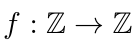：

例 A.1.0.2。存在函数 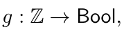，其中 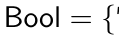 True 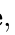 False 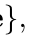，具体定义如下：

True：如果  为偶数；

False：如果 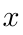 为奇数。

如果 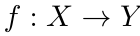 和 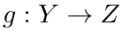 是函数，那么可以将 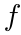 与 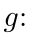 复合。它们的复合是函数 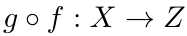，由下式给出：

例 A.1.0.3。如果  与  分别是例 A.1.0.1 和例 A.1.0.2 中的函数，那么其复合 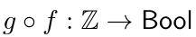 由下式给出：

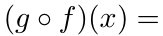 True 

展开原页对照（保留全部图示、代码、标签和数学排版）

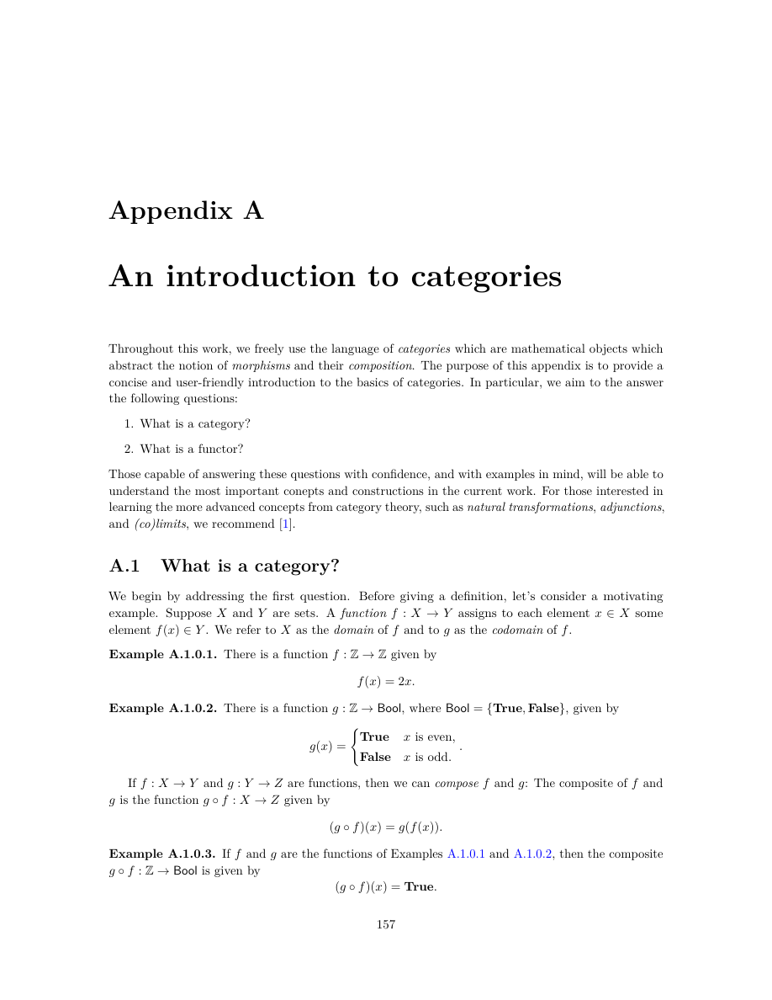

展开本页英文正文

<pre v-pre style="white-space:pre-wrap;overflow-wrap:anywhere">Appendix A

An introduction to categories

Throughout this work, we freely use the language of categories which are mathematical objects which abstract the notion of morphisms and their composition. The purpose of this appendix is to provide a concise and user-friendly introduction to the basics of categories. In particular, we aim to the answer the following questions:

1. What is a category?

2. What is a functor?

Those capable of answering these questions with confidence, and with examples in mind, will be able to understand the most important conepts and constructions in the current work. For those interested in learning the more advanced concepts from category theory, such as natural transformations, adjunctions, and (co)limits, we recommend [1].

A.1 What is a category?

We begin by addressing the first question. Before giving a definition, let’s consider a motivating

example. Suppose X and Y are sets. A function f : X →Y assigns to each element x ∈X some element f(x) ∈Y . We refer to X as the domain of f and to g as the codomain of f.

Example A.1.0.1. There is a function f : Z →Z given by

Example A.1.0.2. There is a function g : Z →Bool, where Bool = {True, False}, given by

True x is even,

False x is odd.

If f : X →Y and g : Y →Z are functions, then we can compose f and g: The composite of f and g is the function g ◦f : X →Z given by

Example A.1.0.3. If f and g are the functions of Examples A.1.0.1 and A.1.0.2, then the composite g ◦f : Z →Bool is given by

(g ◦f)(x) = True.</pre>

## PDF 第 160 页 · 原书第 158 页

函数复合满足两个基本性质。首先，复合满足结合律：如果  与  可复合，且  与 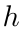 可复合，那么：

其次，每个集合  都有恒等函数 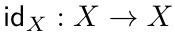，其定义为：

如果 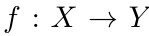 是任意函数，那么在其前面复合 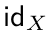，或在其后面复合 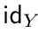，都使函数  保持不变：

在纯数学和应用数学中，我们经常会遇到某一类对象以及这些对象之间的态射，它们具有与集合和函数相同的形式行为：态射可以按照满足结合律的方式复合，而对象具有恒等态射。尽管集合之间的函数是最典型的例子，范畴中的对象却不必是集合，

范畴中的态射也不必是函数。后面我们将看到许多这样的例子。为了刻画这一反复出现的结构，我们定义范畴的概念。

定义 A.1.0.4。范畴 `C` 由以下数据构成：

1. 一类对象：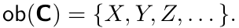。

根据范畴 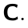 的不同，这些对象可以是集合、元组、数、向量空间、矩阵，或其他某种数学结构。

2. 这些对象之间的一类态射：

`C` 中的每个态射 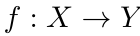 都有一个定义域  和一个陪域 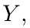，它们都是 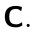 中的对象。

3. 复合规则：如果  与 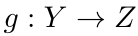 是 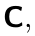 中的态射，那么存在一个态射

称为  与 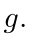 的复合。`C` 中态射的复合满足结合律，即

只要式中的运算有定义，就有上述等式。

4. 恒等态射：如果  是  中的对象，那么存在一个态射

称为 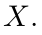 上的恒等态射。如果 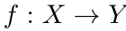 是 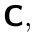 中的任意态射，那么：

下面来看几个重要的范畴例子。我们从引出这一概念的例子开始。

展开原页对照（保留全部图示、代码、标签和数学排版）

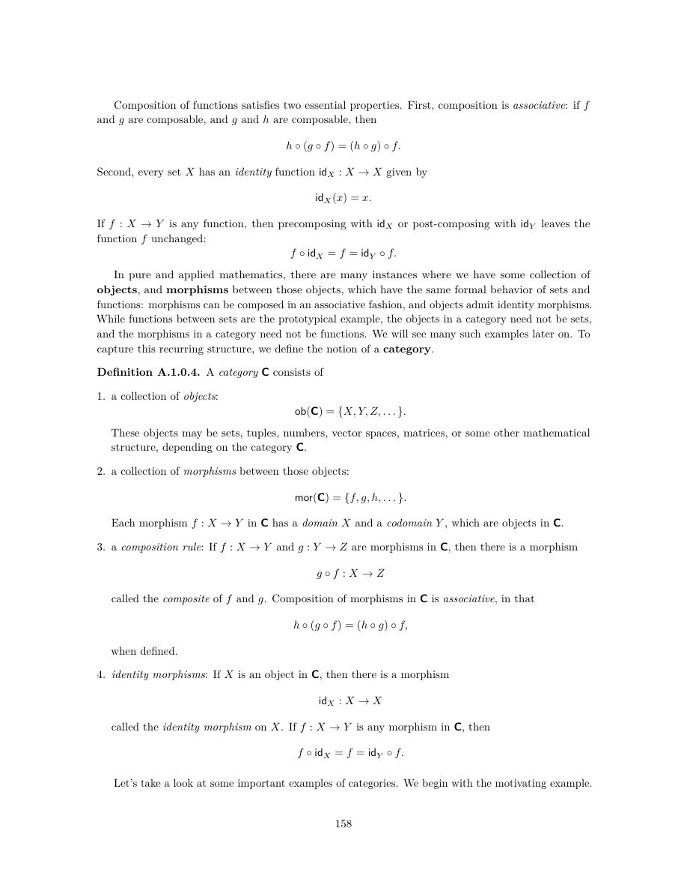

展开本页英文正文

<pre v-pre style="white-space:pre-wrap;overflow-wrap:anywhere">Composition of functions satisfies two essential properties. First, composition is associative: if f and g are composable, and g and h are composable, then

Second, every set X has an identity function idX : X →X given by

If f : X →Y is any function, then precomposing with idX or post-composing with idY leaves the function f unchanged:

In pure and applied mathematics, there are many instances where we have some collection of objects, and morphisms between those objects, which have the same formal behavior of sets and functions: morphisms can be composed in an associative fashion, and objects admit identity morphisms. While functions between sets are the prototypical example, the objects in a category need not be sets,

and the morphisms in a category need not be functions. We will see many such examples later on. To capture this recurring structure, we define the notion of a category.

Definition A.1.0.4. A category C consists of

1. a collection of objects: ob(C) = {X, Y, Z, . . . }.

These objects may be sets, tuples, numbers, vector spaces, matrices, or some other mathematical structure, depending on the category C.

2. a collection of morphisms between those objects:

Each morphism f : X →Y in C has a domain X and a codomain Y , which are objects in C.

3. a composition rule: If f : X →Y and g : Y →Z are morphisms in C, then there is a morphism

called the composite of f and g. Composition of morphisms in C is associative, in that

when defined.

4. identity morphisms: If X is an object in C, then there is a morphism

called the identity morphism on X. If f : X →Y is any morphism in C, then

Let’s take a look at some important examples of categories. We begin with the motivating example.</pre>

## PDF 第 161 页 · 原书第 159 页

例 A.1.0.5。存在一个范畴 `Set`，其对象是集合，态射是函数。态射的复合由函数复合给出：

而集合  上的恒等态射就是恒等函数：

例 A.1.0.6。存在一个范畴 `Vect`，其对象是 n ≥ 0 时的向量空间 ℝⁿ，态射是矩阵。具体地，一个态射

是一个 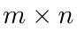 矩阵 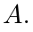。`Vect` 中的复合由矩阵乘积给出：

而 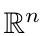 上的恒等态射是下列 n × n 矩阵：

例 A.1.0.7。存在一个范畴 `Div`，其对象是整数 a ≥ 1，并且当 a 整除 b 时，存在唯一的态射

如果 a 整除 b，且 b 整除 c，那么 a 整除 c。这意味着下列复合规则具有良好定义：

并且恒等态射

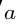 总是存在，因为每个正整数都整除自身。

除了范畴的定义之外，还有几个重要的范畴论概念需要理解。例如，同构这一概念十分重要，它推广了集合的双射概念。

定义 A.1.0.8。设 `C` 是范畴， 是  中的态射。如果 `C` 中存在态射 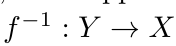，使得以下条件成立，就称  为同构：

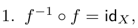，并且

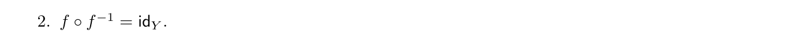

例 A.1.0.9。在范畴 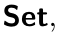 中，同构就是双射：即函数  满足，对于每个 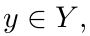，都存在唯一的 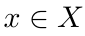，使得 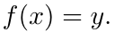。例如，下式定义的函数 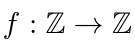

是双射，其逆函数 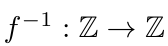 由下式给出：

展开原页对照（保留全部图示、代码、标签和数学排版）

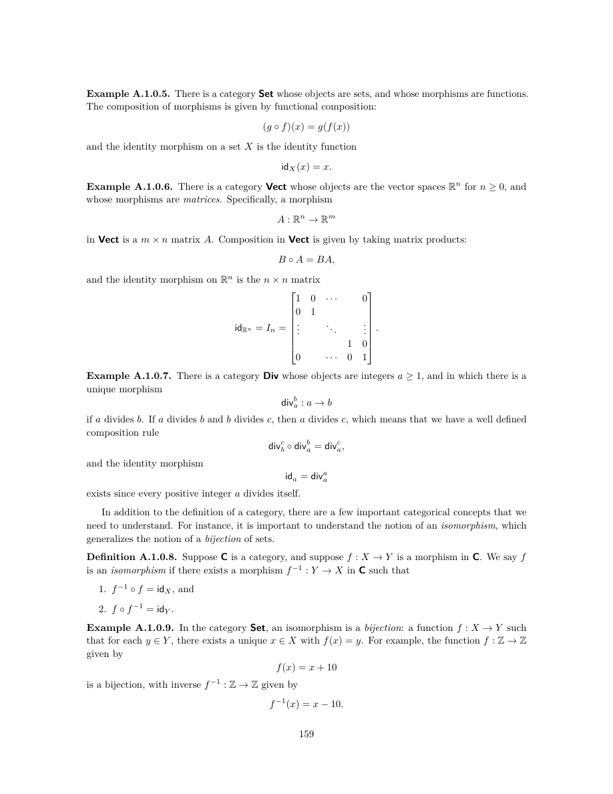

展开本页英文正文

<pre v-pre style="white-space:pre-wrap;overflow-wrap:anywhere">Example A.1.0.5. There is a category Set whose objects are sets, and whose morphisms are functions. The composition of morphisms is given by functional composition:

and the identity morphism on a set X is the identity function

Example A.1.0.6. There is a category Vect whose objects are the vector spaces Rn for n ≥0, and whose morphisms are matrices. Specifically, a morphism

in Vect is a m × n matrix A. Composition in Vect is given by taking matrix products:

and the identity morphism on Rn is the n × n matrix

Example A.1.0.7. There is a category Div whose objects are integers a ≥1, and in which there is a unique morphism

if a divides b. If a divides b and b divides c, then a divides c, which means that we have a well defined composition rule

and the identity morphism

a exists since every positive integer a divides itself.

In addition to the definition of a category, there are a few important categorical concepts that we need to understand. For instance, it is important to understand the notion of an isomorphism, which generalizes the notion of a bijection of sets.

Definition A.1.0.8. Suppose C is a category, and suppose f : X →Y is a morphism in C. We say f is an isomorphism if there exists a morphism f −1 : Y →X in C such that

1. f −1 ◦f = idX, and

Example A.1.0.9. In the category Set, an isomorphism is a bijection: a function f : X →Y such that for each y ∈Y , there exists a unique x ∈X with f(x) = y. For example, the function f : Z →Z given by

is a bijection, with inverse f −1 : Z →Z given by</pre>

## PDF 第 162 页 · 原书第 160 页

例 A.1.0.10。在范畴 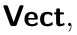 中，同构就是可逆矩阵。例如，下列矩阵

是可逆的，其逆矩阵为：

因为：

例 A.1.0.11。在范畴  中，唯一的同构是恒等态射：

这是因为，如果 a 整除 b，且 b 整除 a，那么 a = b。

### A.2 什么是函子？

接下来，我们转向第二个问题。

定义 A.2.0.1。设 `C` 与 `D` 为范畴。函子 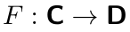 由下列数据构成：

1. 对于  中的每个对象 ，指定  中的一个对象 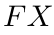；以及

2. 对于  中的每个态射 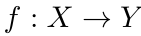，指定一个态射

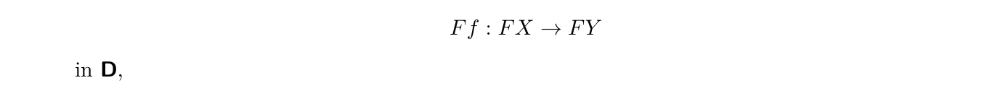

并满足下列性质：

1. F 与复合兼容：如果  和  是  中可复合的态射，那么：

2. F 与恒等态射兼容：如果  是  中的对象，那么：

例 A.2.0.2。存在一个函子 ，其定义如下。在对象上， 由下式给出：

在态射上， 由下式给出：

下面验证  是函子。

1. F 与复合兼容：如果 a 整除 b，且 b 整除 c，那么：

2. F 与恒等态射兼容：如果 a ≥ 1，那么：

展开原页对照（保留全部图示、代码、标签和数学排版）

展开本页英文正文

<pre v-pre style="white-space:pre-wrap;overflow-wrap:anywhere">Example A.1.0.10. In the category Vect, an isomorphism is an invertible matrix. For example, the matrix

is invertible with inverse

since

Example A.1.0.11. In the category Div, the only isomorphisms are the identity morphisms

This is because if a divides b and b divides a, then a = b.

A.2 What is a functor?

Next, we turn our attention to the second question.

Definition A.2.0.1. Suppose C and D are categories. A functor F : C →D consists of

1. for each object X in C, an object FX in D, and

2. for each morphism f : X →Y in C, a morphism

satisfying the following properties:

1. F is compatible with composition: If f and g are composable morphisms in C, then

2. F is compatible with identities: If X is an object in C, then

Example A.2.0.2. There is a functor F : Div →Set defined as follows. On objects, F is given by

and on morphisms, F is given by

Let’s verify that F is a functor.

1. F is compatible with composition: If a divides b and b divides c, then

2. F is compatible with identities: If a ≥1, then</pre>

## PDF 第 163 页 · 原书第 161 页

### 参考文献

[1] Saunders Mac Lane：《工作数学家的范畴论》（Categories for the Working Mathematician）。第 2 版，第 5 卷，Graduate Texts in Mathematics。Springer，1998 年。ISBN：978-0-387-98403-0。

展开原页对照（保留全部图示、代码、标签和数学排版）

展开本页英文正文

<pre v-pre style="white-space:pre-wrap;overflow-wrap:anywhere">Bibliography

[1] Saunders Mac Lane. Categories for the Working Mathematician. 2nd ed. Vol. 5. Graduate Texts in Mathematics. Springer, 1998. isbn: 978-0-387-98403-0.</pre>

---
[译文总目录](Layout.md) · [第 4 章：计算](Translation-10-Computations.md)
