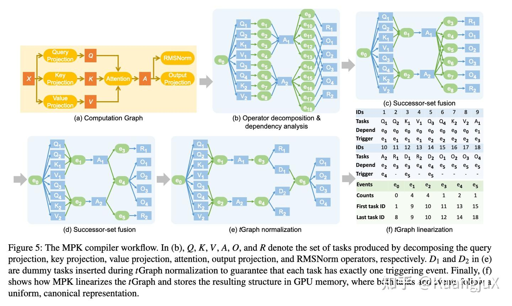
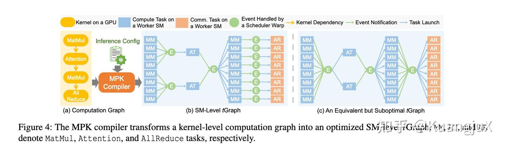
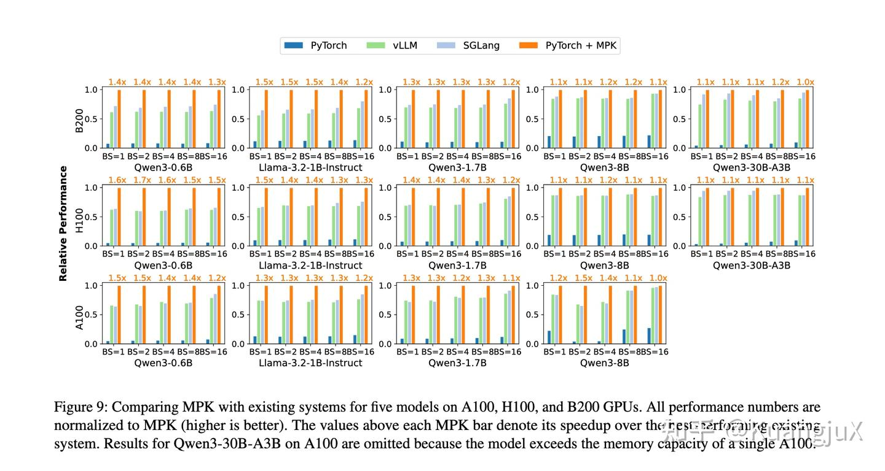

# Mirage Persistent Kernel：任务图与持久化运行时

来源：[个人文章全文归档](../../../Foundations/05_Model_Architecture_and_Reasoning/Research-Reviews/llm-2025.md)。

背景是小 batch 推理的算子边界、启动与尾效应；核心是将计算和通信变为可由持久化 GPU 运行时调度的任务。

## 整理与复习

- tGraph 的任务／事件用于表达局部依赖，不应把所有任务都理解成 CUDA grid 的完整算子。
- 原总结的“1–1.7 倍”没有统一指定基线、硬件和模型，不能作通用加速比引用。
- 讨论“MPK 参考了谁”的历史关系需要作者或引用证据，不能由发布时间先后直接推出。

## 原笔记相关章节

#### Mirage Persistent Kernel[8](https://zhuanlan.zhihu.com/p/1994788371738949558#ref_8)

MPK 的一个主要目的是自动将多 GPU 模型推理转化为单个 MegaKernel，通过所重新设计计算表示与运行时系统解决上述问题，其核心思想可以概括为：**以 GPU 流多处理器（SM）为粒度拆分任务，用细粒度依赖调度替代粗粒度内核同步。**MPK 这个项目主要是依赖于 Mirage[9](https://zhuanlan.zhihu.com/p/1994788371738949558#ref_9) 这个编译器做的。

MPK 编译器工作流

MPK 这篇论文提出了 `tGraph` 这个概念，以 SM 为最小单位，将模型的计算和通信拆成了 SM-level Task 和 Event。Task 表示的是单个 SM 可独立执行的最小单元，例如矩阵乘法子块，注意力子块以及 AllReduce 子块传输，Event 代表任务间的同步信号，仅当所有前置任务完成时激活，触发下游任务执行。

MPK 通过一系列关键的优化，例如：

- 分页共享内存：将共享内存划分为固定页面，任务按需申请 / 释放，支持跨任务数据预取与零拷贝复用；
- 跨任务软件流水线：重叠当前任务的计算阶段与下一个任务的数据预加载阶段，隐藏访存延迟；
- 内核内通信：多 GPU 场景下，用 NVSHMEM 实现跨 GPU 通信任务，与计算任务细粒度重叠（无需启动 NCCL 内核）。

将整个模型 fuse 成一个 MegaKernel。

MPK 讲一个内核级计算转换成 SM 级 tGraph

最终平均实现 1 - 1.7 倍的性能提升，且在低延迟场景（小 bs）、多 GPU 扩展场景中优势最突出，本质是通过细粒度调度消除了传统框架的结构性开销。

MPK 性能评估
