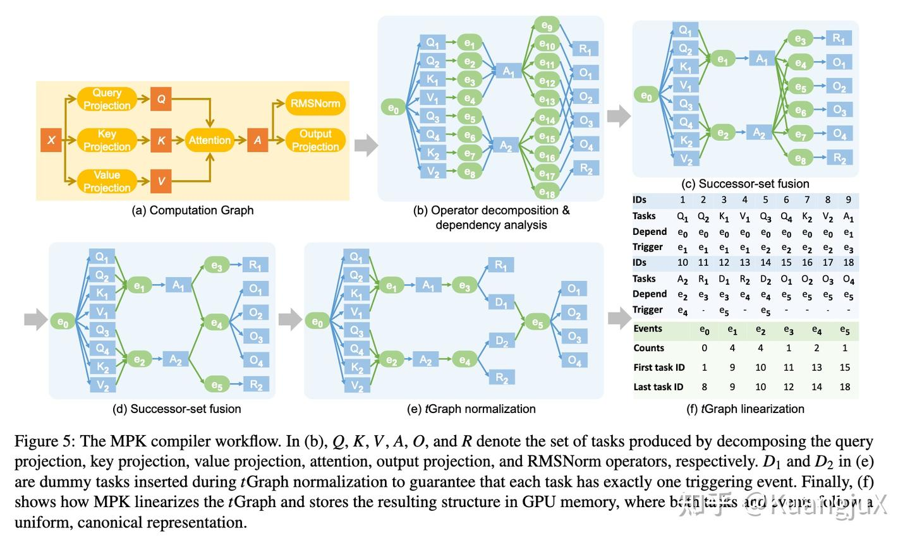
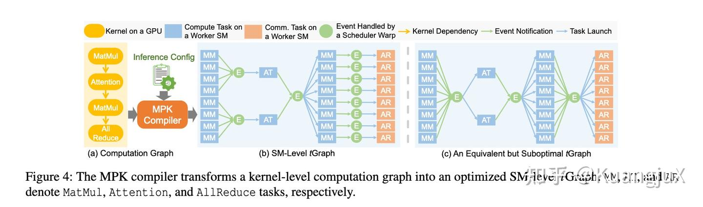
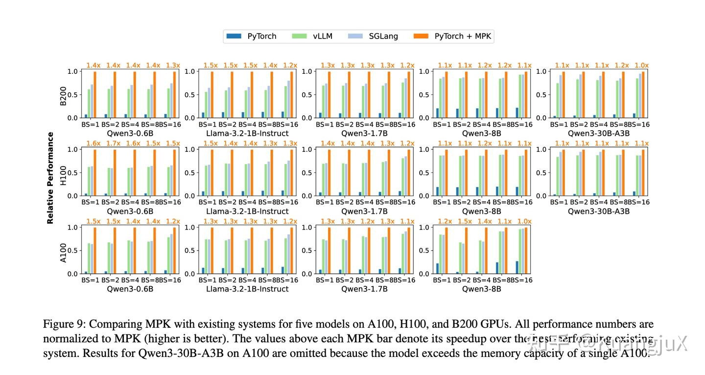

# Mirage Persistent Kernel：任务图与持久化运行时

小 batch 推理中，kernel 启动、算子边界和尾效应会妨碍 GPU 持续执行。Mirage Persistent Kernel（MPK）将模型的计算与通信组织成细粒度任务，由持久化 GPU 运行时根据依赖调度。[原始讨论与参考链接](../../../Foundations/05_Model_Architecture_and_Reasoning/Research-Reviews/llm-2025.md)

## tGraph 将完整算子拆成可独立执行的任务

MPK 基于 Mirage 编译器，将模型转为由 Task 和 Event 组成的 tGraph。Task 对应单个 SM 可执行的工作，例如矩阵乘、attention 或 AllReduce 的子块；Event 表达前置任务完成条件，并据此触发后继任务。任务粒度因此不必等同于一个完整 CUDA grid。

## 运行时如何复用资源并重叠工作

1. **分页共享内存。** 将 shared memory 切成固定页面，由任务申请和释放，为预取与跨任务复用提供空间管理。
2. **跨任务软件流水线。** 当前任务计算时准备后继任务的数据，减少独立 kernel 边界造成的空隙。
3. **内核内通信。** 多 GPU 路径使用 NVSHMEM 执行通信任务，使其与计算按细粒度依赖交叠。

把模型执行融合进持久化 kernel 后，调度、资源管理与依赖通知也进入运行时；减少 kernel 边界不代表这些成本消失。

## 性能记录的范围

原始讨论记录了约 1–1.7× 的性能范围，并指出小 batch、多 GPU 场景的收益。该范围没有在文字中统一绑定模型、硬件和基线，不能作为一般加速比。与 [Llama-1B Megakernel](../Megakernels/zhihu-reading.md) 的设计相似性可以用于对照，但是否存在直接借鉴关系仍需作者或引用证据。
