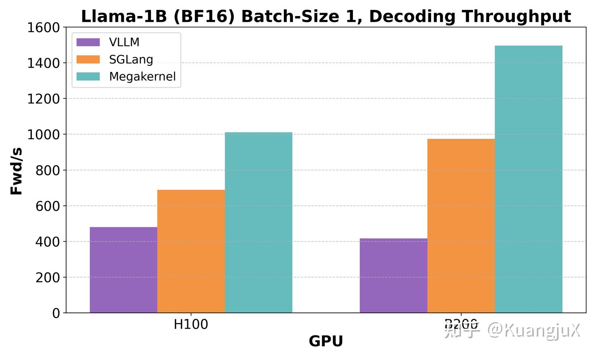

# Look Ma, No Bubbles!：Llama-1B Megakernel 阅读摘记

Llama-3.2-1B 的单序列解码需要不断加载模型权重。拆成大量小 kernel 后，每次准备、收尾与边界同步都可能让访存停顿。Hazy Research 用 ThunderKittens 将一次前向组织成 Megakernel，以跨算子资源复用和同步减少这些间隙。[原始博文](https://hazyresearch.stanford.edu/blog/2025-05-27-no-bubbles)

博文的 Figure 1 使用 32-token prompt、生成 128 tokens、无投机解码；H100 上报告 78% 的显存带宽利用率，以及相对所比较系统超过 1.5× 的速度。这是特定模型、batch size 1 与实现条件下的结果；原始讨论还涉及 B200，不能将不同 GPU 的结果混用。

与 [MPK](../MPK/zhihu-reading.md) 相比，这项工作聚焦特定模型的实现，MPK 则通过 Mirage 的任务图和运行时组织执行。前者的结果不能单独证明通用编译器能够自动达到同样性能。

原笔记曾推测 MPK 参考了该工作；这一历史关系尚无作者或引用证据，保留为个人疑问。[原始讨论](../../../Foundations/05_Model_Architecture_and_Reasoning/Research-Reviews/llm-2025.md)
