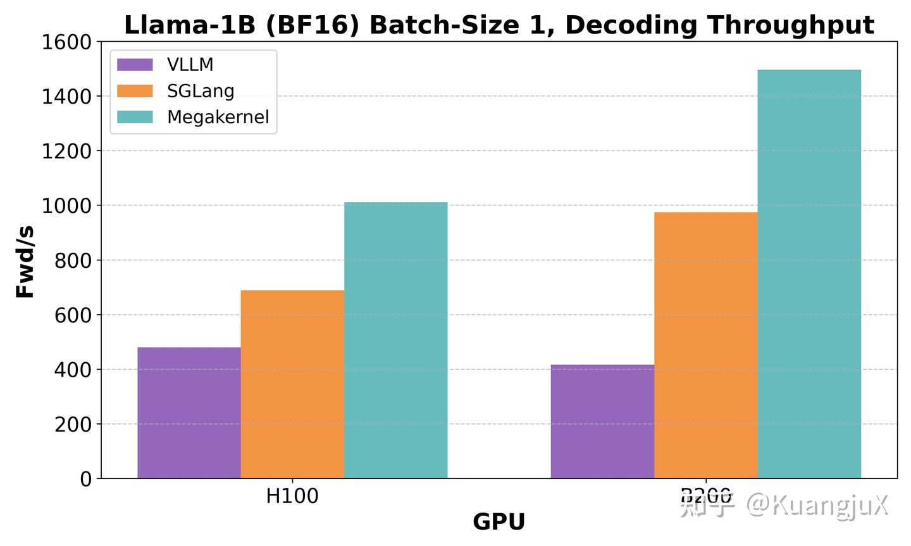

# Look Ma, No Bubbles!：Llama-1B Megakernel 阅读摘记

来源：[个人文章全文归档](../../../Foundations/05_Model_Architecture_and_Reasoning/Research-Reviews/llm-2025.md)。

原记录关注用 ThunderKittens 将模型计算组织成低延迟 Megakernel。

## 整理与复习

- 原始来源：[Hazy Research 博文](https://hazyresearch.stanford.edu/blog/2025-05-27-no-bubbles)。
- 本文保留年度总结摘记；未把实验性模型实现扩写成通用编译器能力。原文与 MPK 的优先权关系需要独立证据。
- 旧文中的性能比较应绑定 Llama-1B、batch size 1、具体 GPU 与服务框架版本，不能跨模型直接套用。

## 原笔记相关章节

#### Look Ma, No Bubbles! Designing a Low-Latency Megakernel for Llama-1B[10](https://zhuanlan.zhihu.com/p/1994788371738949558#ref_10)

同时，Hazy Research Lab 也发布了一篇 Blog 利用 ThunderKittens[11](https://zhuanlan.zhihu.com/p/1994788371738949558#ref_11) 做了这个工作，将 Llama-1B[12](https://zhuanlan.zhihu.com/p/1994788371738949558#ref_12) fuse 成了一个巨型内核。理论上来说 Hazy Research Lab 是第一个做这个工作的，MPK 应该在很大程度上参考了这篇工作。这篇 Blog 的整体思路应该是和 MPK 差不多的，但是 MPK 是将整个的思路做到了他们的 mirage 上，而这篇 Blog 则是采用 ThunderKittens 这个 DSL 来进行实现。

相比于 MPK，MegaKernels 可能算是一个比较实验性的实现，并没有对太多的 DNN Workload 进行评估，主要在单卡 H100/B200 针对 Llama-1B 进行评估，在 bsz=1 的情况下相比于 vLLM 和 SGLang 有巨大的提升。
