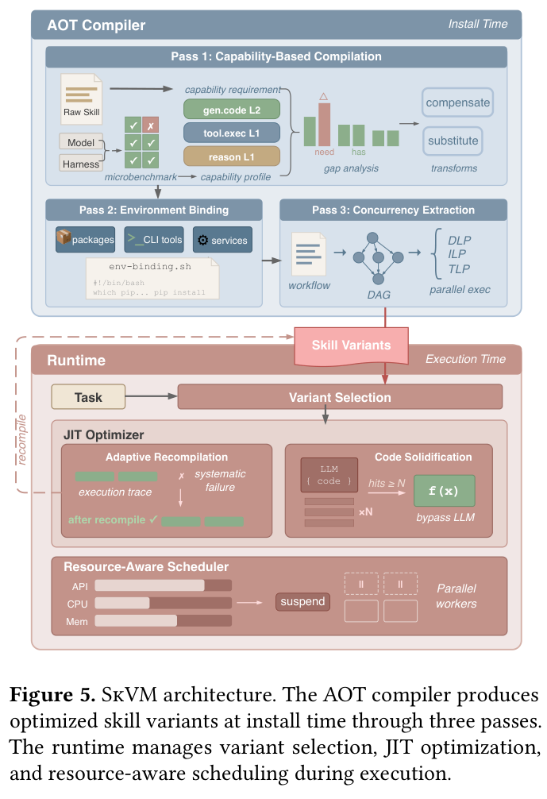
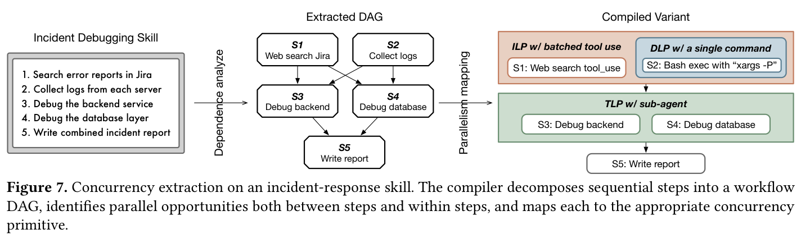
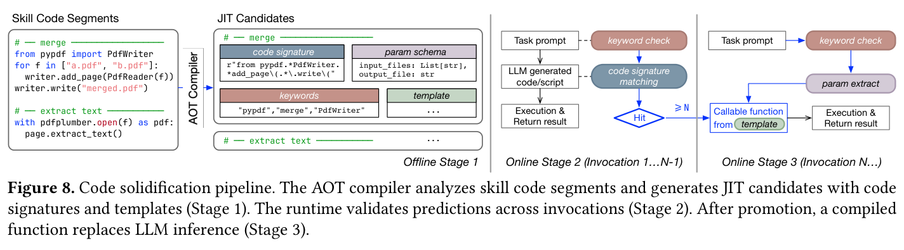
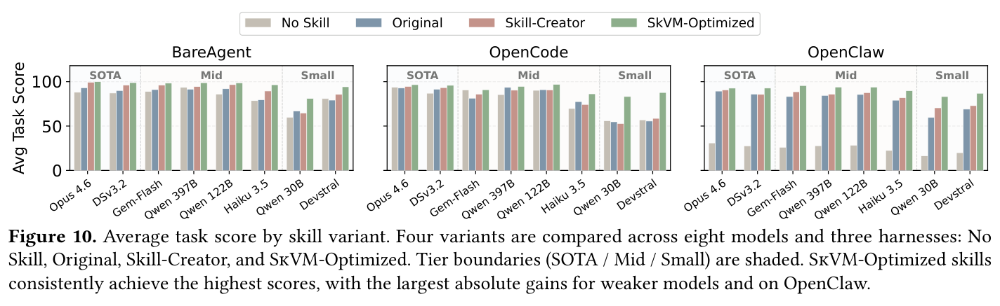

---
tags:
  - papers/agent-systems
aliases:
  - "SkVM"
date: 2026-04-11
doi: 10.48550/arXiv.2604.03088
---

# SkillRT（SkVM）：让技能适配不同模型与执行框架

同一份技能文本可能在一个模型上有效，换一个模型或工具框架后却失败。SkillRT 把技能需求与目标能力显式对齐：执行前改写技能、绑定环境并提取并发，执行中再根据失败反馈和重复代码模式优化。

[论文：arXiv:2604.03088v1](https://arxiv.org/html/2604.03088v1) 的公开标题为 *SkillRT: Compiling Skills for Efficient Execution Everywhere*（早期别名 SkVM）。

## 从上下文注入到目标适配

智能体技能生态系统面临一个根本性矛盾：技能作为自然语言编写的领域知识，被设计为跨平台共享的可复用单元，但当前系统将技能仅作为额外的上下文注入模型提示，缺乏任何编译或适配机制。

具体而言，论文识别了三类不匹配问题：

- **P1 模型能力不匹配**：技能假设的能力（如复杂 shell 管道、多步推理）可能超出目标模型的实际能力。在八个模型上的实验显示，启用技能在 15% 的任务上反而导致性能下降（Opus 4.6 为 7%，Qwen3-30B 高达 25%）。
- **P2 框架不匹配**：不同智能体框架（harness）提供的工具集和执行能力差异显著。BareAgent 仅提供最小化的系统提示注入，OpenCode 提供丰富的代码执行工具，OpenClaw 支持复杂的多步任务编排。同一技能在不同框架上表现差异巨大。
- **P3 环境不匹配**：技能依赖的外部库、命令行工具或系统服务可能在目标环境中不可用，弱模型往往无法自行解决依赖缺失问题。

这些问题使技能优化不仅涉及措辞，还涉及目标能力、工具接口与环境依赖。

## 用原始能力描述技能需求

论文从两个主流分发平台收集了 118,000+ 技能：clawhub.ai（28,990 个）和 skills.sh（89,280 个）。分析发现技能生态极度不均衡——skills.sh 上 89% 的技能下载量不足 86 次，大量技能实际上从未被有效使用。

从 15,063 个技能中，通过两阶段流程提取了 26 个原始能力，分布在四大类别中。典型示例：

| 原始能力 | 低级 | 中级 | 高级 |
|---|---|---|---|
| `gen.code.shell` | 基础命令（`ls`, `cat`） | 管道、重定向、循环 | 复杂管线（`sed`, `awk`） |
| `reason.arithmetic` | 单步运算 | 多步运算 | 复合运算 |
| `tool.exec` | 单个命令 | 带参数和相对路径 | 链式多步执行 |
| `follow.procedure` | 3 步顺序执行 | 5–7 步含分支 | 循环和验证 |

每个原始能力须出现在至少 1% 的语料中才会被纳入，以排除稀有的领域特定需求。

## 一次技能从安装到执行的路径

SkillRT 的核心架构由两大部分组成：AOT 编译器和运行时系统。整体执行链如下：

1. **技能安装时的 AOT 编译**：用户首次安装技能时，AOT 编译器分析技能文本，针对目标（模型、框架、宿主环境）生成一个或多个优化后的技能变体。编译分三趟执行，每趟闭合一种特定的差距。

2. **运行时变体选择与执行**：任务到达时，运行时根据当前（模型、框架）组合选择对应的编译变体，通过渐进式披露机制加载。执行过程中，JIT 优化器监控执行结果，代码固化器将高频模式编译为可直接调用的函数。

3. **自适应重编译**：当 JIT 检测到 AOT 编译遗漏的能力差距或系统性失败时，触发重编译——将积累的失败日志和模型自恢复轨迹作为输入反馈给编译器，生成针对性的补偿变换。

4. **资源感知调度**：并发提取产生的并行注解在运行时与实际资源可用性对接，调度器在需求超过容量时节流或挂起并发子智能体。

## 执行前：能力改写、环境绑定与并发提取

**第一趟：基于能力的编译。** 编译器离线为每个目标运行微基准测试，获得目标的能力画像（capability profile）。将画像与技能的能力需求进行差距分析（gap analysis），根据差距类型选择优化策略：

- 对于目标"具备但较弱"的能力，进行**补偿变换**——例如将复杂 shell 管线拆分为多个简单步骤。
- 对于目标"完全不具备"的能力，进行**替代变换**——例如将 shell 脚本改写为 Python 调用。

这里的关键设计是原始能力定义在需求侧，独立于任何具体模型，这使得编译器无需为每个模型硬编码优化逻辑。

**第二趟：环境绑定。** 编译器从第一趟输出的技能和显式的前置条件中提取依赖清单（外部库、命令行工具、系统服务），然后生成环境绑定脚本，确保运行时依赖项已满足。

**第三趟：并发提取。** 编译器将技能中的子任务改写为独立的子智能体块（sub-agent block），每个块有明确的任务描述、声明的输入上下文和预期输出。编译器在三个粒度上提取并行性——数据级并行（DLP）、指令级并行（ILP）和线程级并行（TLP）——类比传统编译器中的并行性提取。

## 执行中：把重复代码固化，并约束并发资源

代码固化（code solidification）是 SkillRT 最具工程洞察力的优化之一。核心观察是：智能体在执行技能时，经常让大语言模型反复生成结构几乎相同的代码片段（如 PDF 合并脚本、SQL 查询模板）。SkillRT 的处理分三个阶段：

1. **离线阶段**：AOT 编译器分析技能中的代码段，用正则表达式签名识别潜在的 JIT 候选。
2. **在线学习阶段**（前 N-1 次调用）：每次大语言模型生成代码时，运行时用关键字检查和代码签名匹配来判断是否命中已知候选。命中后记录实际代码。
3. **在线执行阶段**（第 N 次及之后）：当同一候选被命中足够多次后，运行时将其固化为可调用函数模板。后续调用直接抽取参数、填充模板并执行，完全绕过大语言模型推理。

### 调度不能超出运行时资源

并发提取在编译时注入了并行性注解，但实际的 API 并发限制、CPU/内存可用性在运行时才可知。资源感知调度器做两件事：

- **节流**：当资源紧张时，推迟新子智能体的启动，避免引入额外的并发压力。
- **选择性挂起**：对已运行的子智能体，SkillRT 选择性地挂起部分子智能体以释放资源给更关键的任务。

## 实验：完成率、token 与延迟分别说明什么

### 评估对象与口径

评估任务来自 SkillsBench 和 PinchBench 的扩展集，涵盖代码生成、数据分析、文档创建和系统管理等 14 个任务类别。每个任务生成 5 个多样化输入实例，测量平均任务完成率、词元消耗和端到端延迟。

生态统计中的 118,000 多份技能不等于全部评测任务；“15% 退化”来自任务实验，不能解释成整个技能生态的有害比例。

### 编译有效性

Fig. 9 和 Fig. 10 展示了 SkillRT 优化技能在八个模型和三个框架上的效果。核心发现：

- **图中汇总分数显示优化技能在各模型—框架组合上有优势**，尤其在弱模型上提升最大。在 BareAgent 上，SkillRT 比 Skill-Creator 为 Qwen3-30B 提升了 25%，为 Devstral-Small 提升了 10%。
- **原始技能反而有害的问题被有效解决**：未优化的原始技能在 14 个类别中有 11 个表现不如完全不使用技能，而 SkillRT 优化后大幅逆转了这一趋势。
- **模型能力越弱，SkillRT 的增益越大**，这符合编译优化在弱处理器上价值更高的直觉。

### 渐进优化分解

Fig. 11 展示了 14 个任务类别在六个优化阶段（无技能 → 原始技能 → AOT 编译 → JIT 第一轮 → JIT 第二轮 → JIT 第三轮）的得分变化。关键观察：

- AOT 编译本身就带来了显著提升，但部分任务在 AOT 后仍有回归。
- JIT 的三轮迭代逐步修复了 AOT 遗漏的问题。例如某个任务中 AOT 编译后的技能触发了 Python 环境路径错误，经过三轮 JIT 修复后才最终解决。
- 这验证了 AOT + JIT 互补的设计合理性。

### 效率优化

- **词元消耗降低高达 40%**：编译后的技能结构更紧凑，减少了冗余的半结构化代码片段和工作流格式。
- **代码固化延迟降低 19–50 倍**：高频代码模式被固化后完全绕过大语言模型推理。
- **并发执行加速高达 3.2 倍**：通过编译时并发提取和运行时资源调度，将原本顺序执行的子任务并行化。

### 负面发现

汇总优势仍需与具体任务上的回归分开：

- Fig. 12 的散点图显示，少数模型-框架组合出现了"质量下降但词元减少"或"质量下降且词元增加"的情况，说明 SkillRT 的编译并非在所有组合上都正面。
- 对于 SOTA 级别的模型（如 Opus 4.6），SkillRT 的改进空间本身就有限（原始技能的退化幅度只有 7%），编译的边际收益不大。

## 编译类比的边界与成本

**个人理解。** 可复用的部分是需求侧的能力词汇表，以及编译期适配和运行期反馈的分工。这里的 primitive capabilities 是能力分类，不是具有指令语义的字节码；任务成功率和失败回滚仍是必要的验证依据。

AOT 处理可提前识别的能力与环境差距，JIT 利用执行反馈处理动态失败，这一分工与传统编译器相似。但自然语言改写没有形式化的语义等价保证；多次编译同一技能可能得到不同变体，回滚与多趟优化只能缓解非确定性，不能消除它。

1. **编译成本**：AOT 编译需要调用大语言模型，产生词元成本。论文论证这些成本可以在多次调用中摊销，编译产物也可以跨用户共享，但对于仅使用少次的技能，编译成本可能不值得。

2. **能力覆盖的可扩展性**：当前的 26 个原始能力覆盖了 15,063 个技能，但随着技能生态持续增长和多样化，需要持续维护和扩展能力目录。论文提出可以迭代扩展，但这本身是一个需要持续投入的工程问题。

3. **评估局限**：实验仅在三个开源框架上进行，且所有实验在单一硬件（Mac Mini M4 16GB）上完成。尚不清楚结论是否能推广到更大规模的生产环境和更多样的框架。

4. **缺少与更多基线的对比**：论文仅对比了 No Skill、Original、Skill-Creator 三个基线。如果有更多基于提示工程或微调的技能优化方法作为对比，结论会更有说服力。
