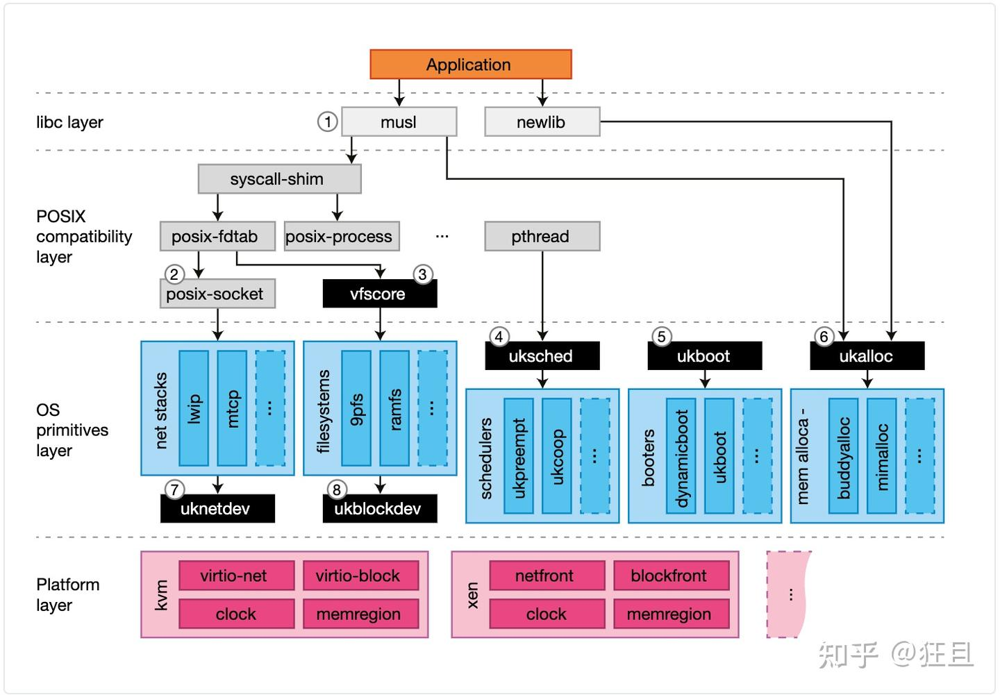
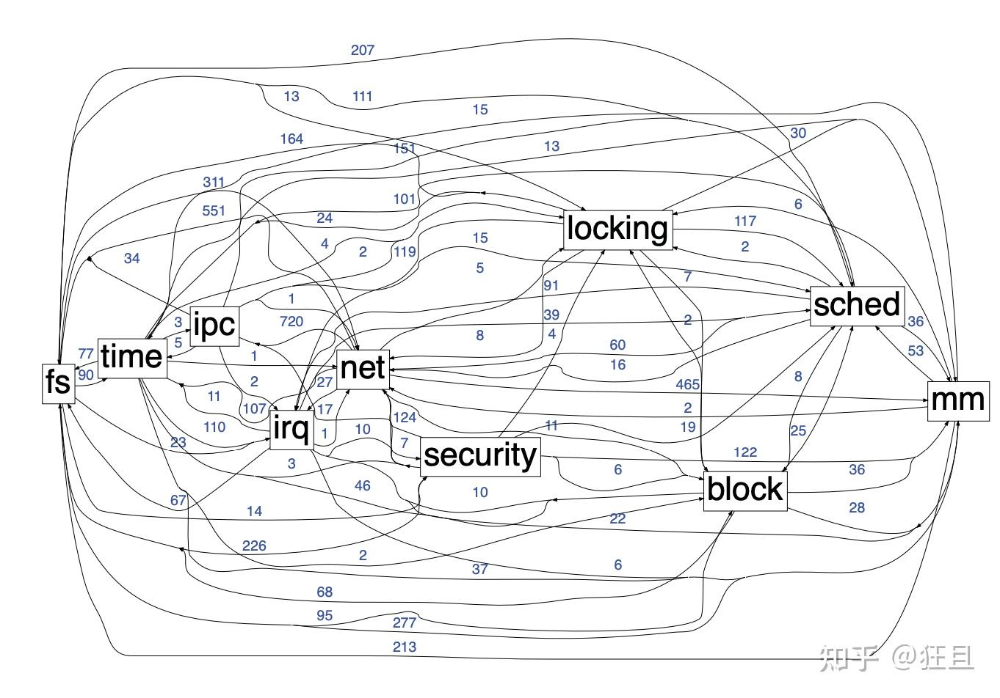
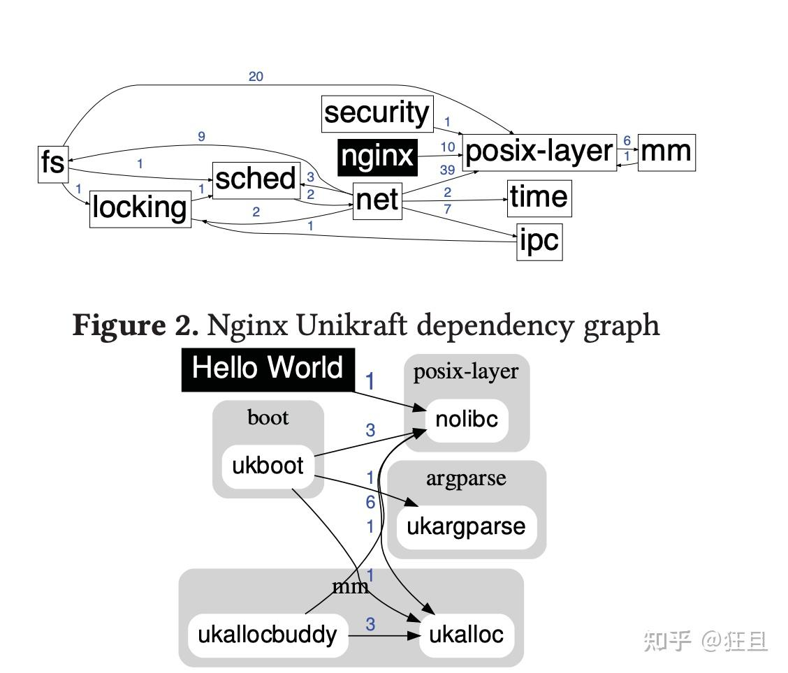

# Unikraft：模块化 library OS 与专用内核

来源：[个人文章全文归档](../../../../Foundations/06_Computing_Foundations/Systems/Virtualization/Unikernel/zhihu-reading.md)；本文从原文章节拆出，2026-10-22 整理。

从单应用的专用化需求理解 Unikraft 的 micro-libraries、构建配置与平台抽象。

## 整理与复习

- 论文：[Unikraft: Fast, Specialized Unikernels the Easy Way](https://dl.acm.org/doi/10.1145/3447786.3456248)。
- 原记录聚焦设计，没有给出定量实验设置；“性能更高”“更安全”是设计动机与历史判断，不能脱离配置与威胁模型视为保证。
- “所有 micro-libraries 实现相同 API”措辞过宽：应按各自功能和组件边界理解接口。
- ArceOS 的构建实践已拆到 [项目笔记](../../../../Projects/06_Computing_Foundations/ArceOS/unikernel-build.md)。

## 原笔记相关章节

### Unikraft

相对于传统操作系统，使用unikernel有以下优势：

1. 更高的性能：unikernel是专门为应用程序设计的，因此它们可以提供比传统操作系统更高的性能。unikernel只包含应用程序所需的最小代码和资源，这使得它们非常高效。
2. 更快的启动时间：由于unikernel只包含应用程序所需的最小代码和资源，因此它们可以在非常短的时间内启动。这使得它们非常适合需要快速启动时间的场景。
3. 更少的内存消耗：由于unikernel只包含应用程序所需的最小代码和资源，因此它们需要比传统操作系统更少的内存。这使得它们非常适合在资源受限环境中运行。
4. 更好的安全性：由于unikernel只包含应用程序所需的最小代码和资源，因此它们具有比传统操作系统更小的攻击面。这使得它们更难受到攻击。
5. 更容易管理：由于unikernel是专门为应用程序设计的，因此它们通常比传统操作系统更容易管理。这使得它们非常适合在云环境中运行。

#### Uniraft 结构

- Library Components
- Configuration
- Build Tools

#### Unikraft Libraries

- Core libraries: memory allocators, schedulers, filesystems, network stacks and drivers
- External libraries: libc, openssl

#### 设计理念

对于每个单应用创造特定的内核以确保最佳性能：

- 单地址空间：针对单一应用场景，可以通过网络通信使不同的应用程序相互交流。
- 全模块化系统：所有组件，包括操作系统原语，驱动，平台和库应当容易添加和删除。
- 单保护级别：没有 user/kernel 空间隔离，因此避免了处理器上下文切换的开销，但是不排除隔离（例如，微型库的隔离）。
- 静态链接：开启编译器特性。
- POSIX 支持
- 平台抽象：可以生成一系列不同的 hypervisors/VMMs 的镜像

#### 结构

使用模块化来构建专用内核，将操作系统功能分为细粒度组件，并仅通过明确定义的 API 进行通信。通过仔细的 API 设计和静态链接，而不是为了性能而缩短 API 边界可以提高性能。以下是两个主要部分：

- Micro-libraries 是实现了核心 Unikraft APIs 的软件组件；我们将它们拆分成库并且它们有最小的依赖且可以任意小。所有 micro-librarys 实现了相同的 API。除此之外，Unikraft 还支持能够从外部项目（OpenSSL,musl,Protobuf 等等），应用(Redis, SQLite 等等)提供的功能，甚至是平台（Solo5,Firecracker,树莓派3）。
- Build-system：用户提供编译哪个组件。

Unikraft 可以通过以下两种方式来提升性能：

- 使用修改过的应用，通过消除 syscall 开销，减少 image 大小和内存消耗，并且通过选择有效率的内存分配器。
- 专用化，通过将应用程序适配到更低级 API，以利用性能优势，尤其是对于寻求高性能磁盘 IO 吞吐量的数据库应用程序而言。

linux 各模块间依赖关系：

unikraft Hello World 应用程序中各模块间依赖关系：

