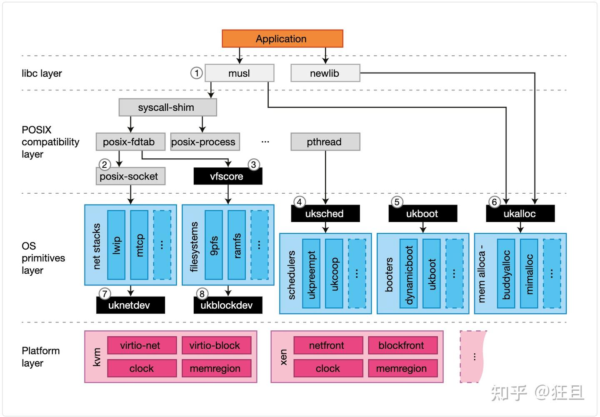
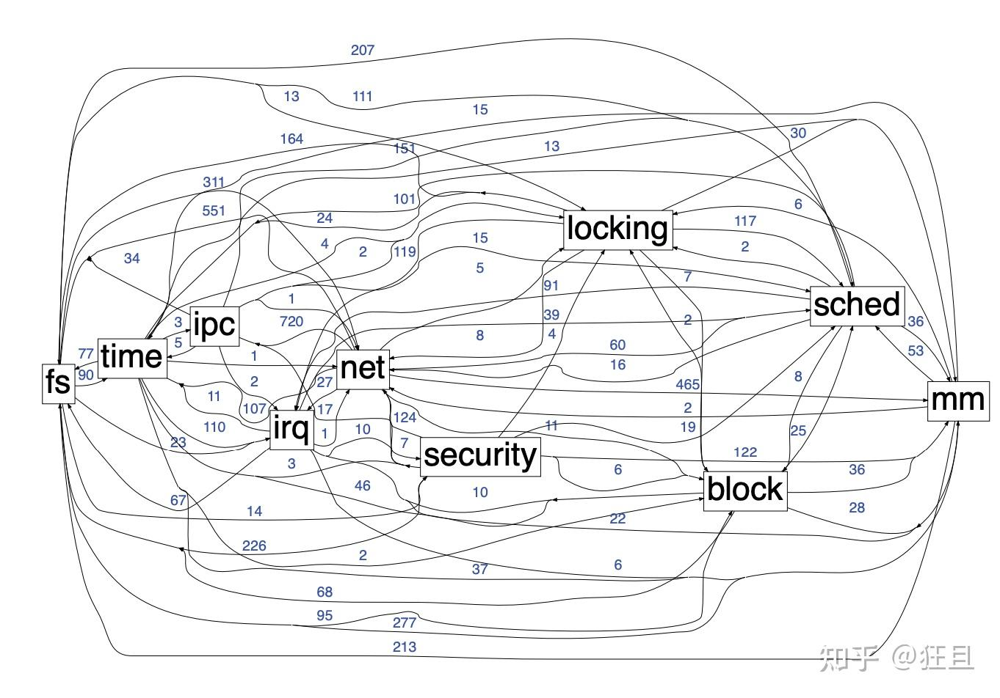
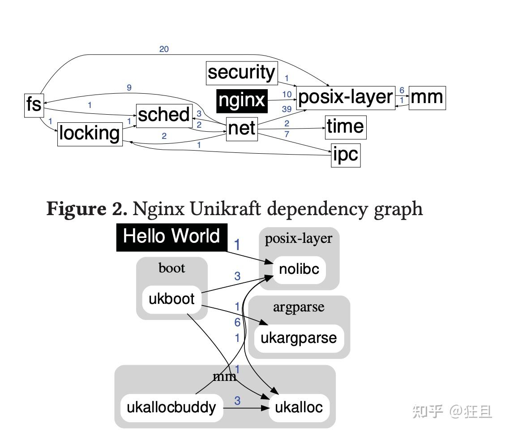

# Unikraft：模块化 library OS 与专用内核

Unikraft 针对单个应用构建专用内核：把操作系统功能拆成 micro-libraries，只选择所需组件，并与应用静态链接。减少无用代码、系统调用边界和资源占用是其设计动机，实际性能与隔离能力仍取决于组件、平台和威胁模型。[论文](https://dl.acm.org/doi/10.1145/3447786.3456248)；[原始讨论](../../../../Foundations/06_Computing_Foundations/Systems/Virtualization/Unikernel/zhihu-reading.md)

## 用组件接口连接应用、库与平台

- **核心库**提供分配器、调度器、文件系统、网络栈与驱动。
- **外部库与应用**接入 libc、OpenSSL、musl、Protobuf，以及 Redis、SQLite 等已有软件。
- **平台抽象**面向不同 hypervisor、VMM 和硬件平台。
- **配置与构建系统**选择组件、解析依赖并生成镜像。

各 micro-library 按功能边界提供明确 API，并非所有库都实现同一套 API。保留接口边界便于替换组件，静态链接与编译优化再处理跨组件调用。

## 专用化带来的收益与约束

单应用通常运行于单地址空间、单保护级别，避免传统 user/kernel 边界的切换；这也意味着不能直接沿用通用操作系统的进程隔离假设。不同实例可以通过网络通信，组件内的其他隔离方式则需要单独设计。

POSIX 支持让既有应用能够接入；进一步改造应用、调用较低层 API、选择合适分配器，可以减少 syscall 开销、镜像大小或内存消耗。高吞吐 IO 应用也可以围绕专用接口优化，但兼容性、可移植性与修改成本需要一起考虑。

减少代码和依赖为更快启动、更小内存占用及较小攻击面创造条件，不自动保证所有应用都更快、更安全或更易管理。

两张依赖图用于比较组件选择的范围，不能替代运行时性能实验。相关构建实践见 [ArceOS 项目笔记](../../../../Projects/06_Computing_Foundations/ArceOS/unikernel-build.md)。
