# Security and Performance in the Delegated User-level Virtualization

## 内核虚拟化组件的权限与退出开销

KVM/QEMU 将虚拟化功能分布在内核与用户态，硬件虚拟化减少了指令模拟开销，但内核组件的漏洞仍可能影响整个宿主机。DuVisor 要将每个 VM 的运行时管理（VM plane）下放到用户态，同时将资源分配与隔离留给内核中的小型 DV-driver。[论文 §2–3](https://www.usenix.org/system/files/osdi23-chen.pdf)

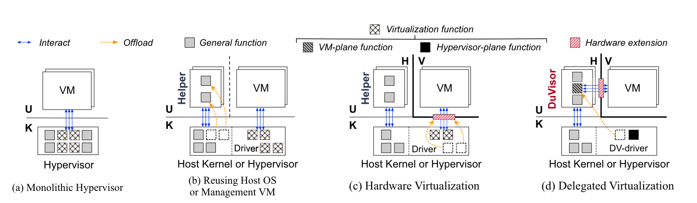

仅把软件搬到用户态无法完成这一目标：传统硬件要求在内核配置第二阶段页表；直接放开权限又可能让用户进程映射其他 VM 的内存；VM exit 经内核转发给用户态、再经内核返回 guest，也会增加模式切换。因此需要同时改变硬件接口、内存访问约束和 VM exit 的交付路径。

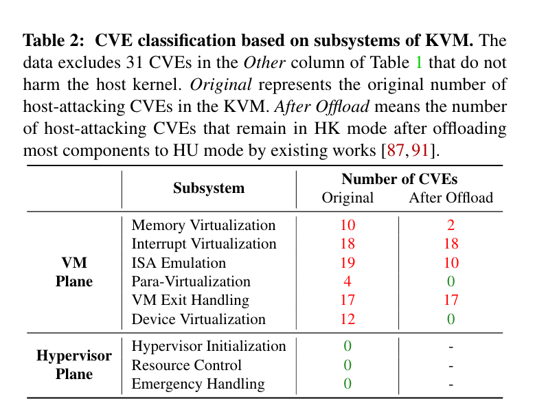

已有的降权方案 NOVA、DeHype 等仍需内核访问特权接口，因而保留部分内核攻击面，也增加 VM 与用户态处理程序之间的切换。

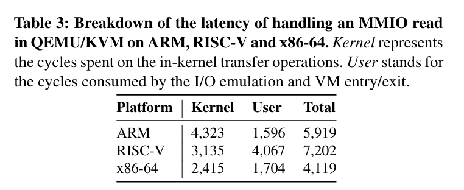

## DV-Ext 如何把 VM plane 下放到用户态

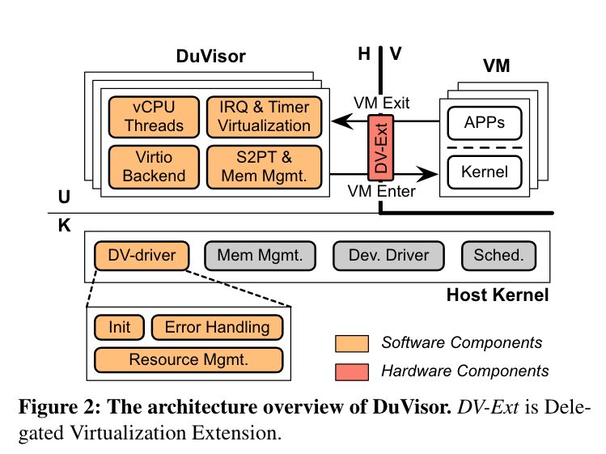

Delegated virtualization 将每台 VM 的运行路径与全局资源控制分开，包含三个部分：

- DV-Ext
- per-VM DuVisor hypervisor process
- global DV-driver in the kernel

DV-Ext 必须安装在硬件上，它授权 host kernel 是否将硬件虚拟化代理到 HU mode。如果开启了代理模式，非特权软件就可以访问硬件虚拟化接口而无需陷入 kernel。如果未启用，DV-Ext 和传统虚拟化一致。

HU-mode DuVisor 利用 DV-Ext 暴露的硬件接口控制未修改的 VM。为了支持 VM 的正常执行，DuVisor 动态虚拟化物理资源处理 VM exits。此外，为了支持 HU-mode 下的内存虚拟化。DuVisor 为 VM 构建第二阶段页表。如果第二阶段页表映射丢失或者无效，它将会动态更新和添加 entries。

一个 tiny DV-driver 被嵌入到 host-kernel 中作为 Hypervisor-Plane，偶尔参与 DuVisor 的物理资源管理，不会干扰 runtime VM exits。DV-driver 使用 DV-Ext 来 enable/disable 委托模式和分配资源。为了降低安全风险，它还限制 DuVisor 的物理内存 view 并处理紧急情况。

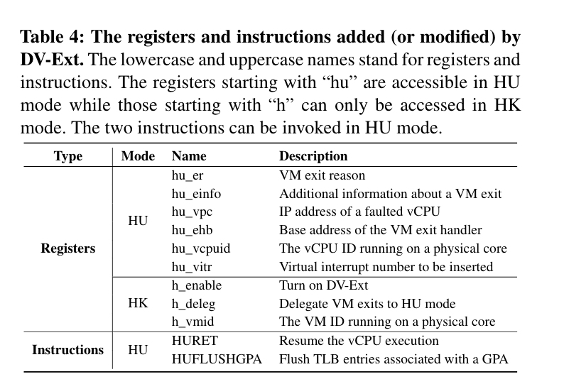

### Delegated Virtualization Extension

DV-Ext 将寄存器、指令和 VM exit 交付路径一起扩展到 HU mode；开启委托后，guest 可以直接退出到用户态 DuVisor。

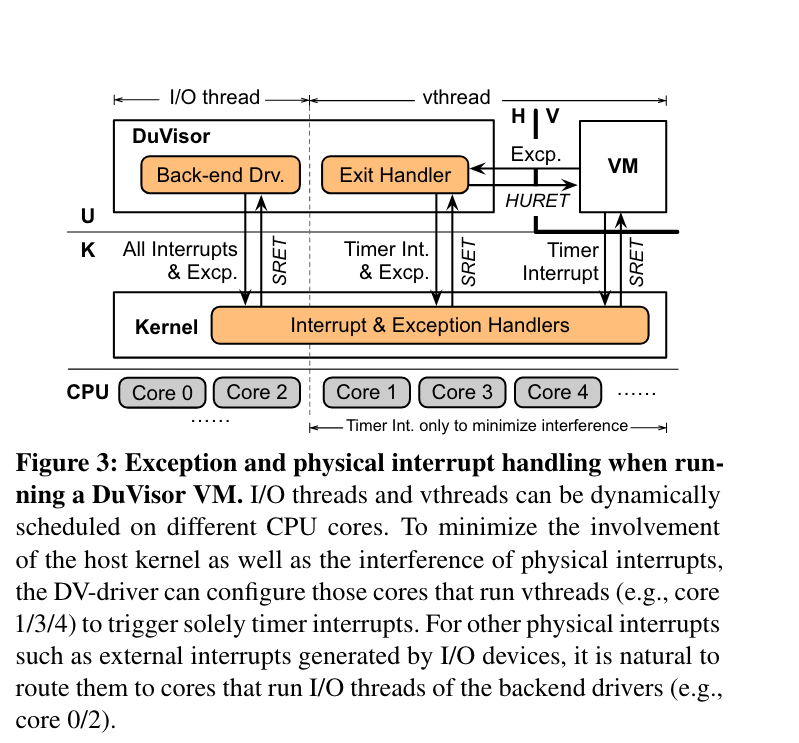

### Duvisor Design

#### Handling VM Exits

一般情况下 VM exits 会重新陷入到 kernel 态的 hypervisor 进行处理，但在 DuVisor 中，VM exit 直接进入用户态的 Duvisor 进程。在 VM 执行环境中，后端驱动的 IO 线程和 vthreads 会被调度到不同的 CPU cores。分发后 Duvisor 执行 HURET 进入 V mode 并且开始运行 guest code 直到 VM exit。随后根据异常的原因访问 DV-Ext 提供的不同的 HU mode 下的寄存器并执行 VM exit。

#### Restricted Memory Virtualization

DuVisor 在 HU mode 管理 GPA 到 HPA 的第二阶段页表，不必为常规页表更新进入内核。

用户态进程可能被攻破，因此不能仅信任它配置的页表。PMC 在翻译完成后检查目标物理地址，将访问限制在内核授予该 VM 的范围内。

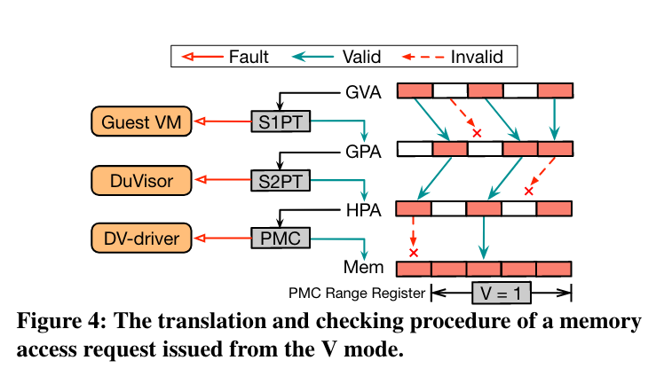

Figure 4 展示了 GVA 如何翻译到 HPA 并且最终到达物理内存。首先通过 MMU 将 GVA -> GPA，随后通过 Duvisor 的 S2PT 翻译到 HPA，最终 PMC 检查输出的 HPA。如果超出了范围，PMC 将生成异常并唤醒 DV-driver 处理。

#### IO and Interrupt Virtualization

Duvisor 的 IO 虚拟化和其他工作类似，都支持 virtio 和模拟设备。但因为不支持 IOMMU 所以不能够进行 passthrough。对于每个 PV 和模拟设备，Duvisor 在 VM 初始化时生成线程，例如对于网卡接收队列在 HU mode 下不断轮询并向 VM 发布虚拟外部中断。

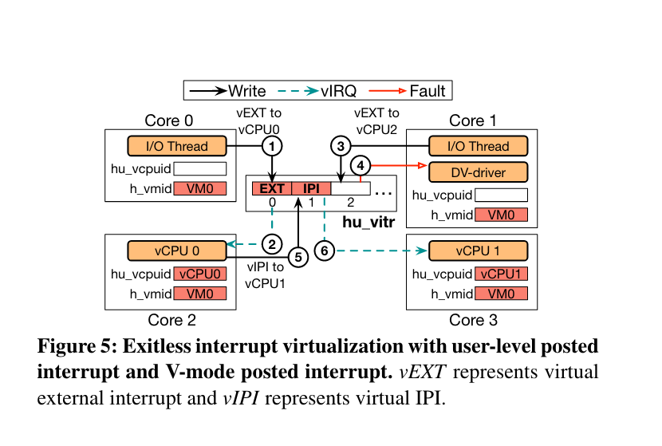

Figure 5 展示了一个 vEXT 是如何使用用户态中断派发的。举例来说，在 core0 上的 IO thread 要往 vCPU0 上发送一个 vEXT，于是写了对应的 `hu_virt`。DV-Ext 然后找到了 vCPU0 在 core2 上然后在 core2 上生成了一个 vEXT。如果发送线程尝试发送一个错误的 VCPUID 或者接收方的 VMID 不匹配，将会触发错误并唤醒 DV-driver 处理。

## RISC-V 原型的验证

以下为论文的安全与性能验证结果。用户态 VM plane 的隔离依赖 DV-Ext 和内核 DV-driver；它不是在现有硬件上单靠软件就能获得的效果。

### 安全验证

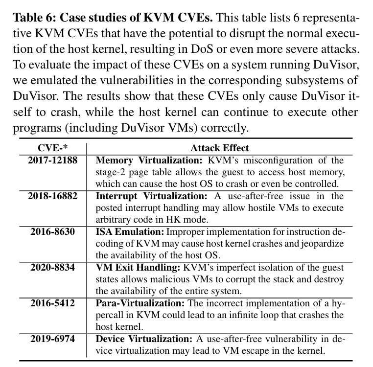

### 性能验证

#### Micro Benchmarks

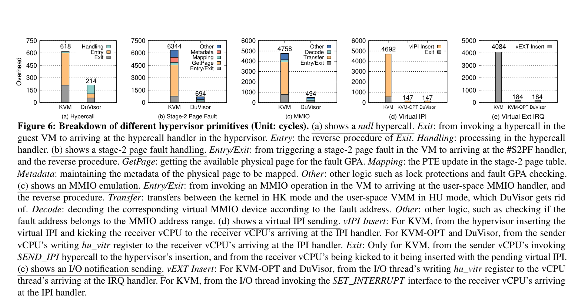

#### Real World Benchmarks

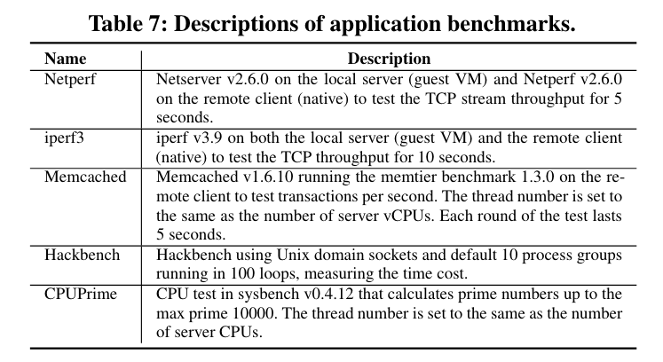
