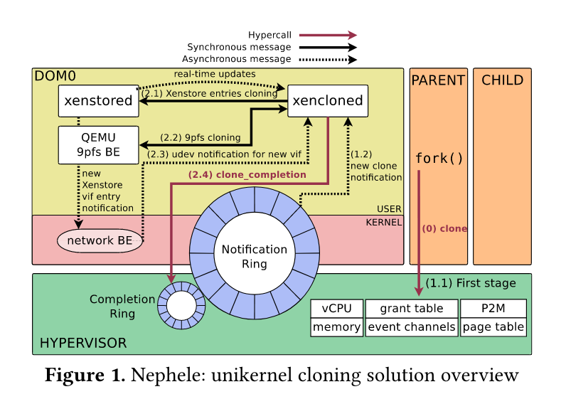

# Nephele: Extending Virtualization Environments for Cloning Unikernel-based VMs

## 用 VM 克隆提供 fork 语义

Unikernel 通常只有一个地址空间，不能直接用线程替代需要隔离的 `fork()`：NGINX 用它创建 worker，Redis 用它生成用于持久化的 COW 快照。让每个副本重新启动又会增加延迟，并失去共享相同初始内存的机会。

Nephele 在 Xen 上克隆整个 unikernel VM，以独立 VM 保持隔离，以 COW 共享未修改的页面。它沿用并扩展 Snowflock 的 VM fork 思路，通过 hypercall 发起克隆；困难在于内存之外的设备状态、共享环和 VM 间通信也必须获得一致的克隆语义。[论文配套实验](https://github.com/nephele-vm/experiments)

## 两阶段克隆：内存与设备状态

Nephele 为 Xen hypervisor 实现了克隆支持。Nephele 为每个实例化进程的组件添加了拷贝语义。

### First stage: Hypervisor operation

Unikernel VM 请求克隆时会创建一个与原有相同地址空间的 unikerel。与 `fork()` 相似，
unikernel 内存在父级和子级共享相同物理内存并进行 COW。**Private Memory** 不在克隆的范围，
根据使用方式，私有页面要么被复制要么被重写，例如构建子页表的私有页。

### Second stage: Host domain operation

第二阶段处理 I/O 状态的克隆。克隆的第二阶段由 `xencloned` 来协调，
xencloned 是一个运行在 host 的 toolstack，用来完成克隆状态的用户控制操作。
**寻找合适的方法来 clone IO 具有挑战性，因为不同设备的行为和状态信息可能存在差异**。

前端驱动使用 shared ring 与后端驱动交换信息。要克隆共享环有两种选择：父与子共享或者创建一个新环。
共享不是一个好选择,因为父子可能会并发访问环造成冲突。也不能简单的复制环，需要考虑不同设备，在网络设备中
复制环因为它们和 guest 的状态密切相关；对于 console 设备则不复制，因为复制会妨碍输出与调试。

### Inter-process communication vs Inter-domain communication

克隆后父子位于不同 VM，因此用 inter-domain communication（IDC）承担原来的进程间通信。Nephele 为 unikernel 设计了一个内部 API，利用 hypervisor interface 专门针对 IDC
共享内存和通知。

## 从 vCPU 状态到 Xenstore 的克隆路径

Nephele 首先拷贝和编辑父 VM 的 data structures，随后克隆 vCPU 状态，memory，event channels
和 grant tables。完成后 hypervisor 将在 notification ring buffer 填充条目并向 xencloned daemon
发送一个新的虚拟中断。收到中断后，xencloned 首先将新的 domain 引入到 xenstored daemon。然后写入从父 daemon
克隆的信息。在 Xen 上对于 Xenstore 进行更新后，后端的驱动会收到通知，例如创建新的网络接口。

### Analysis of the cloning process

- **vCPU**：CPU affinity 和用户寄存器会被复制，除了 `rax` 寄存器。
- **Memory**: 重用并扩展了 `Snowflock` 为 HVM guest 引入的页面共享机制。共享页面时，所有权将从
原有域转移到 `dom_cow`，并进行引用计数。当发生 Page Fault 时所有权将从 `dom_cow` 转移到触发缺页的 domain。
- **Cloning I/O devices**: Xen 使用 Xenstore 来做设备发现，因此需要克隆 Xenstore，为前端和后端驱动写入
新的 xenstore entry。Nephele 对于不同种类型的设备使用不同方法进行克隆：
    - **Console devices**：克隆 console 仅仅添加一个新 xenstore entry，无需对代码进行修改。
    - **Network devices**: 对网络设备的目标需要保持与原有设备相同，这意味着 MAC 地址与 IP 地址也需要相同。
    有两种解决方案，一种是 Linux bond，另一种是 Open vSwitch groups。

## 克隆收益及其范围

作者在配套实验中报告，VM 克隆相对重新启动最高快 8 倍；NGINX、Redis 的测试表明应用可以继续使用 fork 语义，论文还讨论了 fuzzing 和 FaaS 场景。原笔记记录的“与 process forking 相当”缺少对应配置，不能据此认为所有设备和工作负载下的 VM 克隆都具有进程 fork 的开销。
