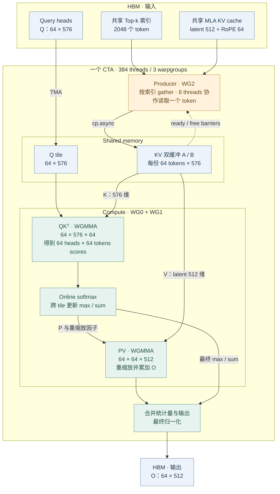

---
tags:
  - projects/FlashMLA
  - topics/sparse-attention
  - topics/GPU-performance
aliases:
  - FlashMLA DSA Sparse Attention
---

# DSA Sparse Attention：Kernel 实现与公开性能

## DSA 如何优化 tokenwise sparse attention

DeepSeek-V3.2 的 DSA 为每个 query 选择 2048 个 KV tokens，所有 query heads 共用这份索引和 MLA latent KV。[算法笔记](../../../Papers/01_Attention/DeepSeek-DSA/deepseek-sparse-attention-dsa.md)

FlashMLA 的 Hopper（SM90）sparse prefill 在提交 [`ba89a34`][revision] 中采用以下实现：

1. **沿 head 维组织 WGMMA tile。** 每个 CTA 处理同一个 query 的 64 个 heads，每轮逻辑计算取 64 个入选 KV tokens；2048 个入选 token 共分成 32 个 KV tiles。tile 的两轴分别是 heads 和入选 KV tokens。[分块配置][config]
2. **按 token 索引异步加载 KV。** Producer warpgroup 读取索引，以 8 个线程协作读取 token 内连续的特征片段，通过 `cp.async` 搬入 shared memory。入选 token 的原序列地址可以不连续，加载后的 KV tile 供 64 个 heads 复用。[加载实现][producer]
3. **双缓冲与 warpgroup 分工。** Producer 使用两份 KV buffer；计算 warpgroups 执行 WGMMA、online softmax 和 PV，与后继 KV 的加载交叠。[主循环][kernel]
4. **在 kernel 内完成归一化与累加。** Online softmax 跨 KV tiles 更新最大值、归一化分母和输出，最终在全部入选 token 上归一化，不向显存写回完整的 attention scores/probabilities。[归一化实现][softmax]

下图为 Hopper sparse prefill 的逻辑数据流；每个 CTA 处理一个 query 的 64 个 heads，遍历 32 个逻辑 KV tiles。[kernel 实现][kernel]

## 公开性能数据

以下为 FlashMLA 官方报告的 sparse attention 算子吞吐。

| GPU / 路径 | KV 存储 / MMA 精度 | 吞吐 | 公开测试条件 | 来源 |
|---|---|---:|---|---|
| H800 SXM5 prefill | BF16 / BF16 | 最高 **640 TFLOPS** | CUDA 12.8；峰值对应的完整 shape 未给出 | [README][performance] |
| H800 SXM5 decode | FP8 latent、BF16 RoPE / BF16 | **410 TFLOPS** | batch=128、heads=128、query length=2、Top-k=2048、QK 维度=576、V 维度=512；CUDA 12.8 | [技术说明][decode]、[README][performance] |
| B200 prefill | BF16 / BF16 | 最高 **1450 TFLOPS** | CUDA 12.9；峰值对应的完整 shape 未给出 | [README][performance] |
| B200 decode | FP8 KV / BF16 | 最高 **700 TFLOPS** | 峰值对应的完整 shape 和具体 CUDA 版本未给出 | [README][performance] |

上述来源未报告模型端到端 MFU。

[revision]: https://github.com/deepseek-ai/FlashMLA/tree/ba89a3466e9470ad08ab39738d4e7bb66989e1e7
[config]: https://github.com/deepseek-ai/FlashMLA/blob/ba89a3466e9470ad08ab39738d4e7bb66989e1e7/csrc/kernels/sm90/prefill/sparse/config.h
[producer]: https://github.com/deepseek-ai/FlashMLA/blob/ba89a3466e9470ad08ab39738d4e7bb66989e1e7/csrc/kernels/sm90/prefill/sparse/phase1.cuh#L463
[kernel]: https://github.com/deepseek-ai/FlashMLA/blob/ba89a3466e9470ad08ab39738d4e7bb66989e1e7/csrc/kernels/sm90/prefill/sparse/phase1.cuh
[softmax]: https://github.com/deepseek-ai/FlashMLA/blob/ba89a3466e9470ad08ab39738d4e7bb66989e1e7/csrc/kernels/sm90/prefill/sparse/phase1.cuh#L133
[performance]: https://github.com/deepseek-ai/FlashMLA/blob/ba89a3466e9470ad08ab39738d4e7bb66989e1e7/README.md#performance
[decode]: https://github.com/deepseek-ai/FlashMLA/blob/ba89a3466e9470ad08ab39738d4e7bb66989e1e7/docs/20250929-hopper-fp8-sparse-deep-dive.md
