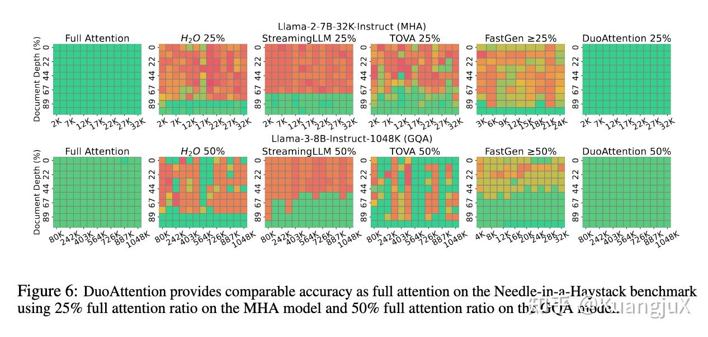
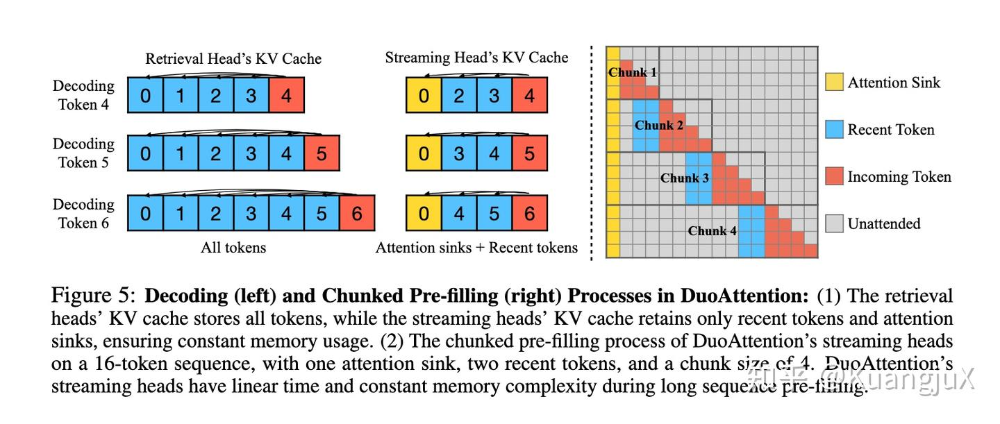
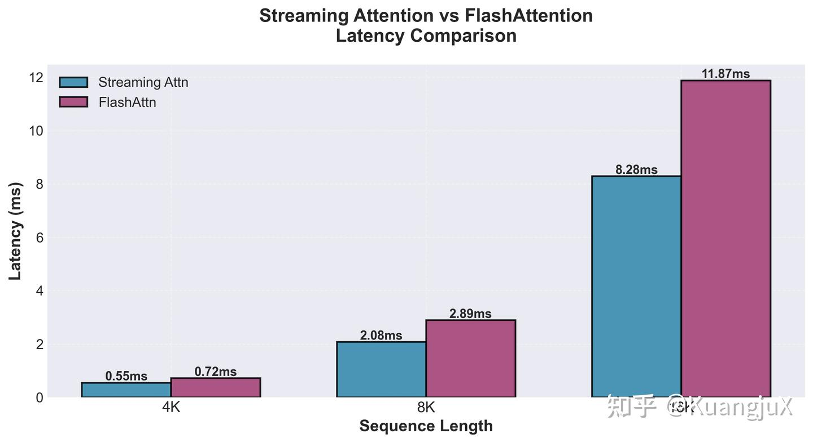

# Light-DuoAttention：CuTeDSL 与 SGLang 实践

- 来源：[Light-DuoAttention：用 CuTeDSL 实现高效长上下文推理](https://zhuanlan.zhihu.com/p/1984978732436431358)。

<video controls preload="metadata" src="./media/niah-demo.mp4" style="max-width: 100%"></video>

在 SGLang 中支持 DuoAttention 运行 NIAH 测试（原文章的 9 秒演示）。

## 长上下文的成本来自哪些头

Dense attention 的 prefill 对长度 N 的序列处理二次量级的 Q–K 配对；有 KV cache 时，decode 每步只有新 query，对历史的扫描则随 N 线性增长。减少 prefill 计算、decode 读取量和持久 KV 容量，是三个相关但不同的目标。

StreamingLLM 只保留初始 attention sink 与最近窗口，可用固定缓存持续处理流式输入，代价是窗口外的旧内容无法被重新检索。“持续处理长流”不等于保留无限历史记忆。Quest 则保留历史 KV，用每页 Key 的统计信息估计 query 相关性，挑选页面参与 attention；它主要减少每步读取和计算，而不是自动缩小全部历史 KV 的存储容量。

DuoAttention 的选择落在 head 维度：部分头需要检索远处内容，保留完整历史；其余头只使用 sink 与近期窗口。收益因此受检索头比例约束，质量则取决于哪些头被分到流式分支。[论文 §2](https://arxiv.org/html/2410.10819v1#S2) 的头划分与 Light-DuoAttention 的 kernel、SGLang 接线是不同层次的工作。



不同稀疏注意力方法在大海捞针测试中的准确率

上图展示了 Full Attention，DuoAttention 与 StreamingLLM 等其他不同稀疏注意力方法在 Needle-in-a-Haystack 上的准确率测试。这张论文图支持头划分能够改善检索质量的判断；它不是下文 H800 kernel 的性能测量。

## DuoAttention：混合注意力机制

### 核心思想

DuoAttention 的关键洞察是，LLM 能够被识别为两种类型的头，分别被称为**检索头（Retrieval Heads）**和**流式头（Streaming Heads）**，检索头仅占一小部分，但需要对全部上下文进行处理；而流式头仅仅需要关注最近的词元（recent tokens）和注意力汇聚词元（attention sink）。DuoAttention 通过针对检索头和流式头的二分性，针对不同头使用不同的注意力，从而显著加速 LLM Inference 的 Prefill Decode 过程，并减少内存占用。



DuoAttention 针对 Decode 和 Chunked Prefill 的处理流程

DuoAttention 针对 Prefill 阶段和 Decode 阶段有不同的处理：

- Decode：在 Decode 阶段，DuoAttention 为 LLM 的每一层分配两个 KV Cache，一个用于检索头，存储所有历史 KV；一个用于流式头，仅存储注意力汇聚和最近的词元，并保持大小恒定，当处理一个新词元的时候，Query，Key，Value 会沿着 Head 维度进行切分，分别计算检索头的完整注意力和流式头的流式注意力。最终按照 Head 维度连接起来得到输出投影。
- Prefill：按 chunk 处理 prompt，流式头在块间保留 sink 与窗口。设序列长 L、chunk 大小 C、保留窗口总长 W，则直接按块计算的流式分支处理量为 O(L(C+W))，工作集为 O(C+W)；当 C 与 W 同阶为 K 时，才简写为 O(LK) 和 O(K)。检索头仍访问完整历史，因此整个模型不会随流式分支一起变为固定缓存。

例如保留 128 个 sink、256 个近期 token，某层一半 KV heads 为检索头，在历史长 N 且 N 远大于 384 时，该层持久 KV 元素量约为全缓存的 `0.5 + 0.5 × 384/N`。这只是相同 dtype/head_dim 下的容量估算，不包括 chunk 临时状态和分配器开销，也不是本项目 prefill 集成的实测收益。

除此之外，DuoAttention 需要通过训练来获得流式头和检索头的信息。DuoAttention 通过知识蒸馏进行训练，定义全注意力模型 $H_{full}$ ，定义使用 DuoAttention 的模型 $H_{mixed}$ ，通过 L2 范数来衡量两个模型输出的隐藏状态，两个模型差异越小，说明“学生”越像“老师”。DuoAttention 通过定义 $L_{distill}$ 来表示该误差。

同时，DuoAttention 为了节省资源，通过引入一个门控值来决定哪些头开启全量计算，哪些可以简化。通过引入损失函数 $L_{reg}$ 通过 L1 正则化，"逼迫"模型在训练中尽可能将门控值变为 0。

最终 DuoAttention 通过总损失函数 $L_{distill}+\lambda L_{reg}$ 来进行训练。通过调节 $\lambda$ 的值来对训练目标进行选择，当$\lambda$ 小的时候，意味着更重要的目标是应当是准确度，当$\lambda$ 大的时候意味着牺牲一定准确度来维持稀疏性。

## Light-DuoAttention：用 CuTeDSL 实现

[Light-DuoAttention `e1d9e4d2`](https://github.com/KuangjuX/Light-DuoAttention/tree/e1d9e4d21de7a46ecec17fa33d84006a34f70d15) 基于 Hopper 的 CuTeDSL attention 实现 streaming mask，并提供 SGLang prefill 接入示例。原实验在 H800 上使用 Llama-3-8B 和 DuoAttention 官方头划分参数。这里的实现证据是 streaming kernel 与 prefill 路径；论文的 decode 双缓存、流式 KV 驱逐及完整端到端内存收益，不能由这条接线推得。

### 先定义可见集合，再决定哪些块可以跳过

PyTorch reference 用掩码明确语义：query 只能看到因果范围内的初始 `sink_size` 个位置，以及包含自身的最近 `local_size` 个位置。Sink 的作用是保留注意力归一化所需的初始位置，不要求这些 token 在语义上重要；序列开头的 query 也不能看到尚未出现的 sink token。

因此在 PyTorch 最重要的部分就是构建**掩码**，并将掩码应用到 Attention Score 中：

```
beyond_causal = col_idx > row_idx
outside_window = torch.logical_and(
   col_idx < row_idx - (local_size - 1), col_idx >= sink_size
)
mask = torch.logical_or(beyond_causal, outside_window)
```

然而，FlashAttention3 并非如 PyTorch 一样是直接将掩码应用在注意力分数中，而是通过分块对 Q，K，V 进行计算，因此当我们应用掩码的时候，需要同时对块内掩码以及块间掩码进行考虑：

- 块内掩码：针对块内掩码，我们需要修改 `mask.py` 找到当前线程所持有的寄存器在整个 Attention Score 中的绝对位置，并根据位置进行原地的掩码应用。
- 块间掩码：针对块间掩码，我们需要修改 `block_info.py` 来获取能够应用 Attention Sink 和 Recent Tokens 的块。

块间跳过只减少遍历范围，块内 mask 仍要精确处理窗口交界、因果边界和尾块。下面是等价条件的机制伪代码，`window_size_left` 不包含当前 query 本身；实际 CuTeDSL 实现还需要线程坐标映射与编译期条件。

```python
is_in_sink = k_pos < sink_size
is_in_window = window_size_left is None or k_pos >= q_pos - window_size_left
allowed = k_pos <= q_pos and (is_in_sink or is_in_window)
if mask_seqlen:
    allowed = allowed and k_pos < seqlen_k
if not allowed:
    acc_S[i] = -inf
```

例如 query 的绝对位置为 1000，sink_size=128、local_size=256，则可见区间是 `[0,127]` 与 `[745,1000]`。两段之间的完整块可以跳过；跨越 127 或 745 的块仍需逐元素 mask。短序列时两段可能重合，块遍历不能重复累计同一 KV。

### 支持 Chunked Prefill

为了支持 Chunked Prefill，我们需要额外引入一个名为 `position_ids` 的变量，含义为当前 Query 中的位置编号。这是由于，当我们计算 Chunked Prefill 的时候，每次处理只能拿到 Query 的相对位置而不是绝对位置，这样当我们去计算要不要为 Attention Sink 支持，我们无法通过相对位置来判断当前结果是否在 Attention Sink 的区域内。因此，我们需要 `position_ids` 来去首先找到当前结果所在的绝对位置，随后再去进行掩码处理。

### 在 SGLang 中支持 DuoAttention

最后，我们需要在 SGLang 中支持 DuoAttention 并运行 LLama-3-8B 模型，当前我们使用 DuoAttention 代替了原生 SGLang 的 Prefill 阶段，原生 SGLang 的 Prefill 实现在 `FlashAttentionBackend` 中的 `forward_extend` 中，我们需要定义一个新的参数 `enable_duo_attn`，当开启这个参数的时候，我们执行 DuoAttention。我们需要从 Query，Key，Value 中对多头进行检索头和流式头的切片，并在最终进行连接（Concat）结果并获得最终结果。

头划分会引出访存组织问题：若两类 heads 交错排列，每次调用都需 gather/scatter。DuoAttention 部署时预先重排投影通道，将同类 heads 放在连续区间，用一次性的权重变换换取推理中的切片访问；输出投影必须应用匹配的列置换，才能保持 head 输出的对应关系。

为了方便且高效地进行切片和连接操作，我们需要预先对 Query，Key，Value 以及 Output 进行重新排列，将流式头和检索头放到两个不同的连续簇中，这样就不需要进行 Scatter 以及 Gather 操作了。在 SGLang 中，我们将这个阶段放到 `ModelRunner` 中进行处理:

```
for i, layer in enumerate(layers):
    attn = layer.self_attn

    # kv_pattern defines which KV head group is full (1) or streaming (0)
    kv_pattern = torch.tensor(full_attention_heads[i], device=device, dtype=torch.int)
    assert len(kv_pattern) == num_kv_heads

    # Get the indices for full and streaming KV heads
    kv_full_indices = torch.where(kv_pattern == 1)[0]
    kv_stream_indices = torch.where(kv_pattern == 0)[0]

    # Expand the KV pattern to the Q heads
    q_head_pattern = torch.repeat_interleave(kv_pattern, repeats=gqa_group_size)
    q_full_indices = torch.where(q_head_pattern == 1)[0]
    q_stream_indices = torch.where(q_head_pattern == 0)[0]

    # --- 2. Reorder Q, K, V Projection Weights ---
    # For models with a combined QKV projection matrix (e.g., Llama)
    if hasattr(attn, 'qkv_proj'):
        qkv_weight = attn.qkv_proj.weight.data
        q_size = num_heads * head_dim
        k_size = num_kv_heads * head_dim
        v_size = num_kv_heads * head_dim

        # --- Reorder Q weights ---
        w_q = qkv_weight[:q_size, :]
        w_q_reshaped = w_q.view(num_heads, head_dim, hidden_size)
        w_q_reordered = torch.cat([
            w_q_reshaped[q_full_indices],
            w_q_reshaped[q_stream_indices]
        ], dim=0).view(q_size, hidden_size)

        # --- Reorder K weights ---
        w_k = qkv_weight[q_size : q_size + k_size, :]
        w_k_reshaped = w_k.view(num_kv_heads, head_dim, hidden_size)
        w_k_reordered = torch.cat([
            w_k_reshaped[kv_full_indices],
            w_k_reshaped[kv_stream_indices]
        ], dim=0).view(k_size, hidden_size)

        # --- Reorder V weights ---
        w_v = qkv_weight[q_size + k_size :, :]
        w_v_reshaped = w_v.view(num_kv_heads, head_dim, hidden_size)
        w_v_reordered = torch.cat([
            w_v_reshaped[kv_full_indices],
            w_v_reshaped[kv_stream_indices]
        ], dim=0).view(v_size, hidden_size)

        # Combine back into a single QKV weight
        new_qkv_weight = torch.cat([w_q_reordered, w_k_reordered, w_v_reordered], dim=0)
        attn.qkv_proj.weight.data = new_qkv_weight

        # --- 3. Reorder O Projection Weights ---
        o_weight = attn.o_proj.weight.data
        # Input to o_proj is concatenation of head outputs. We need to reorder the columns.
        o_weight_reshaped = o_weight.view(hidden_size, num_heads, head_dim)
        o_weight_reordered = torch.cat([
            o_weight_reshaped[:, q_full_indices, :],
            o_weight_reshaped[:, q_stream_indices, :]
        ], dim=1).view(hidden_size, q_size)
        attn.o_proj.weight.data = o_weight_reordered
```

GQA 中同一 KV head 对应的 Q heads 通过 `repeat_interleave` 一起重排，因此 KV 组是这里的分配单位。片段假定投影矩阵可按完整 head reshape；TP 分片和量化权重需要另行满足相应布局，不能直接原样套用。

### 实验与性能评估

在 **Kernel 层面**我们验证了 Streaming Attention 在各种情况下的正确性，包括 Chunked Prefill，Paged Attention 以及在 GQA 情况下的正确性。

原实验记录还包含 Llama-3-8B 的 NIAH 演示，以及知识问答、英文翻译和创业写作的人工尝试。演示说明接入后能完成这些样例，不提供全面质量回归的统计结论。

除此之外，我们还将 Streaming Attention 与 FlashAttention 做了一个简单的性能评估，评估结果如下：



原图配置为单卡 H800，`sink_size=128`、`recent_token=256`，比较 streaming kernel 与 FlashAttention。它度量的是局部 attention 实现；没有在这里给出头划分、两分支调用、拼接及整个模型的分项消融，因而不能把 kernel 曲线直接换算成 SGLang 请求加速比。本次整理未重新运行这些 GPU 实验。

## 参考

1. [^](https://zhuanlan.zhihu.com/p/1984978732436431358#ref_1_0)Xiao G, Tang J, Zuo J, et al. Duoattention: Efficient long-context llm inference with retrieval and streaming heads[J]. arXiv preprint arXiv:2410.10819, 2024.
2. [^](https://zhuanlan.zhihu.com/p/1984978732436431358#ref_2_0)Xiao G, Tian Y, Chen B, et al. Efficient streaming language models with attention sinks[J]. arXiv preprint arXiv:2309.17453, 2023.
3. [^](https://zhuanlan.zhihu.com/p/1984978732436431358#ref_3_0)Tang J, Zhao Y, Zhu K, et al. Quest: Query-aware sparsity for effici
4. [^](https://zhuanlan.zhihu.com/p/1984978732436431358#ref_4_0)Ainslie J, Lee-Thorp J, De Jong M, et al. Gqa: Training generalized multi-query transformer models from multi-head checkpoints[J]. arXiv preprint arXiv:2305.13245, 2023.
5. [^](https://zhuanlan.zhihu.com/p/1984978732436431358#ref_5_0)https://github.com/mit-han-lab/duo-attention
6. [^](https://zhuanlan.zhihu.com/p/1984978732436431358#ref_6_0)https://github.com/mit-han-lab/Block-Sparse-Attention
