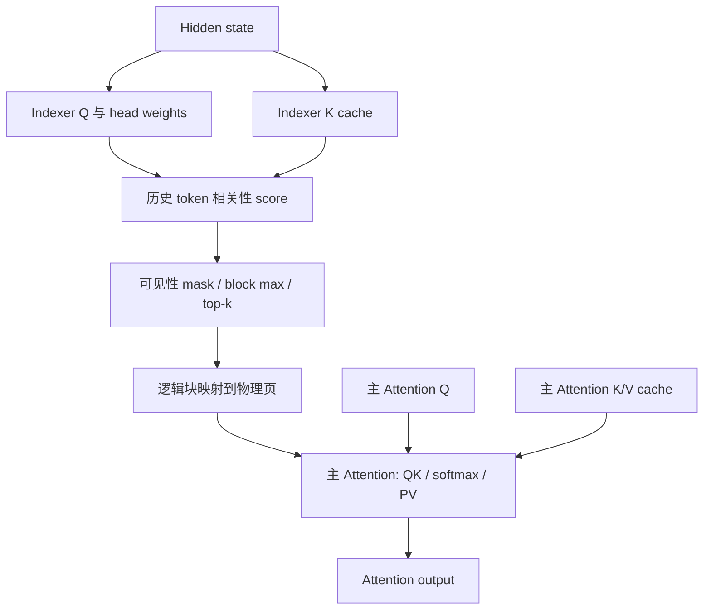

---
tags:
  - topics/sparse-attention
  - topics/kv-cache
  - topics/source-reading
aliases:
  - WeLM Sparse Attention 推理学习
  - GQA 稀疏 Attention：共享 Selection 与计算形状
  - WeLM Sparse 的 HiCache
---

# WeLM Sparse Attention：计算、分页与缓存恢复

稀疏推理需要把三个环节接起来：Indexer 选择历史位置，主 Attention 通过页表读取选中的 KV，前缀缓存则保存并恢复下一次计算仍要用到的状态。Indexer-K、主 Attention KV 和一次 query 的 selection 因此有不同的职责与生命周期。

下文先用共享 selection 的 GQA 解释通用计算与张量关系，再沿 WeLM Sparse 的 HiCache 实现追踪缓存恢复。通用公式与伪代码不代表特定 WeLM 版本的全部模型实现，尤其不能据此推定实际 selection 的 head/group 轴。

HiCache 源码固定于 [PR !497](https://git.woa.com/wxg-odyssey/sglang/-/merge_requests/497) 的 `f96e0205bb312894edef6ec308fd04290931dfff`，比较基点为 `daa5fb89b3441b39ed61fa1fbcede40ac9ac5551`。该版本的 WeLM sparse 集成限于单体 Host L2；未在本次整理中运行模型或 GPU 测试。

## 从 Indexer 到主 Attention 的数据流 {#forward}



Indexer 产生用于选位置的分数；主 Attention 在选中位置上重新计算正式的 attention logits，并对 V 加权求和。两部分的 Q/K 应分别命名，不能把 indexer score 当作主 Attention 的 softmax 权重。

| 记号 | 含义 |
| --- | --- |
| N | 当前 query token 行数 |
| Hᵢ、Dᵢ | Indexer 的 head 数和 head dimension |
| Hq、Hkv | 当前设备上主 Attention 的 Q / KV head 数 |
| Dq、Dv | 主 Attention 的 QK / V 特征维度 |
| B | 每个 KV block 的 token 数 |
| T | 每个 query 选择的 block 数上限 |

一个请求在 prefill 或 verify 中可以对应多个 query 行，所以 N 不等于请求 batch size。

## 共享关系如何决定计算形状 {#head-shapes}

假设同一 GQA 组内的 query heads 共享一份 selection；GQA 本身只定义 KV 共享，不自动保证稀疏选择也共享。

### 三种 head 概念

| 概念 | 职责 |
| --- | --- |
| 主 Attention Q heads | 每个 head 独立计算 attention 分布和输出 |
| 主 Attention KV heads | 为映射到该组的 Q heads 提供 K/V 向量 |
| Indexer heads | 参与相关性打分；不是主 Attention Q heads 的另一个名称 |

GQA 将多个 Q heads 映射到较少的 KV heads。在均匀分组的情形下，每组 Q heads 数为：

$$
G=H_q/H_{kv}.
$$

公开定义与模型背景见 [GQA 论文](https://arxiv.org/abs/2305.13245)。分布式实现中，应区分全模型和设备本地的 head 数；KV 切分或复制会影响本地分组关系。

### 共享 KV 向量与共享 Selection 是两个条件

同一 GQA 组使用同一个 KV head 的向量，但 GQA 本身没有定义稀疏选块方式。Selection 可以按 query 共享，也可以带 head/group 轴。

| Selection 表示 | 描述的共享范围 |
| --- | --- |
| `[query, selected_blocks]` | 每个 query 共用一份块列表 |
| `[query, group, selected_blocks]` | 每个 query、每个 group 有自己的列表 |
| `[query, head, selected_blocks]` | 每个 query、每个 head 有自己的列表 |

在本文假设下，固定一个 GQA 组，query t 的集合记为 $S_t$。不含 sink、softcap 或其他附加项的基本表达式是：

$$
o_{t,h}=\operatorname{softmax}\left(q_{t,h}K_{S_t}^{\top}/\sqrt{D_q}\right)V_{S_t}.
$$

集合不带组内 head 下标，但不同 head 的 Q 不同。因此访问相同 K/V 和相同 token IDs，不要求 attention logits、权重或输出相同。

不同 KV groups 即使选中相同 token IDs，其 K/V 向量也不要求相同，不能把它们无条件合并成针对同一份 K/V 的矩阵行。

### 把一组 Q heads 组织成矩阵

固定一个 query 和一个含 B 个 token 的 KV block：

$$
Q_t\in\mathbb R^{G\times D_q},\qquad
K_b\in\mathbb R^{B\times D_q},\qquad
V_b\in\mathbb R^{B\times D_v}.
$$

Q 的每一行是一个独立 head，不是沿 head 求和或把所有 heads 合成一个长向量。QK 的形状为：

$$
S_{t,b}=Q_tK_b^\top\in\mathbb R^{G\times B}.
$$

softmax 沿该 head 的全部选中 KV tokens 归一化。令 $P_{t,b}$ 为完整归一化权重在 block b 上的切片，则：

$$
O_{t,b}=P_{t,b}V_b\in\mathbb R^{G\times D_v},\qquad
O_t=\sum_b O_{t,b}.
$$

增加 B、Dq 或 Dv，不会改变组内 Q 行数 G。这是矩阵形状的关系，不是 kernel latency 或 Tensor Core 利用率的测量。

各 block 分别 softmax 后直接相加，一般不等价于对完整选中集合归一化。在线分块计算需要维护跨块的归一化与输出状态。[FlashAttention 论文](https://arxiv.org/abs/2205.14135)解释了这种分块计算的基本机制。

### 多个 query 不等于多行共享同一紧凑 KV 矩阵

Dense attention 的多个 query 可以对同一个 K/V block 计算，再处理各自的 mask。逐 query 的 sparse Selection 则不要求相同，例如：

```text
query A → blocks {a, c}
query B → blocks {b, c}
```

普通 GEMM 的所有行共享右操作数。将两个 query 的 Q 堆叠，不会让两份不同的紧凑 KV 列表自动成为同一矩阵。相同的列下标必须有一致的 K/V 含义。

因此需要分别确认：

- 有多少 query 行。
- 哪些 Q heads 使用同一份 K/V 向量。
- 哪些 query/head 的 Selection 相同。
- 实际 kernel 如何组织这些行和列。

这些条件不能由模型的总 Q-head 数代替。在逐 query 页表接口中，多个 query 是独立的逻辑序列；接口本身不规定它们在 GPU 上如何分配 CTA、warp 或 MMA tile。

例如 $H_q=32,H_{kv}=8$ 时，每组 $G=4$。取 $B=128,D_q=D_v=64$，则组内 Q 为 $4\times64$，QK 输出为 $4\times128$，PV 输出为 $4\times64$；四个 heads 访问同一份 K/V，仍各自保留一行输出。

## Indexer score 的一种公开形式

Lightning indexer 的 weighted-ReLU MQA score 可表示为：

$$
r_{t,j}=\alpha\sum_{a=1}^{H_i}w_{t,a}\operatorname{ReLU}\left(q^I_{t,a}\cdot k^I_j\right).
$$

其中 $q^I$、$k^I$ 是 indexer 的 Q/K，$w$ 是 head 权重，$\alpha$ 表示采用的缩放约定。对 head 的归约完成后，输出是每个 query 对历史位置的一个 score。公开的 [DeepGEMM MQA scoring 接口](https://github.com/deepseek-ai/DeepGEMM#v32-mqa-kernels-for-the-indexer)提供这一类打分，并区分 paged 与 non-paged 形式。

FP8 路径需要同时处理量化数据和 scale。投影、位置编码、量化、写 cache、打分、选块是不同职责；一个 Python 调用不一定对应一个 GPU kernel，融合 kernel 也不意味着整条 Indexer 路径已经融合。

主 Attention 的 Hq/Hkv 与 indexer 的 Hᵢ 是不同参数。某个 scorer 的 head 对齐限制不能直接当作主 Attention kernel 的限制。

## 从 token score 得到 block Selection

对按 block 选择、使用 max pooling 的形式，定义 query t 的可见集合为 $\mathcal V_t$，block b 的位置集合为 $\mathcal B_b$：

$$
r'_{t,j}=\begin{cases}r_{t,j},&j\in\mathcal V_t,\\-\infty,&\text{otherwise},\end{cases}
\qquad m_{t,b}=\max_{j\in\mathcal B_b}r'_{t,j}.
$$

然后沿 block 维做 top-k，得到逻辑块号。先处理可见性，再做 block max，可保证未来位置不会影响当前块的分数。

```python
# 机制伪代码：省略 dtype、padding 和有效块数处理
visible_scores = token_scores.masked_fill(~visible, -float("inf"))
block_scores = visible_scores.reshape(N, num_blocks, B).amax(-1)
selected_blocks = block_scores.topk(min(T, num_blocks), dim=-1).indices
```

top-k 的 index 是逻辑块号，不是物理 cache 页号。若可见块少于 T，还需要约定有效数量或无效 sentinel；不能把填充项解释成真实 KV。

这是 block-max 选块形式的定义。其他算法可以按 token 选择、采用其他 pooling，或使用不同的 head/group Selection 语义，不能从“DSA”这个名称推断它们相同。

## 逻辑块与物理页

分页 KV cache 通过请求页表把逻辑块映射到物理页。若 block 和 cache page 大小一致，映射关系可写成：

```text
selected physical page[t, k]
    = request page table[request_of(t), selected logical block[t, k]]
```

这个步骤只重组页号，不要求把选中的 K/V 复制到一块新的连续显存。

如果接口用“页表 + 一个有效长度”表示选中集合，且只有最后一个有效页可以不满，则被选中的当前尾页需要放在有效页表末尾。举一个与模型配置无关的页表示例：page size=4，历史长度=10，三个逻辑页的有效长度分别是 4、4、2。

| 选中的逻辑页 | 合适的页表顺序 | 选中 KV 的有效长度 |
| --- | --- | ---: |
| 2、0 | 0、2 | 6 |
| 0、1 | 0、1 | 8 |

因此稀疏有效长度不等于原请求长度，也不总是“选择页数 × page size”。上表仅演示页表语义，不表示某个设备 kernel 支持 page size=4。

## 主 Attention 如何使用页表？

FlashAttention 的 KV-cache 接口支持分页 KV 与 GQA/MQA；具体参数名和支持范围应以所用版本为准。公开接口见 [FA3 Python API](https://github.com/Dao-AILab/flash-attention/blob/main/hopper/flash_attn_interface.py)。

在逐 query 页表的表示方式中，数据关系是：

| 输入 | 形状 | 含义 |
| --- | --- | --- |
| Q | `[N, Hq, Dq]` | 主 Attention query |
| K cache | `[num_pages, B, Hkv, Dq]` | 分页 Key |
| V cache | `[num_pages, B, Hkv, Dv]` | 分页 Value |
| page table | `[N, T]` | 各 query 选中的物理页 |
| cache lengths | `[N]` | 各 query 的稀疏 KV 有效长度 |
| cumulative query lengths | `[0,1,...,N]` | 各 query 表示为长度 1 的序列 |

“一个 query 一份页表”描述的是接口的数据组织，不表示为每个 token 发起一次 Python 调用或一次 GPU launch。

当每份页表和有效长度已经完整表达该 query 可见的历史位置时，主 Attention 可在这个集合内做非因果矩阵计算；原序列的因果约束由集合构造保证。只有满足这个前提，关闭 kernel 内部的 causal mask 才保留原有语义。

如果启用了 attention sink、softcap、位置偏置等机制，还需保留相应的数值定义。页表只能描述访问哪些 KV，不能替代这些计算。

## HiCache：保存并恢复主 KV 与 Indexer-K {#hicache}

单体 Host L2 缓存适配复用了既有调度器、控制器和前缀树机制。计算路径决定了恢复前缀时不仅需要主 KV，还需要历史 Indexer-K。

### 为什么 Attention KV 之外还需要 Indexer-K

Indexer-K 保存的是历史 token 用于打分的向量，不是 Top-K 编号，不是主 Attention 的 K，也不是最终 attention 权重。当前 Query 的变化会改变打分和选择结果，因此保存可复用的历史 K，比把某次选择结果当作长期缓存更合理。这个 PR 的 L2 sidecar 保存 Indexer-K，不持久化 selection。

源码入口：[WeLMSparseIndexer.store_key / forward](https://git.woa.com/wxg-odyssey/sglang/blob/f96e0205bb312894edef6ec308fd04290931dfff/python/sglang/srt/layers/attention/welm_sparse_indexer.py#L155)。

`store_key()` 的主要步骤如下：

1. 从 backend metadata 中取得当前需要写入的 token 行与位置。
2. 对 hidden state 做 `wk` 投影。
3. 按特征维做 RMS 归一化，再应用 `gamma_k`；是否加 1 取决于 zero-centered 配置。
4. 转为 BF16，应用 RoPE。
5. 通过 `set_index_k_buffer()`，写入 `out_cache_loc` 对应的 GPU token 槽。

`forward()` 则生成 Indexer Query 和 head weights，读取历史 Indexer-K，将它们交给 `runtime.select()`，得到这次 Query 的选择结果。

```text
历史 token hidden ── wk / 归一化 / RoPE ──→ Indexer-K cache
                                                   ↓
当前 token hidden ── wq / ww ──→ Query、weights ──→ 打分与选块
                                                   ↓
主 Attention 自己的 Query、K、V ────────────────→ 稀疏 Attention
```

解释性例子：已经缓存 100 个历史 token，现在处理第 101 个 token。Indexer 用当前 Query 与历史 Indexer-K 比较，选出相关历史块；主 Attention 再读取那些块中的主 K/V。下一 token 可以复用这 100 个历史 Indexer-K，但通常需要重新计算选择结果。

Indexer 只承担打分，不需要像主 Attention 那样对自己的 V 做加权汇总，所以这里没有 Indexer-V。名称里的 K 是相似度匹配中的 Key，不意味着必须有一个配套 V buffer。

### HiCache 为什么需要配套 Host 池

HiCache 是分层缓存机制。GPU 缓存可视为 L1，Host 内存为 L2；其他存储后端可构成更低层级，但本 PR 的 WeLM sparse 集成只支持单体 L2。

模型执行需要 GPU 上的缓存。此前初始化已建立的 GPU 池包括主 Attention KV、Indexer-K，以及配置启用时的 SWA 和 MTP draft 池。`build_welm_sparse_stack()` 并不重新创建这些 GPU 池，而是为它们建立配套 Host 存储与搬运控制器。

当一个前缀从 GPU 被驱逐但仍保留 Host 副本时，下一次命中该前缀可以恢复缓存，减少前缀重算。对 WeLM sparse，只恢复主 KV 不够：后续 Indexer 还要读取相应的历史打分向量；启用 MTP 时也需要恢复相应 draft 状态。

### 初始化入口与配置检查

调用链发生在服务初始化阶段；每个相关执行进程建立自己的缓存资源，并不是每次请求都调用 builder。

```text
Scheduler 创建 UnifiedRadixCache，启用 hierarchical cache
  → UnifiedRadixCache.init_hicache()
  → attach_hybrid_pool_to_unified_cache()
  → 识别 WeLMSparseKVPool / WeLMSparseSWAKVPool
  → build_welm_sparse_stack()
  → 绑定 HostPoolGroup、HybridCacheController、INDEXER sidecar
```

源码入口：[Scheduler 初始化入口](https://git.woa.com/wxg-odyssey/sglang/blob/f96e0205bb312894edef6ec308fd04290931dfff/python/sglang/srt/managers/scheduler.py#L1126)、[build_welm_sparse_stack](https://git.woa.com/wxg-odyssey/sglang/blob/f96e0205bb312894edef6ec308fd04290931dfff/python/sglang/srt/mem_cache/hybrid_cache/hybrid_pool_assembler.py#L1023)。

builder 的输入包括已存在的 `kvcache`、缓存与模型初始化参数、server args、加载事件和通信组；输出是 Host pool group、controller 和传输层数。

开头要求：

- `storage_backend is None`，不接入 L3。
- `hicache_load_end_layer is None`，不接入 Deferred。
- `pp_size == 1`。
- write policy 为 `write_through`。
- layout 为 `layer_first` 或 `layer_page_first`。
- IO backend 为 `kernel` 或 `direct`。

这些是当前集成边界，不是 sparse attention 算法必然只能这样实现。更外层还有其他组合限制；尤其不能由此推出 PD + HiCache 已支持。

### 分开管理，为什么又要关联页面

Attention KV 和 Indexer-K 有独立 buffer，不共享同一块物理内存；关联的是同一批 token 的页面身份与生命周期。

`INDEXER` sidecar 跟随 `KV` anchor，使用 `ALL_PAGES` 命中策略。SWA 有自己的窗口语义，不能因为主模型存在 SWA，就只保留窗口内的 Indexer 历史。源码绑定见 [INDEXER sidecar 注册](https://git.woa.com/wxg-odyssey/sglang/blob/f96e0205bb312894edef6ec308fd04290931dfff/python/sglang/srt/mem_cache/hybrid_cache/hybrid_pool_assembler.py#L1279)。

“相同页数”不等于“相同字节数”。page size 在这里首先表达每页容纳多少 token；不同池的每个 token 内容大小可以不同。

解释性例子：每页 64 token。假设主 KV 每个 token 占 4096 B，Indexer-K 每个 token 占 256 B，则一页分别占 256 KiB 和 16 KiB。两者都分配 100 页，能覆盖同样 6400 个 token 槽，但占用内存不同。这个主 KV 大小仅用于示例，不代表具体 checkpoint。

在实际 WeLM Index-K 配置中，单层每 token 为一个 128 维 BF16 向量，即 256 B。跨层总量还需要乘以 Indexer 层数。

Host 页号与 GPU 页号也不要求相同。恢复时可以将 Host 页 2 搬到 GPU 页 5；关键是对应 KV 和 Indexer-K 的映射与生命周期保持一致。

### Host 预算如何分配

builder 对主 Full/SWA 池逐个统计实际 K/V buffer 的字节数，并把 Indexer-K 和 draft 的字节数加入总量。这里不直接使用 Full wrapper 可能包含 sidecar 的大小，避免把 Indexer-K 重复计费。

显式设置 `hicache_size` 时，主池预算的核心关系是：

```python
host_size_for_pool = hicache_size * sizes[name] / total_bytes
```

接着由 `build_kv_host_pool()` 把字节预算转换成池容量。Indexer Host 不再独立按一份任意预算决定 token 容量，而是复制 Full anchor 的 `size`、`page_num` 和 `page_size`；draft sidecar 也按所跟随的主池建立容量。

解释性例子：假设 GPU 实际存储中主 KV 占 8 GiB、Index-K 占 2 GiB，无 SWA/draft，总 Host 预算按比例扩大到 30 GiB。主 KV 分到约 24 GiB，Index-K 通过匹配主池容量占约 6 GiB，二者覆盖同样的 token 槽。实际配置中的 `hicache_size` 采用代码的十进制 GB 换算，示例只说明比例关系。

未使用绝对预算时，主池沿用 Host/GPU 容量 ratio。页对齐、取整和现有备用页规则意味着总分配不是对预算的逐字节精确切分；理解预算时应区分目标预算、逻辑 token 容量与实际 buffer 大小。

### MHATokenToKOnlyPoolHost 的职责

[MHATokenToKOnlyPoolHost](https://git.woa.com/wxg-odyssey/sglang/blob/f96e0205bb312894edef6ec308fd04290931dfff/python/sglang/srt/mem_cache/memory_pool_host.py#L928) 是本 PR 新增的 class。它既负责 Host Indexer-K 的内存组织，也提供既有缓存框架需要的备份、逐层恢复和页面访问接口。

关键成员来自两类对象：

| 来源 | 属性 | 用途 |
| --- | --- | --- |
| GPU Index-K 池 | dtype、head_num、head_dim、layer_num | 决定每 token 的实际存储大小 |
| Full Host anchor | size、page_num、page_size | 保持可覆盖的 token 页容量一致 |

每 token 跨所有层的字节数是 `head_dim * head_num * layer_num * dtype.itemsize`。`layer_first` 可理解为按 `[layer, token, head, dim]` 组织；`layer_page_first` 将 token 拆为 page 和页内 token 维。

这里的 MHA 是存储家族的命名，不代表 WeLM 主 Attention 一定使用等量 Q/KV heads。GQA 也可以使用这个普通 head 布局的池，实际存储由 KV head 数决定。

不能直接替换为已有的 `NSAIndexerPoolHost`：后者适配 `NSATokenToKVPool` 的量化 Index-K 与 scale 打包表示，访问的是另一套字段和物理布局；WeLM 这里使用普通 BF16 K-only buffer。差异落在数据表示与接口契约，而不只是“模型算法名字不同”。

同理，复用名称带 `_mla` 的搬运函数也不意味着 WeLM 使用 MLA。搬运层可以复用单 buffer plane 的复制能力；MLA 的压缩 latent 表示与 WeLM 的 BF16 Index-K 在算法语义上仍不同。

### PageTransfer 如何适配 K-only

[page_transfer.py](https://git.woa.com/wxg-odyssey/sglang/blob/f96e0205bb312894edef6ec308fd04290931dfff/python/sglang/srt/mem_cache/page_transfer.py) 将一次搬运拆成静态资源和动态映射：

| 对象 | 职责 |
| --- | --- |
| PageTransferBinding | 保存池的 buffer planes、指针表、每页字节数等长期信息 |
| PageTransferMap | 保存本次 Host/GPU 页对应关系；direct 路径生成连续拷贝段 |
| PreparedPageTransfer | 结合 binding 和 map，执行所有层或指定层的搬运 |
| PageTransferGroup | 把多个池按同一次缓存操作组织起来 |

以前主 KV 每层两个 plane：K、V。本 PR 允许 Indexer 每层只有一个 K plane，主要修改 `_select_planes()`、`planes_per_layer` 和逐层偏移计算。

```python
width = binding.planes_per_layer
start, count = (0, binding.plane_count) if layer is None else (layer * width, width)
```

解释性例子：三层主 KV 的 planes 为 `[K0, V0, K1, V1, K2, V2]`，第 1 层从位置 2 复制两个 plane；三层 Indexer 为 `[K0, K1, K2]`，第 1 层从位置 1 复制一个 plane。若仍固定乘 2，Index-K 的逐层恢复就会错位。

#### kernel 与 direct

两种路径都实现 Host↔GPU 搬运，主要区别在执行方式。

- `kernel`：通过 GPU SM 执行复制 kernel。page 路径调用 `module.sm`，进入 `launch_hicache_pages` / `hicache_copy_pages`。
- `direct`：通过 CUDA memcpy API 提交复制。默认实现使用 `cudaMemcpyBatchAsync`；该代码还有其他实现分支。实际 CUDA 版本与 API 支持需要匹配，不应假设不支持时自动 fallback。

底层入口见 [hicache_pages.cuh](https://git.woa.com/wxg-odyssey/sglang/blob/f96e0205bb312894edef6ec308fd04290931dfff/python/sglang/jit_kernel/csrc/hicache_pages.cuh)。本 PR 主要补齐 K-only 接线，没有新增这套 CUDA 页复制 kernel。`layer_first` 还通过 Host 类的既有 JIT/传统搬运函数执行，不能将所有 layout 都简化为同一个 PageTransferGroup 路径。

direct 不代表固定使用某个硬件引擎，也不能仅凭名字断言总比 kernel 快；碎片程度、连续段数量、调度开销和链路情况都会影响性能。

### 从前缀命中到逐层恢复

运行时链路与初始化不同：

```text
请求匹配缓存前缀
  → 判定需要的 Host 数据已就绪
  → 分配 GPU 目标槽，建立 Host/GPU 映射
  → 提交加载操作
  → HybridCacheController.start_loading()
  → load stream 上按层恢复所需 pools
  → 记录对应层的完成事件
  → 模型消费者等待事件，再读取恢复的数据
```

[HybridCacheController](https://git.woa.com/wxg-odyssey/sglang/blob/f96e0205bb312894edef6ec308fd04290931dfff/python/sglang/srt/mem_cache/hybrid_cache/hybrid_cache_controller.py#L586) 的 `start_loading()` 是既有逻辑，不是本 PR 新增的主功能。新池接入这个控制器后，Index-K 与主 KV、必要 draft 状态一起参与所需的加载与同步。

记录完成事件不等于 CPU 当时已经等待复制完成。正确性来自 CUDA stream/event 顺序：消费者在使用某层数据前，必须等待覆盖该层必要 planes 的事件。

备份方向由 controller 的写入路径组织，通常将所需层从 GPU 搬到 Host；Host 数据完成并被确认后才可作为可用命中来源。备份已提交、Host ready、GPU 恢复已提交、模型可读取，是不同状态。

## Decode、Verify 与性能证据的边界

通常 decode 每请求处理一个新 query，verify 每请求可以处理多个候选 query。共用一个请求的历史 KV cache，不意味着各候选的 Selection 相同。

只知道 head 数、query 数或推理阶段，不能确定实际运行是访存瓶颈还是计算瓶颈。矩阵的数学形状也不能直接说明设备指令 padding、有效吞吐或加速比。

阅读 profile 时需要区分：

| 观测量 | 含义 |
| --- | --- |
| 单个 kernel duration | 对应设备 kernel 的执行时间 |
| 多个 kernel duration 之和 | 各次执行时间累计，可能包含互相重叠的区间 |
| GPU annotation 跨度 | 一个标注范围的起止时间差，可包含 kernel 间隙 |
| 请求延迟 | 用户请求的端到端时间，不能由某个局部累计值直接替代 |

比较不同实现时，输入形状、Selection、dtype、数值语义和计时边界必须一致，性能差异才有可解释的含义。本笔记不提供未测量的速度倍率或优化方案。

### 模型、缓存和 kernel 之间的接口职责

可按以下职责查找实际版本的实现：

1. **模型 forward**：主 Q/K/V 与 indexer Q/K 分别由哪里产生。
2. **Indexer cache**：逻辑位置如何写入物理 slot，数据与 scale 如何存放。
3. **Score kernel 调用**：paged/non-paged 输入、可见长度和输出 score 形状。
4. **Selection**：mask、pooling、top-k 的顺序，以及是否包含 head/group 轴。
5. **页表适配**：请求归属、物理映射、尾页长度和 padding。
6. **Attention backend**：Q/K/V、页表、缩放与输出 buffer 如何传入设备 kernel。

仅确认 backend 名称，不能确定具体设备模板、MMA 形状、split 数或 launch 数。它们取决于所用构建和运行时分发，需要结合实际 kernel 记录判断。

### HiCache 实现与验收的范围

- Sparse 的主 Attention KV、Indexer-K、selection 是不同数据；本次增加的是 Indexer-K 的 L2 存储与恢复适配。
- 配套容量和页面关联不等于共享物理 buffer，也不要求 Host/GPU 页号相同。
- builder 负责初始化资源；控制器和前缀缓存负责请求运行时行为。
- 阅读调用链需要包含已有代码，但应将它与 PR diff 区分。
- [PR 验收文档](https://git.woa.com/wxg-odyssey/sglang/blob/f96e0205bb312894edef6ec308fd04290931dfff/docs/msa_merging/todo/05-msa-hicache.md) 报告了历史实机验收；其中明确指出取消观测时 CUDA 事件已完成。它不能被解释为已验证所有 DMA 进行中取消场景，也不能代替对当前提交的运行验证。

### 与 Mooncake 生命周期修复的关系

| 工作线 | 解决的问题 | 与 WeLM sparse 的关系 |
| --- | --- | --- |
| 单体 HiCache L2 恢复 | GPU 上的前缀被驱逐后，从 Host 恢复 Attention KV、Indexer-K 和必要的 draft 状态，再继续推理 | WeLM sparse 的缓存适配，属于推理系统实现 |
| Mooncake GPU-source 生命周期修复 | 失败和取消时避免提前回收源页、避免取消与成功通知交错 | PD 分离的通用并发正确性问题 |

两个功能出现在同一个 PR，不代表它们组成一条已支持的运行路径。该版本仍拒绝 PD + HiCache 的组合；L3、Deferred 等也不在本次 WeLM sparse L2 集成范围内。

[Mooncake：GPU-source 传输取消与资源回收](../Disaggregation/mooncake-gpu-source-lifetime.md) 独立讨论通用 PD 并发正确性。算法背景见 [DSA](../../../../Papers/01_Attention/DeepSeek-DSA/deepseek-sparse-attention-dsa.md)、[MSA 与 DSA 的比较](../../../../Papers/01_Attention/MiniMax-MSA/msa.md#msa-vs-dsa)，主注意力接口见 [SGLang Attention backend](../Layers/flashattention_backend.md)。
