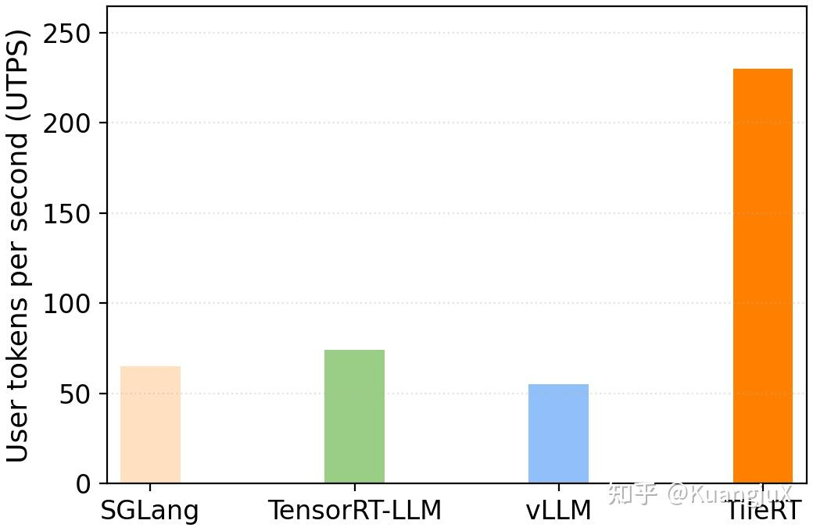

# TileRT：面向低延迟推理的 tile 运行时

来源：[2025 年度 LLM 研究总结](../../../Foundations/05_Model_Architecture_and_Reasoning/Research-Reviews/llm-2025.md)。

- 来源：[TileRT 仓库](https://github.com/tile-ai/TileRT)，原文章节尚未展开源码调用链或记录 commit。
- “尚未发布 Technical Report”只描述 2026-01 写作时的状态，不保证之后仍成立。
- 当前保存的是项目初读与图表，不能据此推导完整调度算法或生产部署成熟度。

## TileRT

**个人理解（2026-01）：** TileRT 是我喜欢的工作之一。

TileRT 相比于 [MPK](../../../Papers/04_GPU_Compiler_and_Performance/MPK/mirage-persistent-kernel.md) 和 [Llama-1B Megakernel](../../../Papers/04_GPU_Compiler_and_Performance/Megakernels/look-ma-no-bubbles-designing-a-low-latency-megakernel-for-llama1b.md)，可能更聚焦于某一类场景，比如在低延迟以及小批量的实时交互场景。如果说 MPK 和 Megakernels 则是针对技术创新的尝试，而 TileRT 则更进一步想将这类技术为 LLM 推理打造一个端到端的系统。

而 TileRT 也是使用 User tokens per second（UTPS）作为评估手段与 SGLang，vLLM，TensorRT-LLM 进行了评估。写作时尚未发布 Technical Report。
