# FractalTensor 笔记

不同长度序列形成 batch 时，规则 Tensor 往往需要 padding，普通嵌套列表又不直接表达编译器可以利用的计算依赖。FractalTensor 把数据组织为“嵌套列表 + 形状固定的叶子 Tensor”，用 map、fold、scan 等模式显式表达计算，让编译器同时看到不规则结构和可分析的局部运算。

[项目 `84f0db24`](https://github.com/microsoft/FractalTensor/tree/84f0db243db08298ede0e87a25fedcbc50158558) 的 README 区分前端、独立 IR 和 TileFusion。下列图示解释的是数据模型和 stacked LSTM 的分析过程，不表示仅运行前端仓库就已经实现全部优化。

## 数据结构

TensorShape, Number, Tensor 和 FractalTensor 是定义在编译器和运行时系统中的 first-class types。

Tensor 是一个形状规则的高维度数组。嵌套的 FractalTensor 把一个 Tensor 分成两个部分：

- 内部最完整形状的维度，被编码为 `TensorShape`。

- **data-dependent dimensions** 总是包围 fully-shaped 维度。这些维度的遍历由 parallel/access patterns 描述，叶子内部则保留规则数组运算。编译器据此分析重排、打包与分区；代价是维护嵌套索引并受模式的表达范围约束。

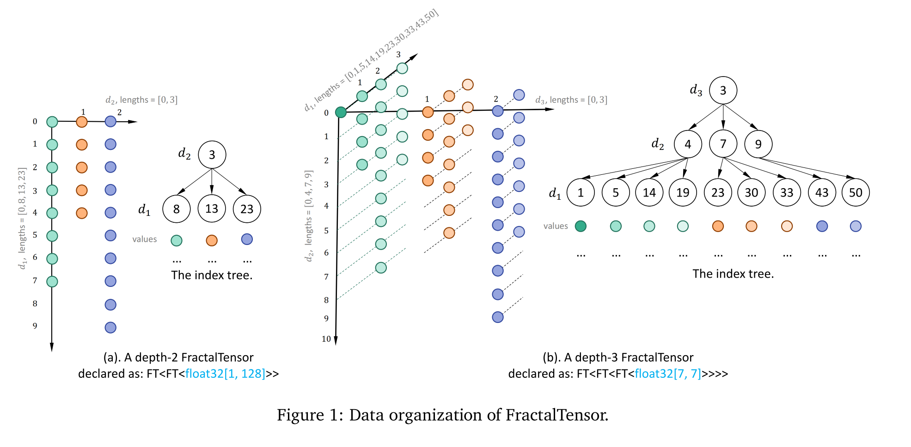

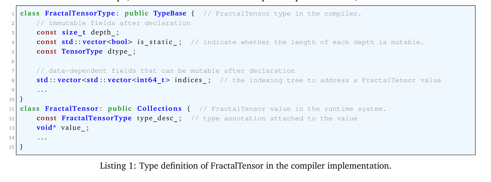

两层的 indexing-tree 的 FractalTensor xss 展示如图 Figure1 (a)：

- xss 有 23 个同类型的 tensor，每一个的 shape 都是 [1, 512]。

- 0-7 是第二层第一个元素，8-12 是第二层第二个元素，13-22 是第二层第三个元素。

## 使用 FractalTensors 组织神经网络计算

嵌套结构上的操作分成 parallel patterns 与 access patterns：前者描述 map、fold、scan 等迭代结构，后者描述访问与重排；叶子 Tensor 内仍有普通数组计算。名称里的 parallel 不保证每次迭代独立：map 可表达互不依赖的计算，fold/scan 则可能携带状态依赖。

### General recurrence

#### A simplified RNN layer

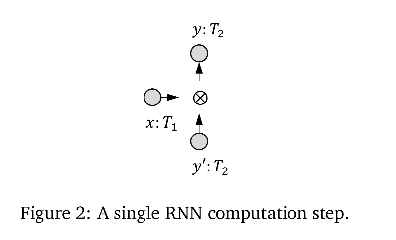

在 Figure 2 中，x 和 y' 通过 cell 处理单元形成一个新的 y。

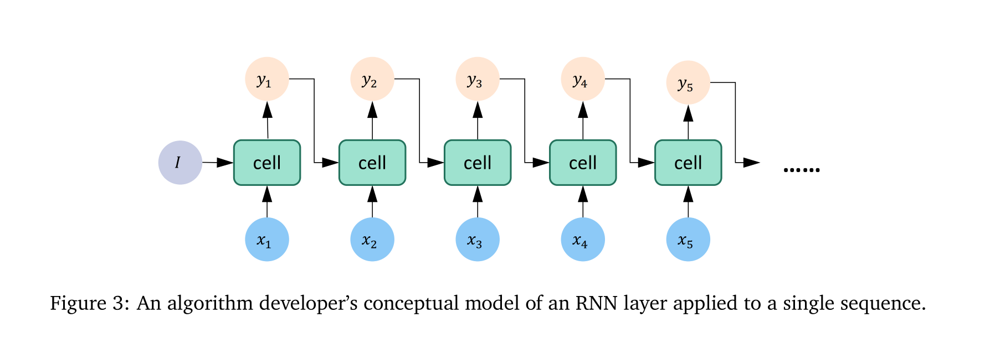

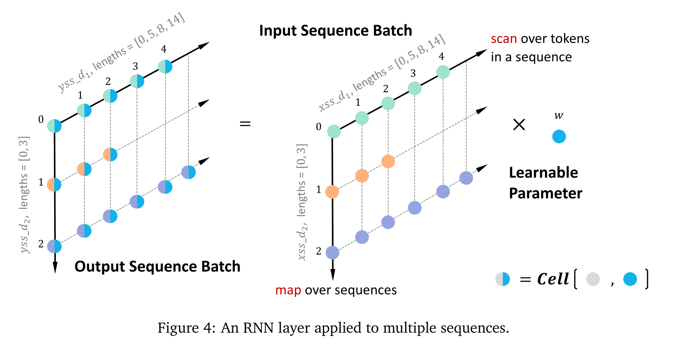

Figure 3 中一个序列沿时间递推，当前 cell 消费前一时刻状态；Figure 4 将同一层作用于多条独立序列。时间轴上的依赖仍在，batch 轴却暴露了可并行的工作。

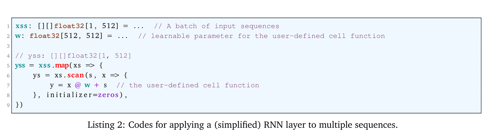

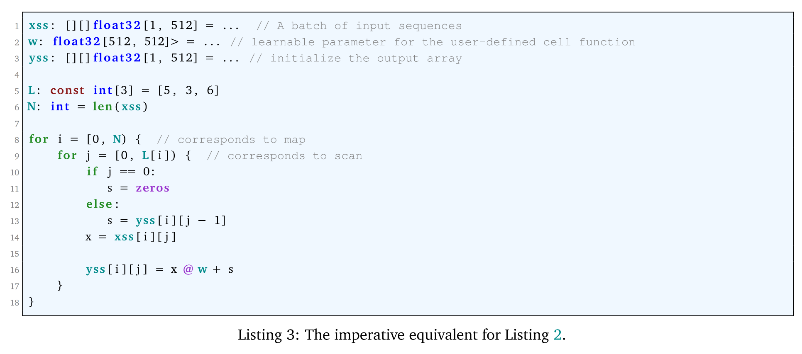

#### A simplified stacked RNN network

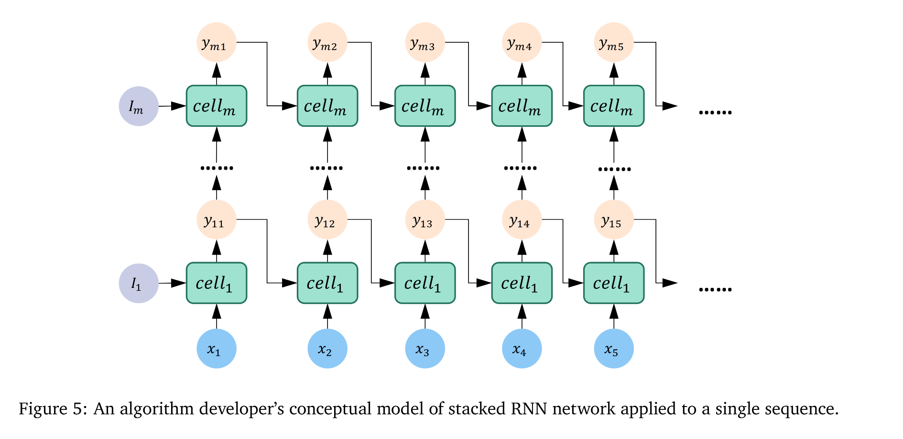

将多个 RNN layers 从深度神经网络堆叠起来。每个 RNN layers 有自己的学习参数。Figure 5 展示了开发者对于 stacked RNN network 的视角。

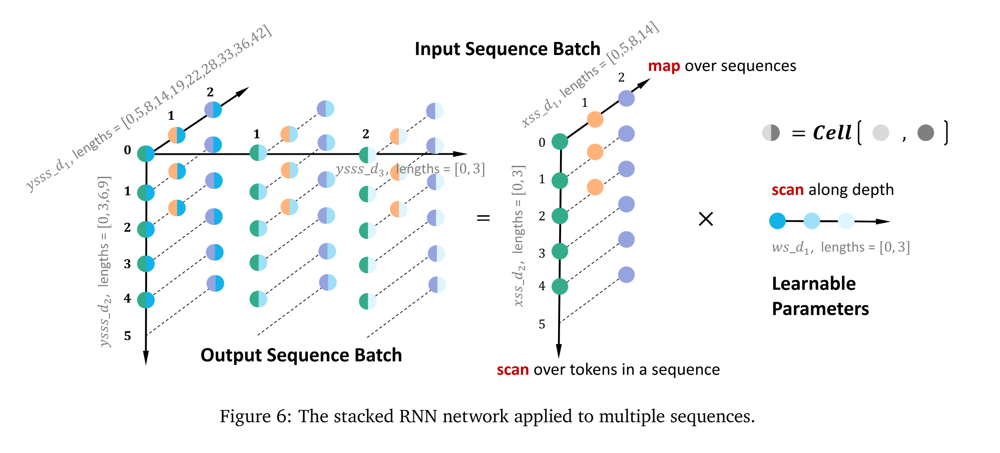

Stacked RNN network 总是被一批次的 sequences 所训练。Figure 6 展示了同时在多个 sequences 上使用 RNN layer，Listing 4 是使用 FractalTensor 的构建方法。

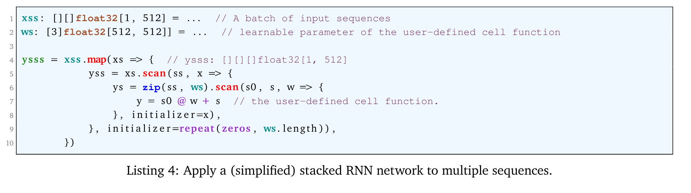

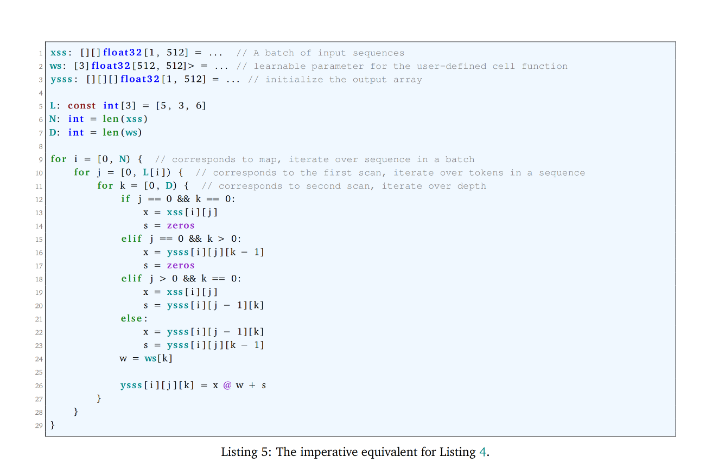

## Program Analysis for the Motivating Example: Stacked LSTM

### User program and program representation

Listing 9 是 stacked LSTM network 的用户代码。

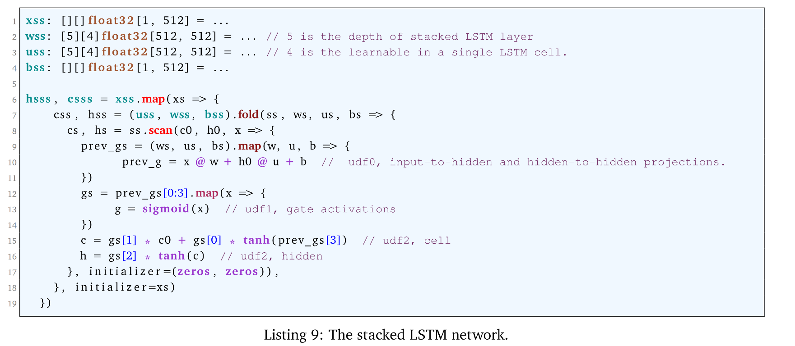

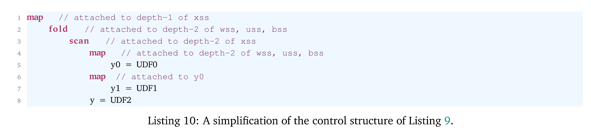

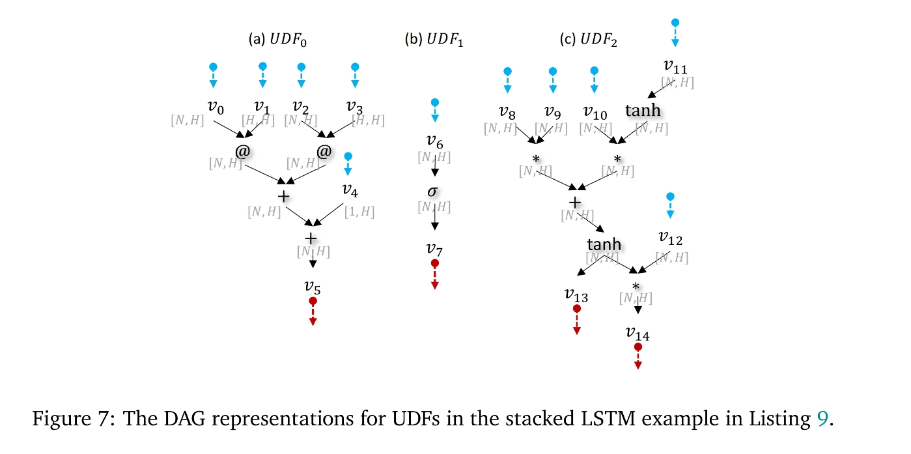

为跨嵌套层寻找并行性，分析先把控制区域边界显式化，再将每个 UDF 内部表示为 DAG。Listing 10、Figure 7 与 Figure 8 分别展示控制结构、局部计算和组合后的表示；局部 DAG 本身并没有消除层间或时间上的状态依赖。

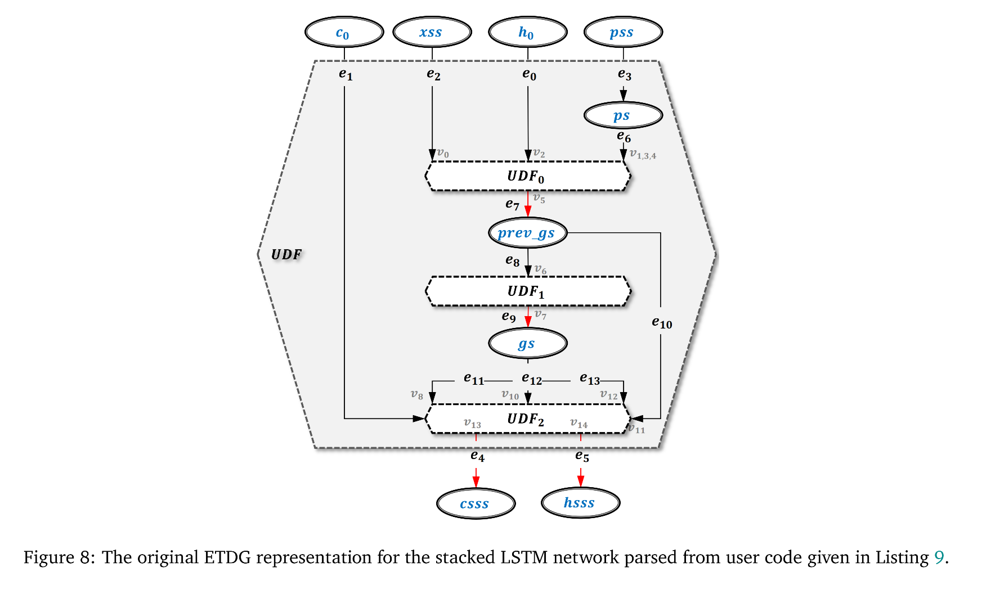

### Program analysis and IR transformations

#### Convert conditional branches to dataflow edges

为了将状态分支变得更为直觉，Listing 9 给出了 FractalTensor program 的同等描述。

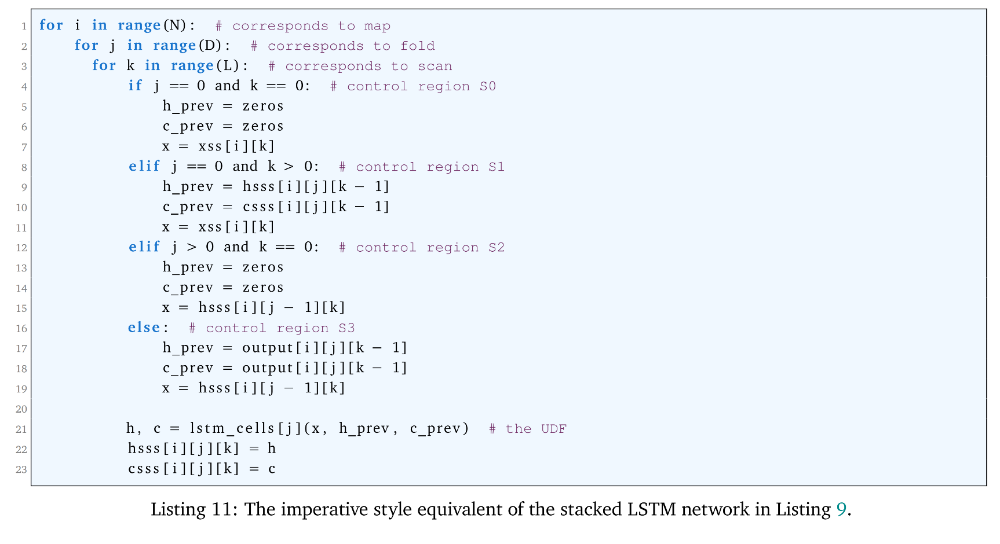

由于 fold，scan 和其他步骤的数据访问不同，由 map，fold，scan 组成的完美并行模式实际上有四个状态分支。后续代码生成的复杂度在于这四个控制区域有不同的访问行为并且携带不同的数据依赖。

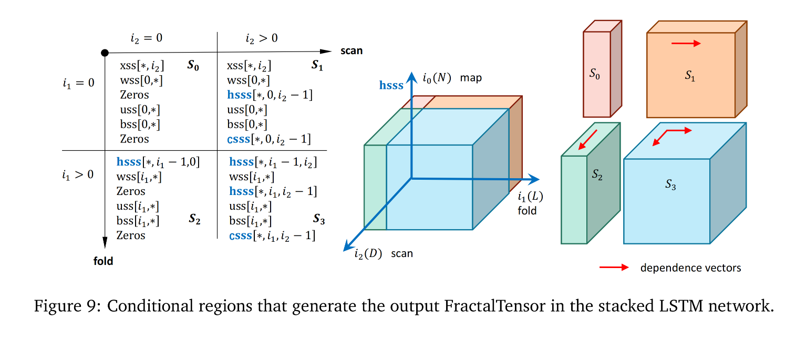

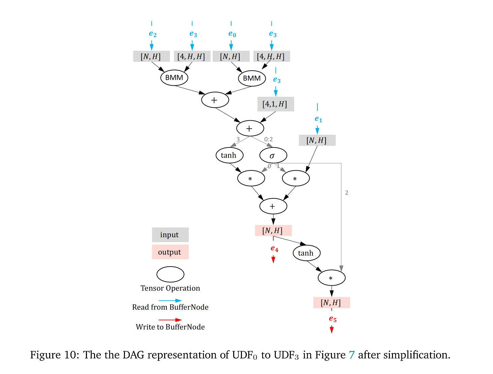

#### Restructure data to expose maximal data-parallelism

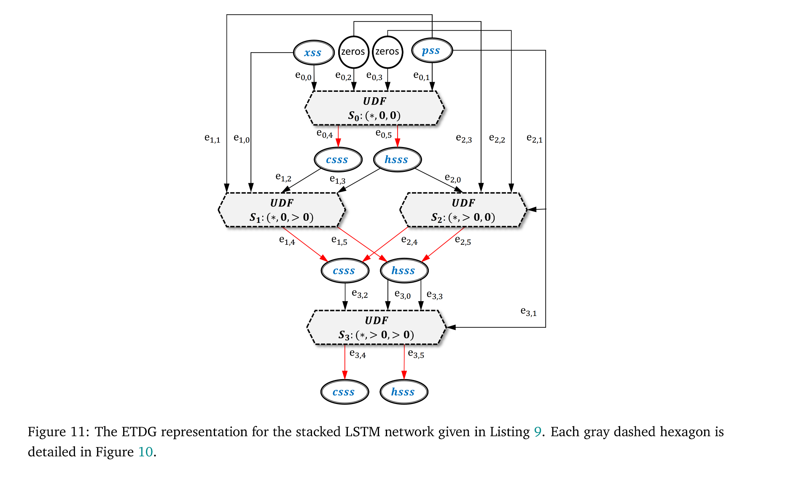

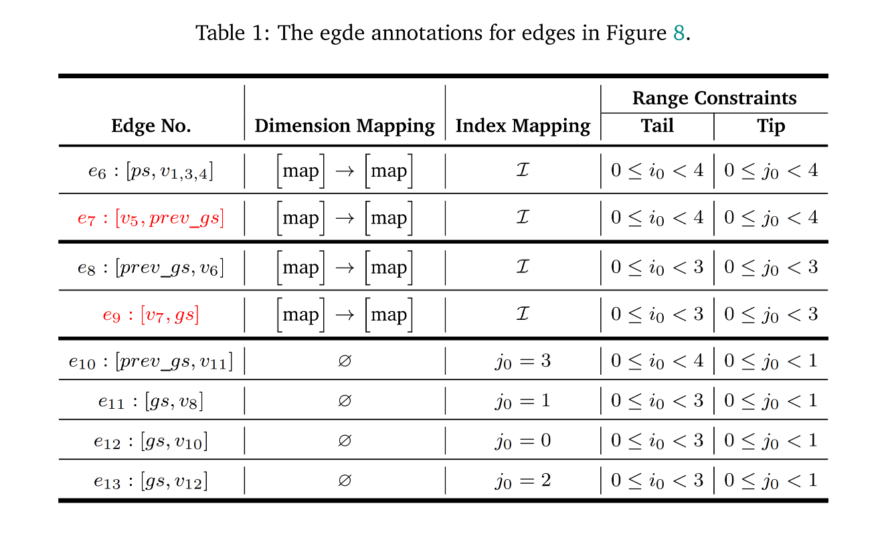

Map 暴露独立迭代；reduce、fold、scan 的聚合或状态传递则引入 loop-carried dependence。Figure 11 和 Table 1 用 dependence distance vector 表示相邻迭代的先后约束，判断哪些嵌套轴可重排，哪些需要保留顺序。

以二维 stacked recurrence 为例，若依赖分别沿 `(1,0)` 与 `(0,1)`，同一坐标和 `i+j` 的点之间没有这两类直接依赖，可以沿对角线并行、按坐标和递进。这说明“多个有依赖的循环”不必等于完全串行；同时也说明并行性来自可证明的依赖结构，而不是给循环换成 scan 名称。

原分析中的完全可置换嵌套与单一顺序推进维度，依赖其距离向量和模式约束。任意数据相关分支、访问或额外副作用未必满足这些条件；即使存在合法重排，索引维护、数据重组和 tile 大小仍会影响实际收益。这里的图和算例支撑合法性理解，没有提供这些变换的独立性能消融。
