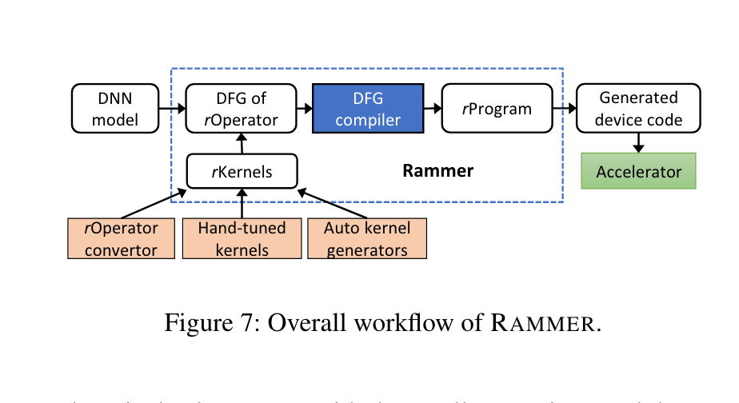
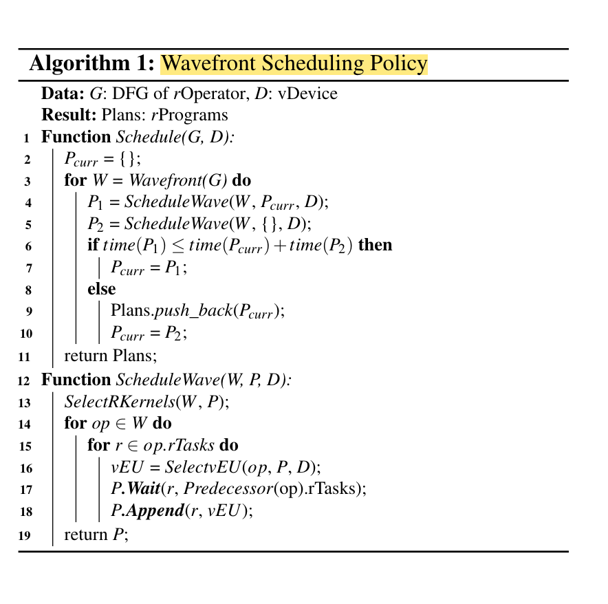

# nnfusion 源码阅读

NNFusion 要把模型数据流图变成有设备分配、内存布局和同步关系的可执行程序。入口加载 TensorFlow 模型后交给 `CudaEngine.run_on_graph`：图级 pass 决定算子和 kernel，visitor 生成程序 IR，程序级 pass 再规划存储并生成代码。

调用链依据 [`00c13173`](https://github.com/microsoft/nnfusion/tree/00c13173a155556e50510575f6682a6a654cd585)。Rammer 的设计图帮助解释调度目标，但源码的 `Graph / Program / Instruction` 不必与论文抽象逐个同名对应；这里没有运行编译产物或新增性能实验。

## Frontend(数据流图生成)

以 tensorflow 为例，首先查看 `frontend/tensorflow_import/tensorflow.cpp`，在该文件中定义了 `load_tensorflow_model()` 函数并调用了 `GraphConvert` 将模型转换成数据流图：

```cpp
            GraphConvert::GraphConvert(const tensorflow::GraphDef& proto)
                : tf_graph_proto{&proto}
            {
                NNFUSION_LOG(INFO) << "Converting Tensorflow Graph";

                m_graph = std::make_shared<nnfusion::graph::Graph>();

                generate_topology();

                std::vector<InputInfo> inputs;
                while (!tf_topology_.empty())
                {
                    uint32_t node_idx = tf_topology_.front();
                    tf_topology_.pop();
                    inputs.clear();
                    const auto& node_proto = proto.node(node_idx);
                    bool in_control_dependence = false;
                    for (auto& input : node_proto.input())
                    {
                        TensorId input_tensor(ParseTensorName(input));
                        int src_index = input_tensor.second;

                        std::shared_ptr<nnfusion::graph::GNode> src_node;

                        auto iter = m_node_map.find(input_tensor.first);
                        NNFUSION_CHECK(iter != m_node_map.end())
                            << "Node " << node_proto.name()
                            << " has Un-Converted input node: " << input_tensor.first;
                        if (src_index == nnfusion::graph::Graph::kControlSlot)
                        {
                            in_control_dependence = true;
                            if (iter->second.size() > 0)
                            {
                                src_node = iter->second.at(0);
                                inputs.emplace_back(input_tensor.first, src_node, -1);
                            }
                        }
                        else
                        {
                            NNFUSION_CHECK(!in_control_dependence)
                                << "Control dependencies must come after regular "
                                   "dependencies.";
                            src_node = iter->second.at(src_index);
                            inputs.emplace_back(input_tensor.first, src_node, 0);
                        }
                    }

                    auto results = convert_node(node_proto);
                    m_node_map[node_proto.name()] = {};
                    for (auto& name_gnode_pair : results)
                    {
                        auto gnode = name_gnode_pair.second;
                        m_node_map[name_gnode_pair.first].push_back(gnode);

                        // add control edge
                        for (size_t input_idx = 0; input_idx < inputs.size(); input_idx++)
                        {
                            NNFUSION_CHECK_NOT_NULLPTR(inputs[input_idx].node)
                                << "Back edge is not supported now.";

                            if (inputs[input_idx].index == nnfusion::graph::Graph::kControlSlot)
                            {
                                m_graph->add_control_edge(inputs[input_idx].node, gnode);
                            }
                            else
                            {
                                // normal edge, do nothing
                            }
                        }
                        if (gnode->get_name() != name_gnode_pair.first)
                        {
                            //NNFUSION_CHECK(!(*gnode)["Alias"].is_valid())
                            //    << "node " << gnode->get_name() << " has more than one alias.\nThe tensorflow node is : \n" << node_proto.DebugString();
                            (*gnode)["Alias"] = name_gnode_pair.first;
                        }

                        if (tf_output_name_.find(node_proto.name()) != tf_output_name_.end())
                        {
                            m_graph_outputs.emplace_back(gnode);
                        }
                    }

                    for (size_t i = 0; i < tf_node_outputs_[node_idx].size(); ++i)
                    {
                        const int output = tf_node_outputs_[node_idx][i];
                        tf_pending_counts_[output]--;
                        if (tf_pending_counts_[output] == 0)
                        {
                            tf_topology_.push(output);
                        }
                    }
                }

                m_graph->set_outputs(m_graph_outputs);
                m_graph->set_default_parameters();
                NNFUSION_LOG(INFO) << "convert graph done";
            }
```

转换时最重要的是依赖是否就绪。`generate_topology()` 建立节点名称到索引的映射、后继列表和 pending 输入计数，将无前驱节点放入队列。每完成一个节点，递减其后继的计数；降到零后才能继续转换。这让 `m_node_map` 在消费某个输入时已有对应结果。

`convert_node` 可以把一个 TensorFlow 节点展开为多个内部节点，结果按名称存回映射；数据边由具体转换器建立，构造循环额外添加控制边。控制边只规定执行先后，不产生普通输入 Tensor。代码要求控制依赖位于普通输入之后，并拒绝这里无法解析的 back edge，所以这条导入路径不能直接推广到任意循环图。

内部名称与源名称不同时，`Alias` 保存源名称，帮助对应模型中的对象；没有证据表明这里仅仅是在处理非法字符。转换完毕再设置 outputs 和默认 parameters，得到后续 pass 消费的 Graph。

## 计算图

在 `src/nnfusion/core/graph/graph.hpp` 中定义了 `Graph` 数据结构的成员变量：

```cpp
        private:
            // Map from node ids to allocated nodes.  nodes_[id] may be nullptr if
            // the node with that id was removed from the graph.
            GNodeVector m_nodes;

            //ordered ops from bfs
            GNodeVector m_bfs_ordered_ops;
            bool m_bfs_ordered_ops_is_valid = false;

            // Number of nodes alive.
            size_t m_node_size = 0;

            // Map from edge ids to allocated edges.  m_edges[id] may be nullptr if
            // the edge with that id was removed from the graph.
            std::vector<std::shared_ptr<Edge>> m_edges;

            // The number of entries in m_edges that are not nullptr.
            size_t m_edge_size = 0;

            // Allocated but free nodes and edges.
            GNodeVector m_free_nodes;
            std::vector<std::shared_ptr<Edge>> m_free_edges;

            // TODO: Output nodes of this graph
            GNodeVector m_output_nodes;
            GNodeVector m_parameters;
            // For generating unique names.
            int name_counter_ = 0;

            static std::atomic<size_t> m_next_instance_id;
            size_t m_instance_id;
            std::string m_name;
            const std::string m_unique_name;

            size_t m_temporary_pool_size;
```

在这个数据结构中有几个重要的成员变量：

- m_nodes: 包含了所有节点

- m_edges: 包含了所有边

- m_free_nodes：用于分配但已经回收了的节点，避免频繁内存分配

- m_output_nodes：图的输出节点

同时，该数据结构也有很多方法，例如向图中添加节点和边：

```cpp
void Graph::add_gnode_and_edge(const std::shared_ptr<GNode> gnode,
                               const GNodeIndexVector& input_gnodes)
{
    // 固定版本此处的 CHECK 条件与报错语义相反，见下文。
    NNFUSION_CHECK(gnode == nullptr) << "GNode can't be nullptr.";

    add_node(gnode);

    for (size_t i = 0; i < input_gnodes.size(); i++)
    {
        add_edge(input_gnodes[i].gnode, input_gnodes[i].index, gnode, i);
    }
    gnode->get_op_ptr()->revalidate_and_infer_types(gnode->shared_from_this());
}
```

固定版本 [`graph.cpp`](https://github.com/microsoft/nnfusion/blob/00c13173a155556e50510575f6682a6a654cd585/src/nnfusion/core/graph/graph.cpp) 确实写成了 `gnode == nullptr`，与后续解引用及报错语义不一致。这是源码中的可疑断言，不能把它解释为正确的非空检查；片段只用于说明 add node、连边、重新推导类型的流程。

`GNode` 将图连接与算子语义分开：

```cpp
        protected:
            int64_t m_id; // m_id is for graph, the index in graph m_nodes
            size_t m_instance_id;
            static std::atomic<size_t> m_next_instance_id;
            std::string m_name;
            const std::string m_unique_name;

            std::string m_op_type;
            std::shared_ptr<op::Op> m_op_ptr;

            std::set<std::shared_ptr<Edge>> m_in_edges;
            std::set<std::shared_ptr<Edge>> m_out_edges;

            std::vector<std::shared_ptr<Input>> m_inputs;
            std::vector<std::shared_ptr<Output>> m_outputs;
```

`m_in_edges/m_out_edges` 表达依赖，`m_inputs/m_outputs` 描述端口，`m_op_ptr` 指向具体算子。Input 的 `m_shape/m_partial_shape` 分别描述完整或部分已知的形状；有 PartialShape 这个类型，并不足以证明整条后端能执行任意动态形状。

### Tensor 描述与物理布局分开

`descriptor::Tensor` 保存 dtype、shape、名称、device/type/id、persistent/constant/parameter/RDMA 等属性，并通过 pool 与 offset 关联存储。root tensor 和引用关系用于表示共享或复用，使内存规划能同时考虑对象寿命、设备位置与别名关系。

`TensorLayout` 则回答多维索引如何映射到存储，包括 stride、大小和偏移。[该版本的 `DenseTensorLayout`](https://github.com/microsoft/nnfusion/blob/00c13173a155556e50510575f6682a6a654cd585/src/nnfusion/common/descriptor/layout/dense_tensor_layout.cpp) 直接调用 `row_major_strides`，并计算 `sum(indices[i] * strides[i])`，不是自动支持任意行列主序和切片的通用布局。

例如 shape `[2,3]` 的 row-major strides 为 `[3,1]`，索引 `[1,2]` 对应元素偏移 5；FP32 时相对基址为 20 B。逻辑 offset 与实际内存池位置仍是两个层次，代码生成需要把二者接起来。

## Engine

[`Engine::run_on_graph`](https://github.com/microsoft/nnfusion/blob/00c13173a155556e50510575f6682a6a654cd585/src/nnfusion/engine/engine.cpp) 明确分成三步：

```text
g_passes->run_on_graph(graph, context)  // 图优化、设备与 kernel 选择
g_visitor->run_on_graph(graph, context) // Graph → ir::Program
m_passes->run_on_program(p, context)    // 存储规划、代码生成
```



Rammer 的总体图表达从算子图到调度程序的目标。源码仍在 Graph 上进行图级优化，再由 visitor 建立 Program；最后一步是 `m_passes`，不是再次运行 graph visitor。

### rOperation 生成

观察 `GraphPassManager::Pointer` 是一个继承自`vector<shared_ptr<nnfusion::pass::graph::GraphPassBase>>` 的类，有一个 `run_on_graph` 的方法。

观察 `GraphPassBase` 发现其是一个基类，里面没有任何私有数据。考虑到 `CudaEngine` 在初始化时向 `g_passes` push 了很多派生类：

```cpp
CudaEngine::CudaEngine()
    : Engine()
{
    g_passes->push_back(make_shared<CSEPass>());
    g_passes->push_back(make_shared<AutodiffPass>());
    g_passes->push_back(make_shared<GradientWeightMappingPass>());
    g_passes->push_back(make_shared<RuntimeConstantFoldingPass>());
    g_passes->push_back(make_shared<MultiReshapeFoldingPass>());
    g_passes->push_back(make_shared<VectorDotTransposePass>());
    g_passes->push_back(make_shared<GemmFusionPass>());
    g_passes->push_back(make_shared<BatchNormInferenceFoldingPass>());
    g_passes->push_back(make_shared<AssignLayoutPass>());
    g_passes->push_back(make_shared<OpInplacePass>());

    g_passes->push_back(make_shared<PatternSubstitutionPass>());

    // Kernel selection
    g_passes->push_back(make_shared<DefaultGNodeDeviceDispatcher>());
    g_passes->push_back(make_shared<ProfilingBasedKernelSelector>());
    g_passes->push_back(make_shared<FetchBasedSelector>());
    g_passes->push_back(make_shared<DefaultKernelSelector>());

    // GPU specific graph passes
    g_passes->push_back(make_shared<KernelFusionPass>());
    g_passes->push_back(make_shared<KernelProfilingPass>());
    g_passes->push_back(make_shared<PatternSubstitutionPass>());
    g_passes->push_back(make_shared<BlockFusionPass>());

    // Specific opt for dot
    g_passes->push_back(make_shared<DotTransposePass>());

    // Assign stream passes
    g_passes->push_back(make_shared<AssignAsyncInfoPass>());

    // Visitor
    g_visitor = make_shared<ReversedDFSVisitor>();

    // extract graph signature
    m_passes->push_back(make_shared<ExtractGraphSignature>());
    // Do tensor allocation plan
    m_passes->push_back(make_shared<TensorDeviceDispatcher>());
    m_passes->push_back(make_shared<TensorLivenessAnalysis>());
    m_passes->push_back(make_shared<InplaceTensorAnalysis>());
    m_passes->push_back(make_shared<AssignTensorMemoryLayout>(64, false));

    // Do codegen
    m_passes->push_back(make_shared<CudaCodegenPass>());
}
```

图级 pass 保持 Graph 容器，但可能替换、融合节点，并附加设备、kernel 与异步执行信息。注册顺序因此有实际依赖：设备分派先于依赖 DeviceType 的 kernel 选择，异步信息再供 visitor 插入拷贝和同步。

点入 `CSEPass` 查看，发现其中实现了 `run_on_graph()`:

```cpp
bool CSEPass::run_on_graph(std::shared_ptr<Graph>& graph)
{
    bool enable_cse = FLAGS_fcse;
    if (!enable_cse)
        return true;

    bool replaced = false;
    unordered_map<NodeKey, shared_ptr<GNode>> expressions{};

    for (auto n : graph->get_ordered_ops())
    {
        auto op = n->get_op_ptr();
        if (op->is_output() || op->is_parameter())
        {
            continue;
        }

        NodeKey n_key(n);
        if (expressions.count(n_key))
        {
            graph->replace_node(n, expressions.at(n_key), false);
            replaced = true;
        }
        else
        {
            expressions.insert(make_pair(n_key, n));
        }
    }
    return true;
}
```

CSE 用 `NodeKey` 识别已经出现的表达式，重复者通过 `replace_node` 复用前面的节点，输出与 parameter 节点被排除。省去重复计算的前提是 key 正确刻画语义与输入；复用也可能延长结果的活跃区间，所以减少节点数不能直接换算为同比例降低峰值内存。

`ProfilingBasedKernelSelector` 是一个基于分析器用来选择内核算子的算法实现：

```cpp
bool ProfilingBasedKernelSelector::run_on_graph(std::shared_ptr<nnfusion::graph::Graph>& graph)
{
    bool enable_tuning = FLAGS_fkernel_tunning;
    if (!enable_tuning)
        return true;

    // auto dev_name = FLAGS_fdefault_device.c_str();
    // NNFusion_DeviceType default_device = nnfusion::get_device_type(dev_name);

    // Config area
    vector<string> white_list{"Broadcast"};
    //bool all_device = false;
    NNFusion_DeviceType the_device = ROCM_GPU;

    // if (the_device != default_device)
    //     return true;

    // Currently *ONLY* has BroadCast Selection
    std::vector<std::shared_ptr<GNode>> nodes = graph->get_nodes();
    for (auto it : nodes)
    {
        if (!(*it)["DeviceType"].is_valid())
        {
            NNFUSION_CHECK_FAIL() << "GNode DeviceType should be assigned before this pass："
                                  << it->get_name();
        }
        auto n_device_type = (*it)["DeviceType"].as<NNFusion_DeviceType>();
        NNFUSION_CHECK(n_device_type != UNKNOWN);
        if (n_device_type != the_device)
            continue;
        auto opname = it->get_op_type();
        for (auto& rule : white_list)
            if (opname == rule)
            {
                (*it)["Enable_Kernel_Selection"] = true;
                // if (!all_device)
                //     (*it)["Kernel_Selection_Device"] = the_device;
            }
    }

    for (auto it : nodes)
    {
        if ((*it)["Enable_Kernel_Selection"].is_valid() &&
            (*it)["Enable_Kernel_Selection"].as<bool>())
        {
            auto n_device_type = (*it)["DeviceType"].as<NNFusion_DeviceType>();
            auto ans = profiling_best(it, n_device_type, get_default_runtime(n_device_type));
            if (ans.second != nullptr)
                (*it)["Kernel_Selection_Result"] = ans;
            else
            {
                if (n_device_type == ROCM_GPU)
                {
                    auto ans_cuda = profiling_best(it, CUDA_GPU, get_default_runtime(CUDA_GPU));
                    if (ans_cuda.second != nullptr)
                        (*it)["Kernel_Selection_Result"] = ans_cuda;
                }
            }
        }
    }

    return true;
}
```

这段 selector 受 `FLAGS_fkernel_tunning` 控制，显式标记的是 ROCM 上白名单中的 Broadcast；之后对已启用选择的节点调用 `profiling_best`，结果写入 `Kernel_Selection_Result`，ROCM 无结果时还尝试 CUDA 候选。不能因为它在 CudaEngine 的 pass 列表中，就说所有 CUDA 算子都会经过穷举调优。

Profiling 以编译和测量成本换取候选选择；这段调用者代码未展示完整的测量环境与候选覆盖，因此只说明选择流程，不能证明所得 kernel 在所有输入上最快。

### rProgram 生成

在 `cuda.cpp` 中初始化 `CudaEngine` 的时候将 `g_vistor` 初始化了为 `ReversedDFSVistor`，在 `ReversedDFSVistor` 中实现了 `run_on_graph` 的方法：

```cpp
nnfusion::ir::Program::Pointer ReversedDFSVisitor::run_on_graph(shared_ptr<graph::Graph> graph,
                                                                EngineContext::Pointer context)
{
    NNFUSION_LOG(INFO) << "Translating graph:\t" << graph->get_name();

    auto program =
        make_shared<ir::Program>(nnfusion::ir::Program::create_single_basic_block_program());
    auto bb_main = program->get_entry();

    // Translate the Node
    // Currently:
    // * Translate each gnode into an instruction;
    // * Store all instruction inside one basicblock since we don't have
    //   control-flow by now.
    nnfusion::graph::GNodeVector node_vec;
    if (FLAGS_fstream_assign_policy == "kernel_prof_based")
        node_vec = graph->get_bfs_ordered_ops();
    else
        node_vec = graph->get_ordered_ops();

    for (auto gnode : node_vec)
    {
        shared_ptr<TranslationUnit> _tu(new TranslationUnit());
        nnfusion::ir::Instruction::Pointer ir(new nnfusion::ir::Instruction);
        ir->setGNode(gnode);
        ir->copy_tags_from(*gnode);
        ir->setName(gnode->get_name());
        bb_main->push_back(ir);
        add_memcpy_ir(graph, gnode, bb_main);
    }

    return program;
}
```

visitor 创建单个 BasicBlock，把有序 GNode 包装成 Instruction，复制节点标签并插入必要的拷贝指令。Program 可以容纳 BasicBlock，BasicBlock 再容纳 Instruction；这一实现选择单块，是代码注释所说此处没有控制流，而不是论文 rProgram 定义与源码冲突。

Instruction 关联 GNode、kernel emitter、inputs/outputs 和内部 Tensor，是代码生成的组织单元。Rammer 的 rTask 是调度层抽象，不能仅凭 Instruction 包含 kernel 就断言二者一一对应。



### 设备划分引出拷贝与跨流同步

[`add_memcpy_ir`](https://github.com/microsoft/nnfusion/blob/00c13173a155556e50510575f6682a6a654cd585/src/nnfusion/engine/device/reversed_dfs_visitor.cpp) 遍历非控制出边，**仅在源目标 device type 或 device id 不同**时插入 memcpy，不是在每条数据边上拷贝。

它为目标设备创建新 Tensor 和布局，将原 Tensor 作为 memcpy 输入，并把消费者 kernel 的输入替换为目标 Tensor。同一处理过程还按目标设备缓存已建立的 memcpy 指令。设备切分因此引入额外存储与传输，不能只考虑各设备算子的执行速度。

拷贝有自己的 host thread/device stream。`AsyncManagerFactory` 提供相应管理器；若生产者、拷贝、消费者不在相同线程或 stream，就通过 barrier/event 记录先后关系。常量、变量与 runtime constant folding 位于初始化路径，代码另作处理。这个流程解释了为何设备分派和 Async_info 必须先完成：没有这些信息，visitor 无法知道在哪复制、何时可消费。

### 代码生成

生成 Program 后，InterpreterPassManager 建立 TranslationUnit 和上下文，按序运行程序级 pass。这一层消费已经选好的计算与同步关系，继续决定接口、存储和输出文件。

检查 `nnfusion/engine/device/cuda.cpp`，发现 `CudaEngine` 在初始化时添加了如下的 pass:

```cpp
    // extract graph signature
    m_passes->push_back(make_shared<ExtractGraphSignature>());
    // Do tensor allocation plan
    m_passes->push_back(make_shared<TensorDeviceDispatcher>());
    m_passes->push_back(make_shared<TensorLivenessAnalysis>());
    m_passes->push_back(make_shared<InplaceTensorAnalysis>());
    m_passes->push_back(make_shared<AssignTensorMemoryLayout>(64, false));

    // Do codegen
    m_passes->push_back(make_shared<CudaCodegenPass>());
```

这里先提取图接口，再分析 Tensor 活跃区间、in-place 关系并安排内存布局，最后交给 CudaCodegenPass。存储复用必须建立在先前的执行关系上；只看 Tensor 大小，无法判断两块数据能否共用地址。

`ExtractGraphSignature` 导出图接口信息。`CodeGenerator::codegen()` 则处理 LanguageUnit 的依赖和文件输出：

- **准备阶段**：首先，函数会调用 `pass_exec_info()` 方法，这个方法用于在代码生成单元之间传递执行信息，比如生成文件的目录和写入位置。这个阶段确保每个代码生成单元都有执行的位置和目录信息。

- **排序代码单元**：接下来，函数会对所有的代码生成单元进行排序，以便确定代码的生成顺序。排序的顺序是根据代码生成单元的类型和执行优先级。

- **写入代码**：通过对排序后的代码生成单元进行迭代，函数会逐个执行这些单元的 `execute()` 方法，将生成的代码写入到对应的文件中。

- **创建文件**：在写入代码之前，函数会首先判断文件是否存在，如果不存在就创建文件。根据单元中的 `pwd`（文件路径）和 `write_to`（文件名）信息，函数会确保生成文件的目录结构存在。

- **共享文件处理**：如果在单元中指定了共享文件（`write_to` 为 `shared` 开头），函数会创建一个名为 "shared.h" 的共享文件，并将相关的代码引用添加到生成的代码文件中。
