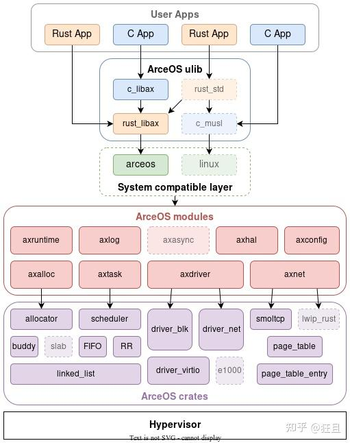
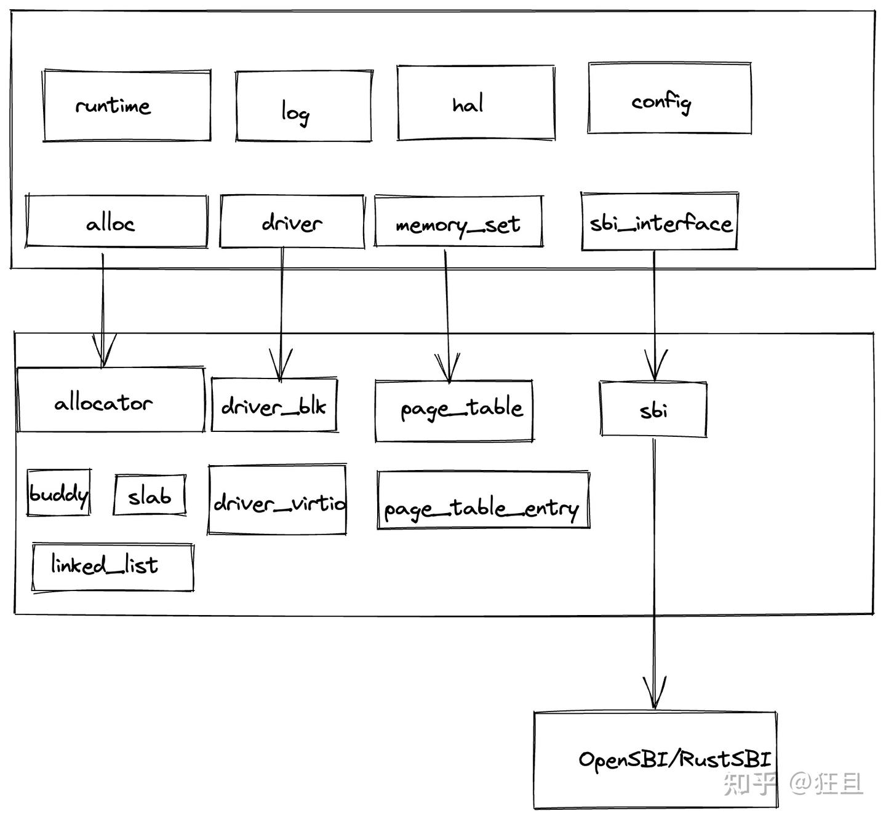

# ArceOS：从 feature 配置到 unikernel 启动

来源：[个人文章全文归档](../../../Foundations/06_Computing_Foundations/Systems/Virtualization/Unikernel/zhihu-reading.md)。

保留 2023 年文章中的构建与启动调用链：Makefile → cargo feature → axruntime → 应用 main。

## 整理与复习

- 这是 2023-04 的源码阅读记录，原文没有 commit；文件名、Rust 属性和命令均可能随版本变化，本次没有在当前 ArceOS 上重跑。
- 构建路径：应用的 `Cargo.toml` 声明 `libax` features；Makefile 汇总配置并调用 Cargo；QEMU 启动镜像后进入平台引导，再进入 `axruntime::rust_main` 和应用入口。
- 最后关于 hypocaust-2 的模块复用是个人设计思考，不标为已实现。

## 原笔记相关章节

### Arceos

#### 目标：

- 兼容 rust api 和 rust 应用程序
- 在 unikernel 支持 tokio，提高 IO 性能



#### Arceos 模块

- crate: 一些与 OS 设计的公共模块，也可以在构建其他内核/hypervisor 中使用
- modules:
  - 一些对于公共模块的封装：axalloc，axdriver
  - 一些 OS 设计耦合模块：axtask，axnet
- 必选模块：
  - axruntime: 启动，初始化，模块总体管控
  - axhal：硬件抽象层
  - axlog：打印日志
- 可选模块：
  - axalloc：动态内存分配
  - axtask：多任务、线程
  - axdriver：设备驱动
  - axnet：网络

**当执行了 `make A=apps/net/httpserver ARCH=aarch64 LOG=info NET=y SMP=1 run` 发生了什么？**

根据 cargo 不同的 feature 来进行条件编译。

- Makefile：根据不同参数进行选择，`FS/NET/GRAPHIC` 是否为 y，如果为 y 的话放在条件编译里面进行编译，见 `cargo.mk`:

```
features-$(FS) += libax/fs
features-$(NET) += libax/net
features-$(GRAPHIC) += libax/display
```

- `_cargo_build`: 首先根据不同的语言，选择不同的编译方法，例如对于 rust，调用 `call cargo_build,--manifest-path $(APP)/Cargo.toml`，其中 `$(APP)` 表示目前要运行的应用程序。
- 以 `httpserver` 为例，查看 unikernel 如何条件编译，首先在 `httpserver` 中的 `Cargo.toml` 的依赖项为：`libax = { path = "../../../ulib/libax", features = ["paging", "multitask", "net"] }`,这个表明需要编译 `libax` 并且有以上三个 features
- 查看 `libax`，找到以上三个 features，发现：
  - `paging = ["axruntime/paging"]`
  - `multitask = ["axruntime/multitask", "axtask/multitask", "axsync/multitask"]`
  - `net = ["axruntime/net", "dep:axnet"]`
  - 这里涉及到 `axruntime` ，`axtask`，`axsync` 等 module，并对这些 module 进行条件编译
- `cargo.mk`：这个文件里描述了如何使用 cargo 进行条件编译的方法，build 参数如下：

```
build_args := \
  -Zbuild-std=core,alloc -Zbuild-std-features=compiler-builtins-mem \
  --config "build.rustflags='-Clink-arg=-T$(LD_SCRIPT)'" \
  --target $(TARGET) \
  --target-dir $(CURDIR)/target \
  --features "$(features-y)" \
```

`cargo_build`:

```
define cargo_build
  cargo build $(build_args) $(1)
endef
```

这也就回到了最上层关于 `_caro_build` 命令的封装，将 `$(APP)/Cargo.toml` 作为顶层模块，引用其他模块，并进行条件编译构建 unikernel。

- 查看 `Makefile` 发现 `make run` 指令需要执行 `build` 和 `justrun`，build 指令在上面梳理完成，`justrun` 需要调用 `run_qemu` 命令，然后跳转到 `qemu.mk` 发现 qemu 构建类似 cargo 构建，不过更加简单一些，如此一来一个单地址空间（不区分内核空间和用户空间）的应用程序就编译完成。
- 运行时首先 Arceos 先进行一些引导启动，例如在 riscv64 的环境中执行：

```
#[naked]
#[no_mangle]
#[link_section = ".text.boot"]
unsafe extern "C" fn _start() -> ! {
    extern "Rust" {
        fn rust_main();
    }
    // PC = 0x8020_0000
    // a0 = hartid
    // a1 = dtb
    core::arch::asm!("
        mv      s0, a0                  // save hartid
        mv      s1, a1                  // save DTB pointer
        la      sp, {boot_stack}
        li      t0, {boot_stack_size}
        add     sp, sp, t0              // setup boot stack

        call    {init_boot_page_table}
        call    {init_mmu}              // setup boot page table and enabel MMU

        li      s2, {phys_virt_offset}  // fix up virtual high address
        add     sp, sp, s2

        mv      a0, s0
        mv      a1, s1
        la      a2, {platform_init}
        add     a2, a2, s2
        jalr    a2                      // call platform_init(hartid, dtb)

        mv      a0, s0
        mv      a1, s1
        la      a2, {rust_main}
        add     a2, a2, s2
        jalr    a2                      // call rust_main(hartid, dtb)
        j       .",
        phys_virt_offset = const PHYS_VIRT_OFFSET,
        boot_stack_size = const TASK_STACK_SIZE,
        boot_stack = sym BOOT_STACK,
        init_boot_page_table = sym init_boot_page_table,
        init_mmu = sym init_mmu,
        platform_init = sym super::platform_init,
        rust_main = sym rust_main,
        options(noreturn),
    )
}
```

随后跳转到 `axruntime` 中的 `rust_main` 中运行，`rust_main` 经过一系列条件初始化后，执行 `main()`，由于这个 `main` 实在应用程序定义的，应当进行符号连接并跳转（由于是单地址空间，所以不须上下文切换）。

随后开始执行用户程序，用户程序通过 `libax` 的 API 进行执行，应用程序在内核态执行，无需进行 syscall 与上下文切换，效率更高。

**ArceOS 相比 Unikraft 的优势？**

- 使用 Rust 编写，具有现代化包管理（crate），条件编译和引用更简单。
- 可以更为轻松扩展模块，例如 hypervisor 可以和 ArceOS 使用相同模块。
- 原声支持异步，可以在内核重写 tokio runtime 进行调度。

**问题：ArceOS 中模块之间是否会互相引用状态？如何解决？**

例如：`axsync` 引用了 `axtask`，使用了 `axtask` 中的 WaitQueue（xv6 中 SpinLock 对 Process 的引用）。`axruntime` 中也需要引用 `axtask` 的调度器（需要仔细设计不同模块间的依赖关系）。

**思考：如何将 hypocaust-2 拆分成模块化？**

kernel/hypervisor 模块复用：

- hypervisor 可以复用一些内核模块，例如 `axlog`，`axdriver`，`axtask`
- 对于一些模块需要重写，例如 `axruntime`
- 底层 crate 可以复用

目前 hypocaust-2 有以下功能：

- 基于设备树的配置与解析，初始化 hypervisor 和 guest（可选配置方案）
- 内存分配器
- 页表翻译（hypervisor 为了隔离需要多地址空间）
- SBI 接口
- trap 处理
- 中断子系统
- 设备模拟



可以在基于模块化 hypocaust-2 中运行 Arceos，用于提供安全的执行环境。
