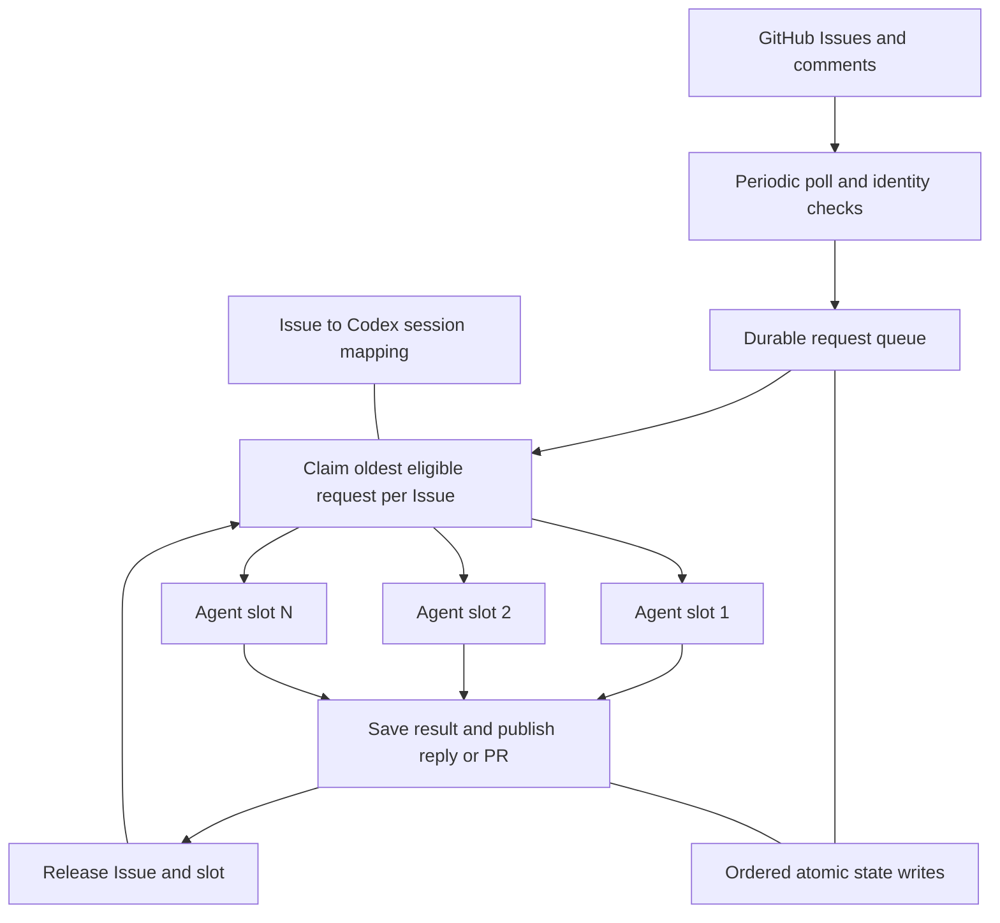

# Reading Bot Agent Pool

阅读 bot 使用一个常驻调度器管理有界 Agent Pool。不同 Issue 可以同时查阅资料和生成答复；同一 Issue 的请求保持顺序，以复用 Codex 会话并避免 PR 更新互相覆盖。此前 `tick()` 等待一个任务完成才再次轮询，长任务会阻塞整个仓库；现在轮询与任务执行分开。

## Architecture



Pool 的 Agent 是并发执行名额，执行时调用独立的 Codex CLI 进程；不预先启动 N 个常驻模型进程。问答会话归 Issue 所有，任何空闲名额都可以续接该 Issue 的会话。`/note` 仍在独立 Git worktree 中创建新编辑会话，按原流程检查并更新已有 PR；发布回复使用经过验证的 GitHub App 身份。

| 对象 | 生命周期与职责 |
| --- | --- |
| Worker | 单个协调进程，持有本机 `worker.lock`，持续轮询与调度 |
| Agent slot | 1 到 `maxConcurrentJobs` 的执行名额；一次承接一个请求，完整执行/发布后释放 |
| Issue claim | Issue 的互斥认领；覆盖问答、reset、笔记更新和结果发布 |
| Job | 一次 Issue 正文或评论触发，保留来源 ID、状态、重试时间与完整结果 |
| Session | `threads[issue]` 中的 Codex session ID，不绑定 Agent slot |

默认 `maxConcurrentJobs = 3`，配置范围 1–8；1 可恢复串行。上限覆盖整个请求生命周期，包括资料读取、Codex、文档检查及发布，而不只是模型调用。不同 Issue 的回复可能乱序完成。

## Scheduling

实现入口为 [worker.mjs](worker.mjs) 中的 `tick()`、`dispatch()` 与 `runJob()`。

1. `poll()` 校验来源、去重并把新请求写入持久队列。生产循环不等待 Agent 完成，因此长任务不会暂停后续轮询。
2. 按请求时间、来源 ID 排序，从每个 Issue 的最早未完成请求中选取候选。先保留这个队首，再判断重试时间，避免后来的提问越过失败或等待发布的请求。
3. 在任何异步操作前同步占用空闲 slot 和 Issue claim，写入 `job.claim = { agent, claimedAt }`。先落盘认领，再执行任务；重复轮询不会重复启动同一请求。
4. 同一 Issue 的问答、`/reset`、`/note` 共用一把逻辑锁。后一个请求只能在前一个完成、跳过或确认不可用后执行；`answered` 状态的待发布回复也占据队首。
5. 完成或失败后清理持久 claim，再释放 slot/Issue。后台模式立即检查已知队列以补足空闲名额，不必等下一次轮询；没有新工作时不忙轮询。

`start --once` 只执行一次轮询，等待本轮认领的一批请求完成后退出。它不会继续自动认领后续同 Issue 请求；后台 `start` 才持续补位。

这是单协调进程内的认领机制，不是分布式租约。启动第二个 Worker 会被进程锁拒绝；不能通过同时运行多个 `start` 实例扩容。

## State Persistence

多个 Agent、轮询和笔记检查都可能调用保存状态。原 `saveJson()` 使用同一个进程临时文件，直接并发调用会产生临时文件竞争，且可能让旧快照覆盖新快照。

`Worker.save()` 在调用时复制完整状态，并用 Promise 队列依调用顺序执行原子写入。每个关键步骤都等待对应保存完成；旧保存失败不会毒化后续重试链，最后一次保存失败仍会在关闭时报告。协调进程是唯一状态写入者，Agent 不直接操作 `state.json`。

任务状态仍使用原有 `queued → running → answered → done`，无需迁移旧队列。结果在调用 GitHub 发布 API 前进入持久 `answered` 状态；发布失败只重试发布，不重新调用 Codex。回复标记和不可变提交机制继续处理“服务端已成功，但客户端未收到响应”的情况。

## Failure and Shutdown

- GitHub 暂时失败：当前任务设置重试时间并释放 Agent。只阻塞其所在 Issue 的后续请求，其他 Issue 继续执行。
- 提问已删除或不可用：任务进入 `unavailable`，后续请求可继续；触发内容或身份已变化时仍按原流程跳过。
- Codex 执行失败：保留现有错误回复与私有日志策略，不把内部错误内容发到 GitHub。
- 笔记审阅：要求 `findings` 为字符串数组，同时规范化历史提示词产生的文件／问题／修正要求对象。拒绝意见进入最多两轮正文修订；审阅结果本身无法解析时只重新审阅，最多三次，仍失败则回复格式错误并停止该请求，不重跑构建或无限重新排队。格式重试分别保留原始日志，网络与子进程故障仍按临时故障处理。
- 正常退出：停止认领，对所有执行中的 Agent 发送 abort，等待子进程与保存操作结束，然后释放进程锁。MCP 配置探测也响应 abort，避免关闭后又启动新 Codex 进程。
- 异常退出：下次加载时清除遗留 claim，将 `running` 恢复为 `queued`，保留 `answered`、回复 ID 与 Issue 会话。恢复精度取决于最后成功落盘的状态；不声称跨网络/进程崩溃的绝对 exactly-once 执行。
- PR 清理：不清理仍有排队/运行任务的 Issue。清理过程中也持有 Issue claim，避免刚收到的更新请求与删分支操作重叠；保留原有远端 head 和本地改动校验。

## Configuration and Operation

本机配置增加可选字段：

```json
{
  "maxConcurrentJobs": 3
}
```

旧配置省略该字段时默认使用 3，无需修改现有队列与会话文件。调整后重启服务。`status` 显示池上限与持久 claim；它不能替代进程健康检查。部署和日志位置见 [运行说明](../READING-BOT.md)。

## Verification

[agent-pool.test.mjs](agent-pool.test.mjs) 用可控制完成时机的执行器验证：跨 Issue 重叠执行、并发上限、释放后立即补位、长任务期间持续轮询、同 Issue 的问答/reset/note 顺序、会话隔离、失败发布不重复生成、重试隔离、并发快照保存、PR 清理互斥、重启恢复，以及退出时等待全部 Agent 落盘后才释放进程锁。

```sh
node --test scripts/reading-bot/*.test.mjs
```

现有真实 Git worktree 与 PR 更新回归测试继续运行。单元测试不向 GitHub 发消息；真实模型连通性可以另用本机 smoke 验证，不需要在阅读 Issue 中制造测试评论。
