# Kernel design 论文图参考

先选择对应表达问题的原图并实际查看；只迁移图形表达，不迁移硬件配置与调度结论。

## 按表达问题选择参考

| 要表达的问题 | 首选参考 | 可借鉴的表达 |
| --- | --- | --- |
| 分块、HBM/片上搬运、循环范围 | FlashAttention Fig. 1；NSA Fig. 3 | 张量围绕计算区域排列，当前 tile 高亮，搬运箭头与循环箭头分开 |
| 稀疏选择、gather、循环重排 | NSA Fig. 3；FSA Fig. 1 | 稀疏网格、索引选取、非连续对象聚合及前后对应 |
| 片上矩阵运算与数据流 | SageAttention Fig. 5 | 小矩阵嵌入公式，SM 边界区分全局数据与片上计算，颜色追踪操作数 |
| warp 分工与共享数据 | FlashAttention-2 Fig. 3 | 在张量上直接分区，区分共享与独占，而非只画 warp 名称框 |
| warpgroup 调度与跨迭代流水线 | FlashAttention-3 Fig. 1、2 | 按角色/算子分泳道，颜色关联 iteration，明确阶段依赖 |
| 缓冲生命周期与多个消费者 | PageWeaver Fig. 3 | 内存槽与执行角色对齐，ready/release 事件连接消费者与下一次覆盖 |
| CTA 到硬件执行的映射 | FlashAttention-4 Fig. 1 | 数据分块与执行泳道并列，通过同名 tile 关联 |
| 多分支算法与稀疏模式 | NSA Fig. 2；MiniMax Sparse Attention Fig. 1 | 算法结构与 mask 分区呈现；不同分支的稀疏语义可对照 |

## FlashAttention：分块与内存层次

[FlashAttention](https://arxiv.org/abs/2205.14135)，Fig. 1，PDF p. 2；Zotero key `JUA6HWCG`。

中心图用 Q、K、V、O 条带围住计算 tile，用颜色区分 HBM 与 SRAM，并单独标出 inner/outer loop。适合总体数据流与驻留位置；右侧性能柱图不是 kernel overview 的必需部分，原图硬件数值不可沿用到新图。

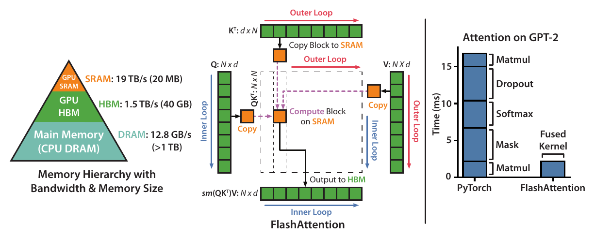

## NSA：按 group 加载与稀疏 KV 选取

[Native Sparse Attention](https://arxiv.org/abs/2502.11089)，Fig. 3，PDF p. 9；Zotero key `KNIU8HE3`。

每张 Q 薄片包含同一 query 的一组 heads，堆叠方向表示 queries；背景网格表达稀疏关系，高亮 tile 表达当前搬运和计算对象；Grid Loop 与 Inner Loop 明确区分。适合共享 KV 和 sparse kernel 的主参考。原图选择连续 KV blocks，不能据此把 DSA 的 tokenwise gather 画成原序列中的连续块。

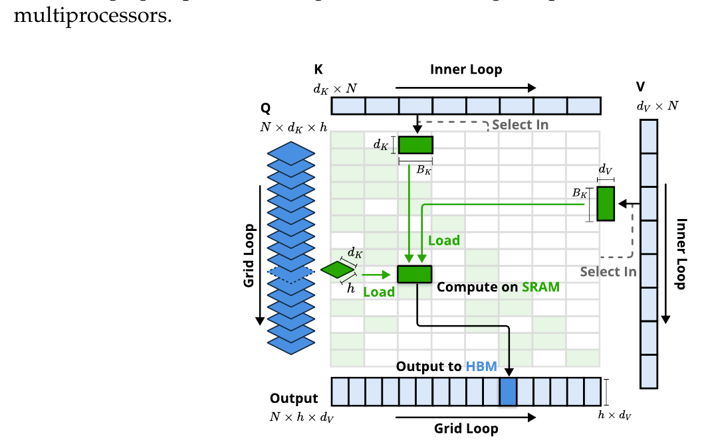

## FSA：对齐的循环顺序与 gather 对照

[FSA](https://arxiv.org/abs/2508.18224)，Fig. 1，PDF p. 5；Zotero key `YUGV34KQ`。

左右保留相同图形语法，将 Q/K 的循环角色互换直接画出来；被选中的非连续 Q 聚合成 batch，输出位置与 index mapping 相连。适合循环重排、gather/scatter 和不同 owner 的比较。只借鉴表达方法，不将 FSA 的 KV-outer 实现移植为其他 kernel 的事实。

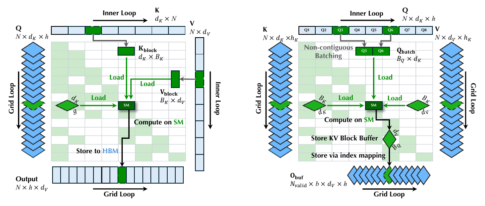

## SageAttention：小矩阵、计算边界与分块循环

[SageAttention](https://arxiv.org/abs/2410.02367)，Fig. 5，PDF p. 7（v9）；Zotero key `LKKCKXKE`。

Q 放在计算区域左侧，K/V 放在上方；小矩阵嵌入 QK、softmax、PV 的计算式，颜色追踪各操作数。Global Memory / On Chip 与 SM 边界直接说明驻留位置，顶部箭头表示遍历 K/V，左右子图用一致排布对比方案。适合单个 CTA/SM 内的计算展开，不需要给矩阵加厚。只借鉴排布和张量表达，不向目标图引入未讨论的量化、缩放因子或累加精度。

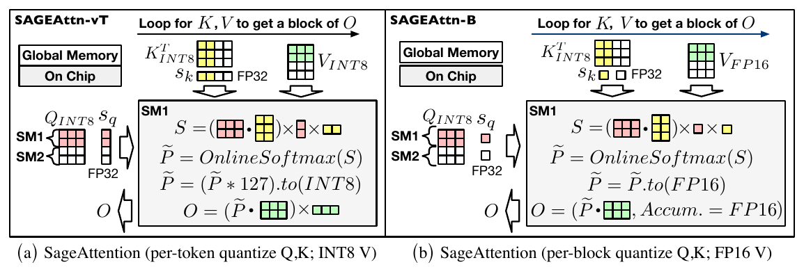

## FlashAttention-2：共享与 warp 分区

[FlashAttention-2](https://arxiv.org/abs/2307.08691)，Fig. 3，PDF p. 9；Zotero key `E269JI6Y`。

Q、K、V 的排布保持一致，颜色与虚线区分所有 warps 共享的区域、按 warp 切分的区域。适合解释 ownership；应直接标实际切分轴，不能把该图的四个 warps 复制成目标 kernel 的分工。

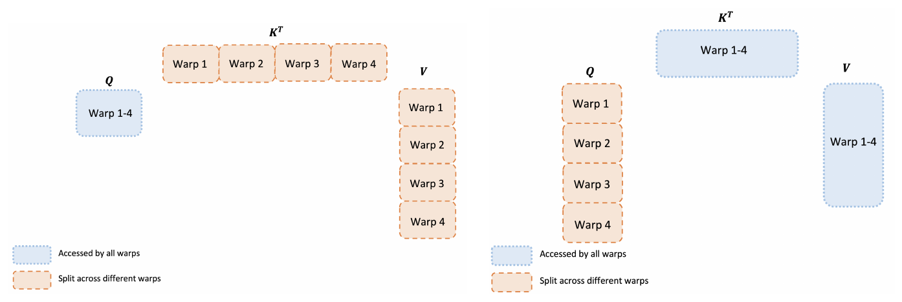

## FlashAttention-3：warpgroup 与算子流水线

[FlashAttention-3](https://arxiv.org/abs/2407.08608)，Fig. 1、2，PDF p. 6；Zotero key `MNPEHW5Y`。

Fig. 1 以 warpgroup 为泳道，同色对应同一次 iteration；Fig. 2 以 WGMMA0、softmax、WGMMA1 为泳道，方块中的编号跨阶段对应。两者分别回答“谁在执行”和“哪些算子可交叠”。源码只确认角色分工时，先画依赖图，不照搬论文的 ping-pong 时序。

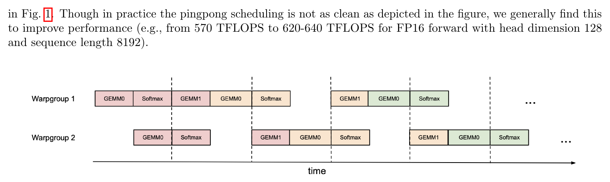

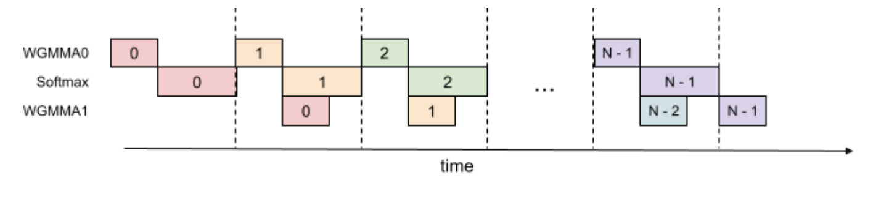

## FlashAttention-4：tile 与硬件流水线并列

[FlashAttention-4](https://arxiv.org/abs/2603.05451)，Fig. 1，PDF p. 6；Zotero key `TGHHGFQG`。

左侧说明 Q/K/V/O 的 tile 与 CTA 对应，右侧将对应 tile 展开到 SM 和执行单元泳道。适合已有硬件调度依据的局部放大图，信息较密时应拆成子图。图中 cycle 数值、Blackwell 指令和 CTA 组织只属于原文条件。

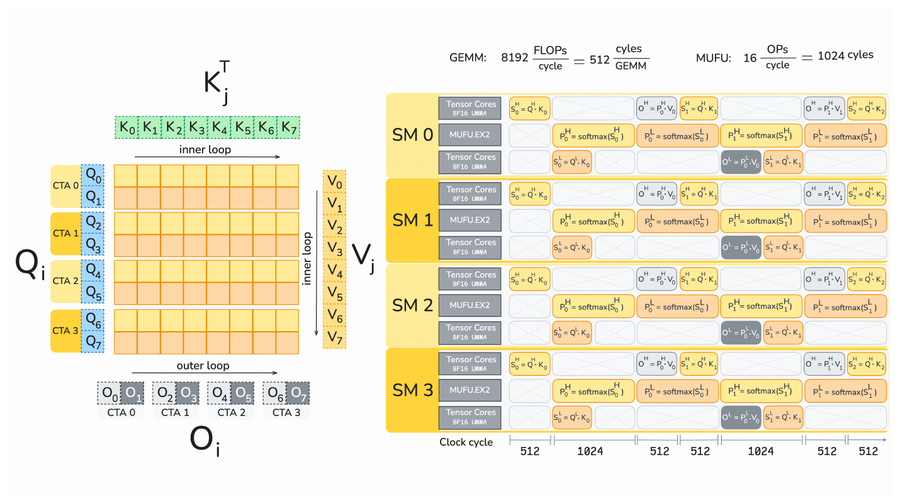

## PageWeaver：缓冲生命周期与消费角色

[PageWeaver](https://arxiv.org/abs/2610.11201v1)，Fig. 3，PDF p. 5；Zotero 附件 key `SBISCM3P`。此处复用仓库阅读笔记保存的原图截图。

KV slot 与 CTA 执行放在同一张图中，深浅绿色区分加载和驻留；事件 1 连接 ready 与消费，事件 2 连接全部消费者释放与 slot 重填。相同 CTA 的 QK、softmax、PV 留在同一泳道，输出 ID 与状态归属明确。适合解释缓冲何时可读、谁仍在使用以及何时可以覆盖。目标实现可能按特征区域而非整个 slot 释放，必须按源码标出粒度；不要复制其双 CTA、multicast 或每 CTA 四个 warps 的配置。

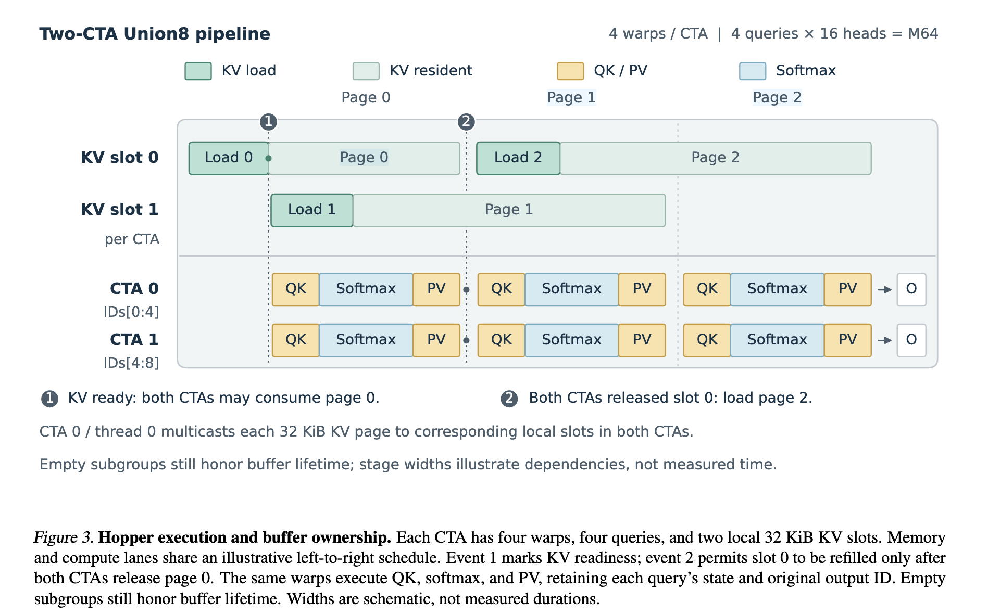

## NSA 与 MiniMax：算法结构和 mask

[Native Sparse Attention](https://arxiv.org/abs/2502.11089)，Fig. 2，PDF p. 3；Zotero key `KNIU8HE3`。条带表达 token 的压缩、选择、滑窗，右侧并列 mask 说明不同分支的稀疏语义。

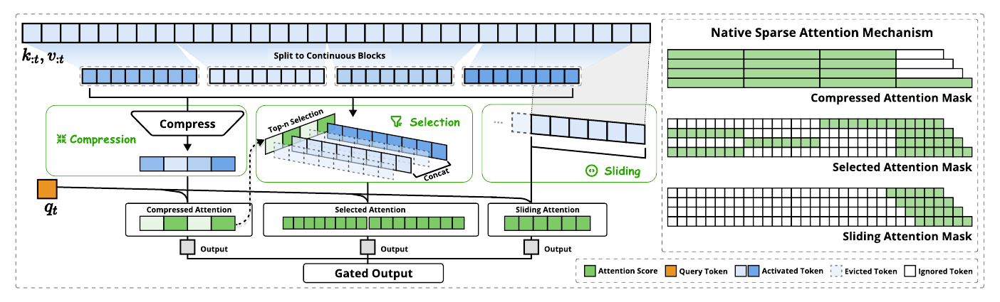

[MiniMax Sparse Attention](https://arxiv.org/abs/2606.13392)，Fig. 1，PDF p. 1；Zotero key `HZCJAG36`。左侧 index/main branch 的主干、右侧各 query group 的 mask 分开排布，连线说明两部分的对应。适合算法级 overview；不因参考这张图就在仅讨论 attention kernel 的图里额外加入 indexer、投影等未关注模块。

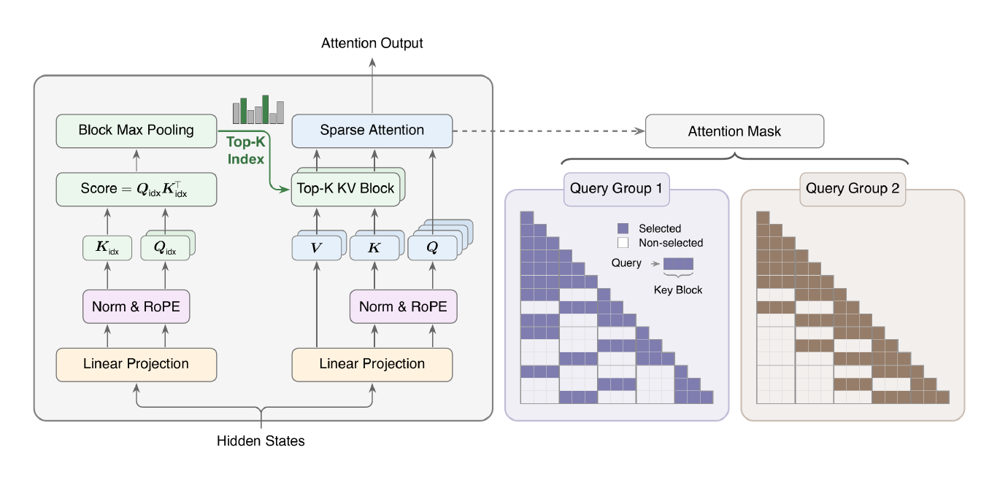

以上为论文作者原图，用于绘图参考；图片版权归原作者，论文链接和图号保留在各图旁。
