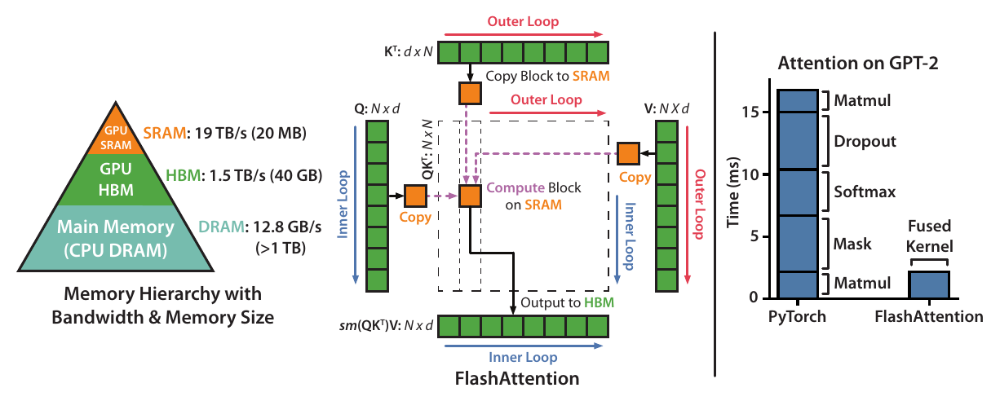
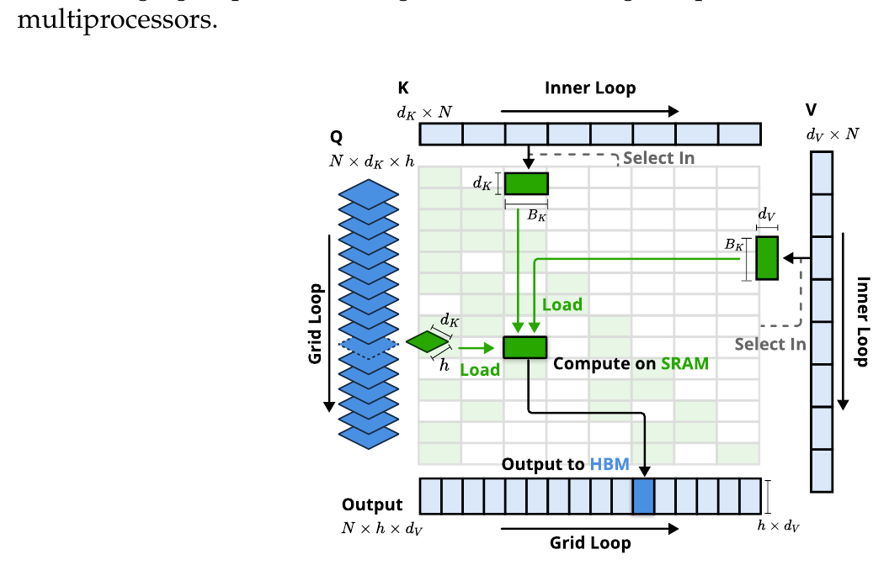
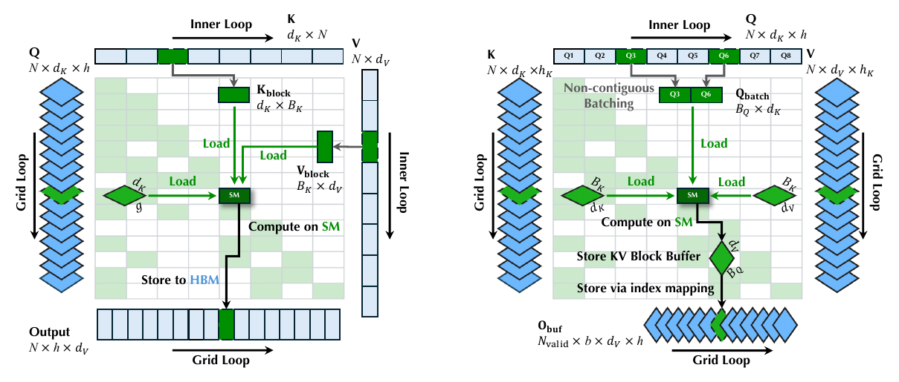
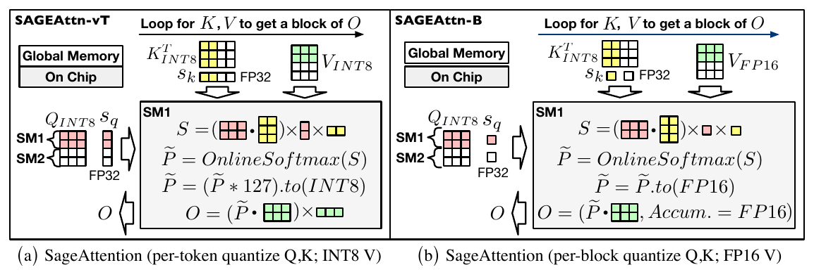
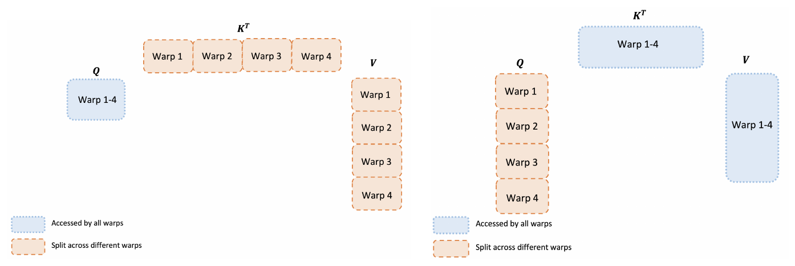
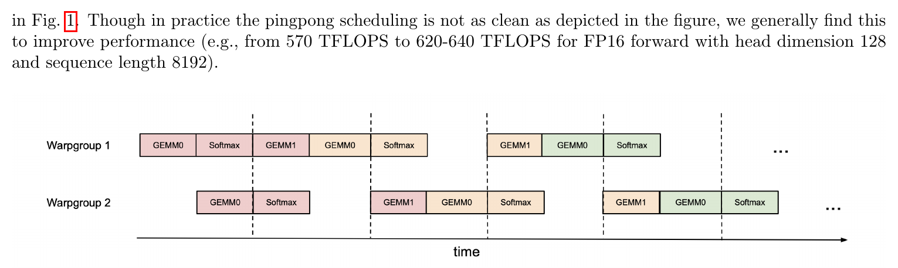
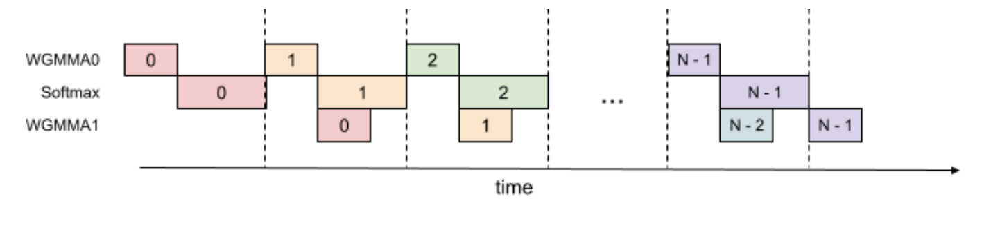
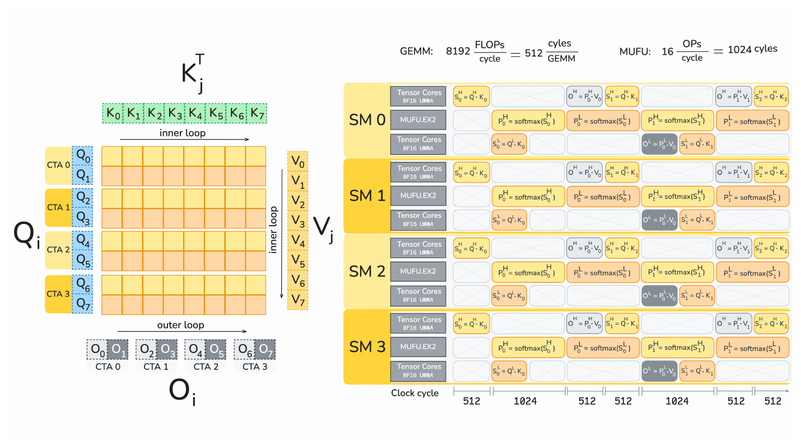
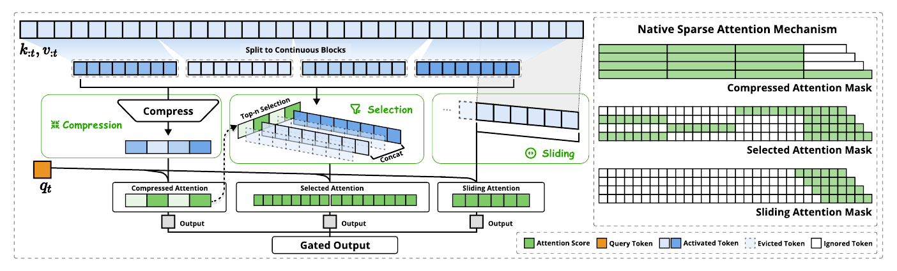
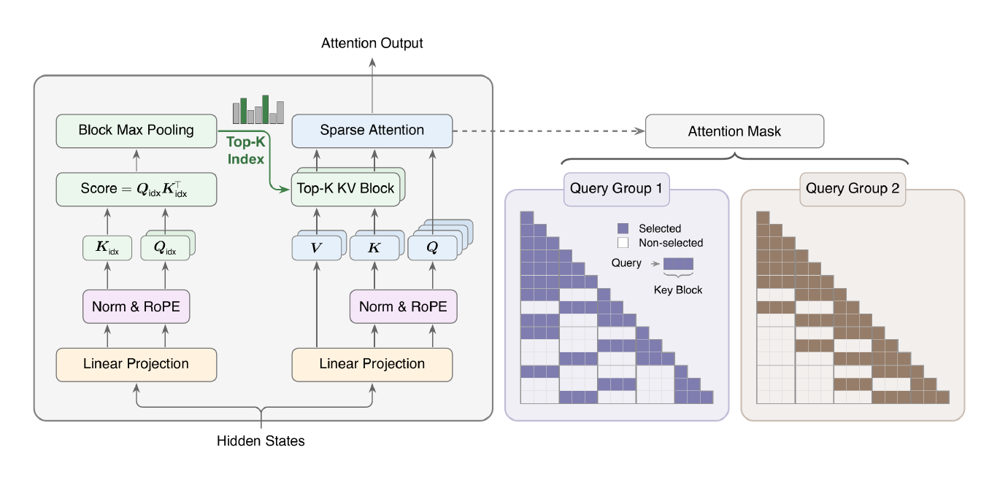

# Kernel design 绘图参考

绘制学习笔记中的 system overview、attention kernel design、张量布局或流水线图时使用。先按要解释的机制选择原图，实际打开图片再设计；不要只看标题或 caption，也不要按论文知名度套版。

## 选图与制作

1. 确定图要让读者看清的关系：数据如何分块和搬运、谁复用或拥有数据、计算如何映射到硬件、哪些步骤存在依赖。选最相近的主参考，其他参考只补必要的局部表达。
2. 从 Zotero 查看同类论文原图。下面是已选取的本地参考；不够匹配时继续搜索，不将这份列表当成封闭模板库。新增参考附论文、图号、PDF 页码、来源链接及适用场景，不复制整篇 PDF。
3. 画数据对象本身。用矩阵及维度标注表达 GEMM，用 token 条带与高亮行表达 gather，用共享区域与分区表达复用和 ownership；仅真实算子或存储区域使用文字框。复杂 kernel overview 优先用 draw.io、PowerPoint 等可编辑的专业绘图工具交付原生对象，保留 `.drawio` 或 `.pptx` 源文件。Mermaid 可用于简单关系图或草稿，不能以默认文字框流程图代替论文式机制图，也不能将整张位图贴进专业工具后声称可编辑。
4. 总览与局部放大分层。主图让读者顺着数据读通；tile 形状、线程分工或依赖细节放在有对应标记的子图。不将所有实现细节塞在一条长链上，也不为填满版面重复相同流程。
5. 配色要鲜明、可区分，不将整图限制为很淡的低饱和填充。用少量主色编码稳定语义，同一张量、tile、iteration 或执行角色跨区域保持一致；用颜色区分当前 tile、背景数据与中间结果，确保文字与背景有足够对比。图例明确颜色编码的含义，留白与对齐保持清晰。
6. 空间层次参考 FSA、NSA 的薄片堆叠与张量围绕计算区域的排布：每张薄片、堆叠方向和展开方向都对应明确的 query、head 或 block 轴。不要将“论文式立体感”理解为给所有矩阵和算子添加厚侧面、顶面与阴影；SageAttention 的平面小矩阵与片上计算边界同样能清楚表达机制。深度只在有语义时使用，算子与文字保持简洁；张量之间的位置和连线优先于装饰。
7. 核对图形语义与源码。标明轴是 query、head、token 还是 feature，以及真实 shape、存储位置、硬件和代码路径。示意小格数量不代表实际维度；必要时注明。参考论文的 blockwise/tokenwise、循环顺序、TMA/cp.async、warp ownership、TMEM/SMEM 和数值配置不能直接搬到目标实现。
8. 时序图需要已确认的依赖与调度依据。定性时序注明非等比例，不以块宽、空隙或重叠面积暗示实测耗时或完全隐藏延迟；没有足够调度证据时画 producer/buffer/consumer 依赖关系。
9. 保留原生编辑源；用所选工具实际打开或导出，核对导出与源文件一致，再生成适合笔记嵌入的 SVG/PNG。源码生成脚本不能替代原生源文件，后续修改以用户实际编辑后的源文件为准。实际打开最终渲染图，在正文显示宽度检查文字、维度、箭头端点、交叉线、裁切、图例及对比度；语法检查或成功导出不能替代视觉检查。图注注明自绘及实现依据，参考原图另保留出处，不冒充作者原图。

## 按表达问题选择参考

| 要表达的问题 | 首选参考 | 可借鉴的表达 |
| --- | --- | --- |
| 分块、HBM/片上搬运、循环范围 | FlashAttention Fig. 1；NSA Fig. 3 | 张量围绕计算区域排列，当前 tile 高亮，搬运箭头与循环箭头分开 |
| 稀疏选择、gather、循环重排 | NSA Fig. 3；FSA Fig. 1 | 稀疏网格、索引选取、非连续对象聚合及前后对应 |
| 片上矩阵运算与数据流 | SageAttention Fig. 5 | 小矩阵嵌入公式，SM 边界区分全局数据与片上计算，颜色追踪操作数 |
| warp 分工与共享数据 | FlashAttention-2 Fig. 3 | 在张量上直接分区，区分共享与独占，而非只画 warp 名称框 |
| warpgroup 调度与跨迭代流水线 | FlashAttention-3 Fig. 1、2 | 按角色/算子分泳道，颜色关联 iteration，明确阶段依赖 |
| CTA 到硬件执行的映射 | FlashAttention-4 Fig. 1 | 数据分块与执行泳道并列，通过同名 tile 关联 |
| 多分支算法与稀疏模式 | NSA Fig. 2；MiniMax Sparse Attention Fig. 1 | 算法结构与 mask 分区呈现；不同分支的稀疏语义可对照 |

## FlashAttention：分块与内存层次

[FlashAttention](https://arxiv.org/abs/2205.14135)，Fig. 1，PDF p. 2；Zotero key `JUA6HWCG`。

中心图用 Q、K、V、O 条带围住计算 tile，用颜色区分 HBM 与 SRAM，并单独标出 inner/outer loop。适合总体数据流与驻留位置；右侧性能柱图不是 kernel overview 的必需部分，原图硬件数值不可沿用到新图。

## NSA：按 group 加载与稀疏 KV 选取

[Native Sparse Attention](https://arxiv.org/abs/2502.11089)，Fig. 3，PDF p. 9；Zotero key `KNIU8HE3`。

每张 Q 薄片包含同一 query 的一组 heads，堆叠方向表示 queries；背景网格表达稀疏关系，高亮 tile 表达当前搬运和计算对象；Grid Loop 与 Inner Loop 明确区分。适合共享 KV 和 sparse kernel 的主参考。原图选择连续 KV blocks，不能据此把 DSA 的 tokenwise gather 画成原序列中的连续块。

## FSA：对齐的循环顺序与 gather 对照

[FSA](https://arxiv.org/abs/2508.18224)，Fig. 1，PDF p. 5；Zotero key `YUGV34KQ`。

左右保留相同图形语法，将 Q/K 的循环角色互换直接画出来；被选中的非连续 Q 聚合成 batch，输出位置与 index mapping 相连。适合循环重排、gather/scatter 和不同 owner 的比较。只借鉴表达方法，不将 FSA 的 KV-outer 实现移植为其他 kernel 的事实。

## SageAttention：小矩阵、计算边界与分块循环

[SageAttention](https://arxiv.org/abs/2410.02367)，Fig. 5，PDF p. 7（v9）；Zotero key `LKKCKXKE`。

Q 放在计算区域左侧，K/V 放在上方；小矩阵嵌入 QK、softmax、PV 的计算式，颜色追踪各操作数。Global Memory / On Chip 与 SM 边界直接说明驻留位置，顶部箭头表示遍历 K/V，左右子图用一致排布对比方案。适合单个 CTA/SM 内的计算展开，不需要给矩阵加厚。只借鉴排布和张量表达，不向目标图引入未讨论的量化、缩放因子或累加精度。

## FlashAttention-2：共享与 warp 分区

[FlashAttention-2](https://arxiv.org/abs/2307.08691)，Fig. 3，PDF p. 9；Zotero key `E269JI6Y`。

Q、K、V 的排布保持一致，颜色与虚线区分所有 warps 共享的区域、按 warp 切分的区域。适合解释 ownership；应直接标实际切分轴，不能把该图的四个 warps 复制成目标 kernel 的分工。

## FlashAttention-3：warpgroup 与算子流水线

[FlashAttention-3](https://arxiv.org/abs/2407.08608)，Fig. 1、2，PDF p. 6；Zotero key `MNPEHW5Y`。

Fig. 1 以 warpgroup 为泳道，同色对应同一次 iteration；Fig. 2 以 WGMMA0、softmax、WGMMA1 为泳道，方块中的编号跨阶段对应。两者分别回答“谁在执行”和“哪些算子可交叠”。源码只确认角色分工时，先画依赖图，不照搬论文的 ping-pong 时序。

## FlashAttention-4：tile 与硬件流水线并列

[FlashAttention-4](https://arxiv.org/abs/2603.05451)，Fig. 1，PDF p. 6；Zotero key `TGHHGFQG`。

左侧说明 Q/K/V/O 的 tile 与 CTA 对应，右侧将对应 tile 展开到 SM 和执行单元泳道。适合已有硬件调度依据的局部放大图，信息较密时应拆成子图。图中 cycle 数值、Blackwell 指令和 CTA 组织只属于原文条件。

## NSA 与 MiniMax：算法结构和 mask

[Native Sparse Attention](https://arxiv.org/abs/2502.11089)，Fig. 2，PDF p. 3；Zotero key `KNIU8HE3`。条带表达 token 的压缩、选择、滑窗，右侧并列 mask 说明不同分支的稀疏语义。

[MiniMax Sparse Attention](https://arxiv.org/abs/2606.13392)，Fig. 1，PDF p. 1；Zotero key `HZCJAG36`。左侧 index/main branch 的主干、右侧各 query group 的 mask 分开排布，连线说明两部分的对应。适合算法级 overview；不因参考这张图就在仅讨论 attention kernel 的图里额外加入 indexer、投影等未关注模块。

以上为 Zotero PDF 提取的作者原图，用于绘图参考；图片版权归原作者，论文链接和图号保留在各图旁。
